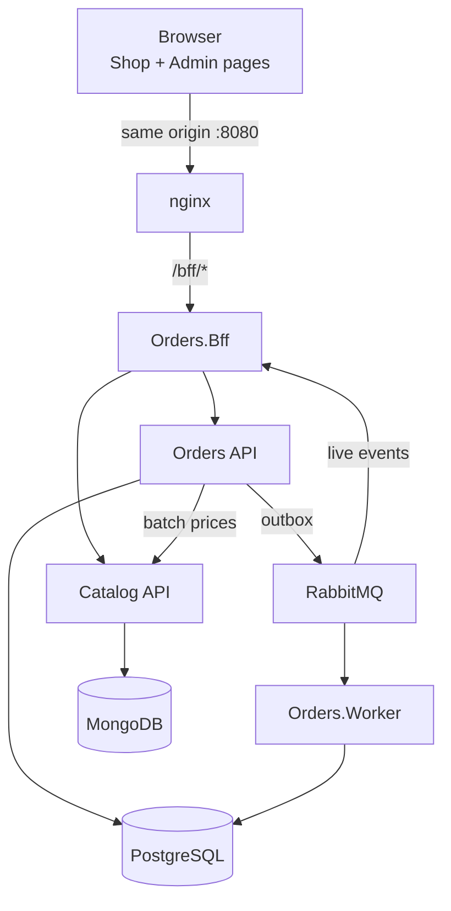

# Orders & Catalog Platform

🌐 **English** · [Português (pt-BR)](README.md)

A RESTful order platform built with .NET 10: an **Orders API** (PostgreSQL, CQRS, RabbitMQ), a **Catalog service** (MongoDB), a **BFF** that is the browser's only entry point, and two front-end pages (Shop and Admin) written in plain HTML, TypeScript and Bootstrap.

> **Status:** planning complete, implementation not started. Work proceeds step by step through the [Execution guide](docs/en-us/02-execution-guide.md), starting with step C01. The commands in [Getting started](#getting-started) describe the target setup and become runnable as the steps land (compose in C06–C07, front-end in C45, smoke test in C54).

## Challenge deliverables

| Deliverable | Where |
| --- | --- |
| Source code of both services, with setup and run instructions | `orders/` (Orders API, Worker, BFF), `catalog/` (Catalog API), `web/` (front-end); instructions in [Getting started](#getting-started) |
| AI development tool: which, why, and how it was used in each stage | [AI-assisted development](docs/en-us/05-ai-development.md) (en-US) · [pt-BR](docs/pt-br/05-ai-development.md) |
| Code review / governance guide | [Code review guide](docs/en-us/03-code-review-guide.md) (en-US) · [pt-BR](docs/pt-br/03-code-review-guide.md) |
| Proposal dimensioning (differentials) | [Tech dimensioning](docs/en-us/04-tech-dimensioning.md) (en-US) · [pt-BR](docs/pt-br/04-tech-dimensioning.md) |
| Link to the AI chat sessions (mandatory) | [AI conversation links](#ai-conversation-links) and the evidence tables in [AI-assisted development](docs/en-us/05-ai-development.md#evidence) |
| Presentation (desirable) | `docs/en-us/presentation/` and `docs/pt-br/presentation/` (produced in step C58) |

## Getting started

### Prerequisites

- Docker Desktop (WSL 2 on Windows) with at least 6 GB RAM for Docker; 16 GB RAM on the machine
- .NET SDK 10.0.x (version pinned in `global.json`)
- Node.js 22 and npm (only to work on the front-end outside Docker)
- Git; Bash for `scripts/*.sh` (Git Bash on Windows)

### Configure

```bash
git clone <repository-url>
cd StefaniniTestProject
cp .env.example .env
```

`.env` holds local-only values: database passwords, the RabbitMQ user, and the passwords of the seeded Keycloak users `shopper` and `admin`. Defaults work as they are for local development; never commit `.env`.

### Run

```bash
docker compose up -d --build --wait
```

| What | URL |
| --- | --- |
| Shop page | http://localhost:8080/shop.html |
| Admin page | http://localhost:8080/admin.html |
| Sign in (seeded users `shopper`, `admin`) | http://localhost:8080/bff/login |

Only nginx publishes a host port; every other service is reached through it. Optional profiles:

```bash
docker compose --profile observability up -d --wait
```

Adds the OpenTelemetry Collector and the Aspire Dashboard for traces, metrics and logs.

```bash
docker compose down -v
```

Stops everything and deletes the volumes (data is re-seeded on the next start).

In compose the Catalog seeds 50 products (BRL and USD) at startup (`Catalog__Seed__Enabled`, never set for staging or production). Building `Catalog.Api` rewrites `catalog/openapi/catalog.v1.json`; commit it when the API changes, because CI fails when it differs from the generated one and Orders generates its Catalog client from it.

### Test

```bash
dotnet test orders/Orders.slnx
```

```bash
dotnet test catalog/Catalog.slnx
```

```bash
cd web && npm ci && npm test
```

```bash
bash scripts/smoke.sh http://localhost:8080
```

Integration tests use Testcontainers, so Docker must be running. Filter by category with `--filter Category=Unit`, `Integration`, `Architecture` or `Resilience`.

## Documentation

Documentation is kept in two languages with the same file names: [`docs/pt-br/`](docs/pt-br/) (Brazilian Portuguese, the source of truth) and [`docs/en-us/`](docs/en-us/) (English mirror, the one linked from this README). Changes are written in pt-BR first and mirrored in en-US in the same PR; when they disagree, pt-BR wins. This README is mirrored by [`README.md`](README.md) (pt-BR). Rules for agents are in [AGENTS.md](AGENTS.md).

| Document (en-US) | pt-BR | What it covers |
| --- | --- | --- |
| [Implementation plan](docs/en-us/01-implementation-plan.md) | [pt-BR](docs/pt-br/01-implementation-plan.md) | Decisions, architecture, BFF, API surface, data model and idempotency, discount and confirmation rules, front-end, observability, testing, phases, traceability |
| [Execution guide](docs/en-us/02-execution-guide.md) | [pt-BR](docs/pt-br/02-execution-guide.md) | 58 commit-sized steps (C01–C58) with the agent prompt, definition of done, and the GitHub Actions CI/CD setup with the mandatory deploy gate |
| [Code review guide](docs/en-us/03-code-review-guide.md) | [pt-BR](docs/pt-br/03-code-review-guide.md) | Governance: clean code principles, PR acceptance criteria, what blocks a PR, review workflow, stack checklists, artifacts and pipelines |
| [Tech dimensioning](docs/en-us/04-tech-dimensioning.md) | [pt-BR](docs/pt-br/04-tech-dimensioning.md) | Premises, runtime sizing, effort by phase, team composition and seniority, delivery timeline, estimate risks |
| [AI-assisted development](docs/en-us/05-ai-development.md) | [pt-BR](docs/pt-br/05-ai-development.md) | Tool choice (Claude Code with Opus 5.5 and Sonnet 5.5), reasons, use in each lifecycle stage, guardrails, session evidence |

## AI conversation links

Every stage was done with Claude Code; one shared session per stage or step. The full list, with the PR each implementation session produced, is in [AI-assisted development](docs/en-us/05-ai-development.md#evidence).

| Session | Link |
| --- | --- |
| Planning: requirements, architecture, execution guide, governance, dimensioning | _add link_ |
| Repository and documentation organisation | _add link_ |
| Implementation, one session per step (C01–C58) | see [evidence table](docs/en-us/05-ai-development.md#implementation-sessions) |

## Architecture at a glance



## Tech stack

- **Back end:** .NET 10 LTS, ASP.NET Core Minimal APIs, EF Core + Npgsql, MongoDB C# driver, Wolverine (CQRS handlers, outbox/inbox, RabbitMQ), YARP in the BFF
- **Data and messaging:** PostgreSQL 17, MongoDB 8 (replica set), RabbitMQ 4 (quorum queues, retries, DLQ)
- **Front end:** TypeScript (strict), Vite, Vitest, Bootstrap 5.3 and Bootstrap Icons
- **Quality:** xUnit v3, NSubstitute, Shouldly, Testcontainers, NetArchTest, axe-core, Stryker.NET
- **Operations:** Docker Compose, OpenTelemetry, GitHub Actions with a deploy gate before every deploy

## Contributing

Every change is one step of the execution guide: one branch, one commit, one pull request, merged only when the `ci / gate` check is green and the [Code review guide](docs/en-us/03-code-review-guide.md) criteria are met. Commit messages follow [Conventional Commits](https://www.conventionalcommits.org/). Documentation changes are made in `docs/pt-br/` first and mirrored in `docs/en-us/`. PRs produced with AI link their session and add a row to the [evidence table](docs/en-us/05-ai-development.md#implementation-sessions).
