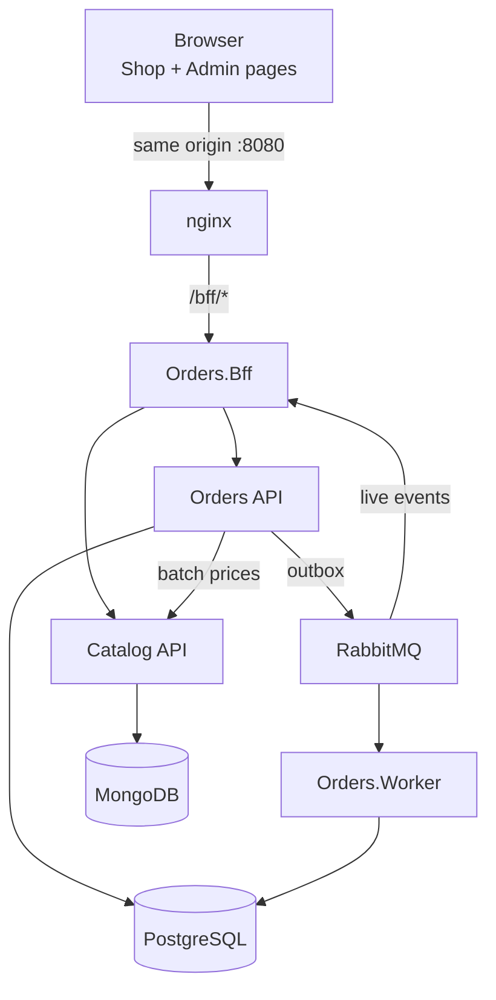

# Orders & Catalog Platform

🌐 **English** · [Português (pt-BR)](README.md)

A RESTful order platform built with .NET 10: an **Orders API** (PostgreSQL, CQRS, RabbitMQ), a **Catalog service** (MongoDB), a **BFF** that is the browser's only entry point, and two front-end pages (Shop and Admin) written in plain HTML, TypeScript and Bootstrap.

> **Status:** steps C01–C56 and C58 (release documentation) delivered; step **C57** (the Stryker.NET baseline) was not done and the **v1.0.0** tag has not been created yet. The work proceeded step by step through the [Execution guide](docs/en-us/02-execution-guide.md); what is left before the release (mutation testing, .NET coverage gates, measured load targets) is in [Quality](docs/en-us/quality.md). The commands in [Getting started](#getting-started) run with Docker Compose; none of the real compose was run by the AI sessions that had no Docker (see the [evidence](docs/en-us/05-ai-development.md#implementation-sessions)).

## Challenge deliverables

| Deliverable | Where |
| --- | --- |
| Source code of both services, with setup and run instructions | `orders/` (Orders API, Worker, BFF), `catalog/` (Catalog API), `web/` (front-end); instructions in [Getting started](#getting-started) |
| AI development tool: which, why, and how it was used in each stage | [AI-assisted development](docs/en-us/05-ai-development.md) (en-US) · [pt-BR](docs/pt-br/05-ai-development.md) |
| Code review / governance guide | [Code review guide](docs/en-us/03-code-review-guide.md) (en-US) · [pt-BR](docs/pt-br/03-code-review-guide.md) |
| Proposal dimensioning (differentials) | [Tech dimensioning](docs/en-us/04-tech-dimensioning.md) (en-US) · [pt-BR](docs/pt-br/04-tech-dimensioning.md) |
| Link to the AI chat sessions (mandatory) | [AI conversation links](#ai-conversation-links) and the evidence tables in [AI-assisted development](docs/en-us/05-ai-development.md#evidence) |
| Presentation (desirable) | [Presentation](docs/en-us/presentation/presentation.md) (en-US) · [pt-BR](docs/pt-br/presentation/presentation.md) |

## Getting started

### Prerequisites

- Docker Desktop (WSL 2 on Windows) with at least 6 GB RAM for Docker; 16 GB RAM on the machine
- .NET SDK 10.0.x (version pinned in `global.json`)
- Node.js 22 and npm (only to work on the front-end outside Docker)
- Git; Bash for `scripts/*.sh` (Git Bash on Windows)

### Configure

```bash
git clone https://github.com/pleshw/StefaniniTest1.git
cd StefaniniTest1
cp .env.example .env
```

`.env` holds local-only values: the PostgreSQL user and password (the local MongoDB has no authentication), the key the BFF signs the tokens it sends to the services with (`SERVICE_TOKEN_SIGNING_KEY`), the RabbitMQ user, and the passwords of the BFF's development sign-in users `shopper` and `admin` (`BFF_SHOPPER_PASSWORD`, `BFF_ADMIN_PASSWORD`), plus two optional values: `LOAD_DURATION` (load test duration) and `ASPIRE_DASHBOARD_PORT` (Aspire Dashboard port). Defaults work as they are for local development; never commit `.env`.

#### For reviewers: `.env` and credentials

`.env.example` is committed and holds local development values only, with no real secret; `.env` (ignored by Git) is the copy `docker-compose.yml` reads. To evaluate the project, just run `cp .env.example .env` and start the stack, without editing anything. If a required variable is missing, compose stops with the message "set ... in .env".

| Credential | Default value (`.env.example`) | Where it is used |
| --- | --- | --- |
| `shopper` / `BFF_SHOPPER_PASSWORD` | `shopper_local_password` | Sign-in at http://localhost:8080/bff/login and access to the Shop page |
| `admin` / `BFF_ADMIN_PASSWORD` | `admin_local_password` | Sign-in at http://localhost:8080/bff/login and access to the Admin page |
| `POSTGRES_USER` / `POSTGRES_PASSWORD` | `orders` / `orders_local_password` | Orders database (not published on the host) |
| `RABBITMQ_DEFAULT_USER` / `RABBITMQ_DEFAULT_PASS` | `orders` / `orders_local_password` | Message broker (not published on the host) |
| `SERVICE_TOKEN_SIGNING_KEY` | `local_service_token_signing_key_change_me_0123456789` | HMAC key the BFF signs the 5-minute service JWTs with |

The values are fictitious and valid locally only; in staging and production they come from GitHub Environment secrets, never from a file. The commented variables in `.env.example` are optional and already have defaults in the `appsettings.json` files.

### Run

```bash
docker compose up -d --build --wait
```

| What | URL |
| --- | --- |
| Shop page | http://localhost:8080/shop.html |
| Admin page | http://localhost:8080/admin.html |
| Sign in (seeded users `shopper`, `admin`) | http://localhost:8080/bff/login |

The sign-in is a **placeholder**: a form served by the BFF itself with two fixed users whose passwords come from `.env`, turned on only by the development compose (`Bff__DevLogin__Enabled`). It opens the same cookie session (HttpOnly, Secure, SameSite=Strict) an identity provider would. A natural improvement is to replace the form with an identity provider such as Keycloak, with the realm (clients, roles and users) versioned in realm files and the BFF using OpenID Connect (code flow + PKCE) and token exchange for the calls to the services.

In the default profile, only nginx publishes a host port; every other service is reached through it. Optional profiles:

```bash
docker compose --profile observability up -d --wait
```

Adds the OpenTelemetry Collector and the Aspire Dashboard (http://localhost:18888, published on `127.0.0.1` only) for traces, metrics and logs. Current limitation: the services only export telemetry when `OTEL_EXPORTER_OTLP_ENDPOINT` is set, and `docker-compose.yml` does not set it yet; until it does, set `OTEL_EXPORTER_OTLP_ENDPOINT=http://otel-collector:4317` on the `orders-api`, `orders-worker`, `orders-bff` and `catalog-api` services (for example in a local `docker-compose.override.yml`).

```bash
docker compose down -v
```

Stops everything and deletes the volumes (data is re-seeded on the next start).

In compose the Catalog seeds 50 products (BRL and USD) at startup (`Catalog__Seed__Enabled`, never set for staging or production). Building `Catalog.Api` rewrites `catalog/openapi/catalog.v1.json`; commit it when the API changes, because CI fails when it differs from the generated one and Orders generates its Catalog client from it. Likewise, building `Orders.Api` rewrites `orders/openapi/orders.v1.json`, from which `Orders.Bff` generates its Orders client (and its Catalog client, from `catalog.v1.json`).

### Test

```bash
dotnet test --solution orders/Orders.slnx
```

```bash
dotnet test --solution catalog/Catalog.slnx
```

```bash
cd web && npm ci && npm test
```

```bash
bash scripts/smoke.sh http://localhost:8080
```

Integration tests use Testcontainers, so Docker must be running. The runner is Microsoft.Testing.Platform (see `global.json`), so filter by category with `--filter-trait "Category=Unit"` (or `Integration`, `Architecture`, `Resilience`; repeating the option adds categories) and add `--ignore-exit-code 8` so projects without tests in that category do not fail the run.

The smoke test (`scripts/smoke.sh`) goes through the BFF only: it signs in as `shopper` and as `admin` through the development sign-in, places an order, checks that it reaches the admin's event stream and ends up `Confirmed` or `OnHold`, and repeats the same `Idempotency-Key` to get the same order number. With the development stack up it is enough to run it; with `--up` it starts the stack first (`docker compose up -d --build --wait`). It depends on the development sign-in, which only `docker-compose.yml` turns on, so it does not run against staging or production yet.

The load test uses k6 in the `load` profile of the compose and enforces the sizing document's latency targets (create order < 300 ms, price batch < 50 ms, list orders < 200 ms, p95): with the stack up, `docker compose --profile load run --rm k6`. `LOAD_DURATION` in `.env` shortens the run (for example `30s`). The `EXPLAIN` plans of Orders' queries are in `docs/perf/`.

### Troubleshooting

| Symptom | Likely cause and what to do |
| --- | --- |
| `docker compose up` fails with "set SERVICE_TOKEN_SIGNING_KEY in .env" (or another variable) | `.env` is missing or incomplete: `cp .env.example .env` |
| `/bff/login` does not answer 200 | The stack is still starting: use `--wait` and check `docker compose ps`; the development sign-in only exists in the development compose |
| The Shop catalog is empty | The Catalog seed (`Catalog__Seed__Enabled`) is off or MongoDB did not start the replica set: check `docker compose logs mongo catalog-api` |
| Placing an order answers 503 | Catalog is down or the circuit breaker opened; wait for the 15 s break and check the health in `docker compose ps` |
| The Admin only shows "Aguardando eventos…" (Waiting for events…) | The live table starts empty and only shows what happens after it is opened (it does not read the history): place an order in the Shop and it appears within seconds. If nothing appears, check `docker compose logs orders-bff orders-worker` (look for "Live events: the event log could not be read") and that RabbitMQ is healthy |
| An order stays `OnHold` | A confirmation rule held it; confirm it in the Admin (see the [runbook](docs/en-us/operations/runbook.md)) |
| Messages in the DLQ | See the replay in the [runbook](docs/en-us/operations/runbook.md) and the thresholds in [Metrics and alerts](docs/en-us/operations/alerts.md) |
| Integration tests fail to start | Docker is not running (Testcontainers) |
| `dotnet restore --locked-mode` fails | A package changed without regenerating the lock files: `dotnet restore` and commit the `packages.lock.json` files |

## Documentation

Documentation is kept in two languages with the same file names: [`docs/pt-br/`](docs/pt-br/) (Brazilian Portuguese, the source of truth) and [`docs/en-us/`](docs/en-us/) (English mirror, the one linked from this README). Changes are written in pt-BR first and mirrored in en-US in the same PR; when they disagree, pt-BR wins. This README is mirrored by [`README.md`](README.md) (pt-BR). Rules for agents are in [AGENTS.md](AGENTS.md).

| Document (en-US) | pt-BR | What it covers |
| --- | --- | --- |
| [Implementation plan](docs/en-us/01-implementation-plan.md) | [pt-BR](docs/pt-br/01-implementation-plan.md) | Decisions, architecture, BFF, API surface, data model and idempotency, discount and confirmation rules, front-end, observability, testing, phases, traceability |
| [Execution guide](docs/en-us/02-execution-guide.md) | [pt-BR](docs/pt-br/02-execution-guide.md) | 58 commit-sized steps (C01–C58) with the agent prompt, definition of done, and the GitHub Actions CI/CD setup with the mandatory deploy gate |
| [Code review guide](docs/en-us/03-code-review-guide.md) | [pt-BR](docs/pt-br/03-code-review-guide.md) | Governance: clean code principles, PR acceptance criteria, what blocks a PR, review workflow, stack checklists, artifacts and pipelines |
| [Tech dimensioning](docs/en-us/04-tech-dimensioning.md) | [pt-BR](docs/pt-br/04-tech-dimensioning.md) | Premises, runtime sizing, effort by phase, team composition and seniority, delivery timeline, estimate risks |
| [AI-assisted development](docs/en-us/05-ai-development.md) | [pt-BR](docs/pt-br/05-ai-development.md) | Tool choice (Claude Code with Opus 5.5 and Sonnet 5.5), reasons, use in each lifecycle stage, guardrails, session evidence |
| [Quality](docs/en-us/quality.md) | [pt-BR](docs/pt-br/quality.md) | Acceptance criteria evidence table, latency targets, state of mutation testing |
| [ADRs](docs/en-us/adr/0001-bff.md) | [pt-BR](docs/pt-br/adr/0001-bff.md) | Decisions: BFF, Wolverine, MongoDB replica set, several currencies, confirmation rules (0001–0005) |
| [Operations](docs/en-us/operations/runbook.md) | [pt-BR](docs/pt-br/operations/runbook.md) | Runbook (DLQ replay, rule changes, rollback) and [metrics and alerts](docs/en-us/operations/alerts.md) |

## AI conversation links

Every stage was done with Claude Code; one shared session per stage or step. The full list, with the PR each implementation session produced, is in [AI-assisted development](docs/en-us/05-ai-development.md#evidence).

| Session | Link |
| --- | --- |
| Planning: requirements, architecture, execution guide, governance, dimensioning | _add link_ |
| Repository and documentation organisation | _add link_ |
| Implementation, one session per step (C01–C58) | see [evidence table](docs/en-us/05-ai-development.md#implementation-sessions) |

## Architecture at a glance



## Tech stack

- **Back end:** .NET 10 LTS, ASP.NET Core Minimal APIs, EF Core + Npgsql, MongoDB C# driver, Wolverine (CQRS handlers, outbox/inbox, RabbitMQ), YARP in the BFF, FluentValidation, Mapperly, NSwag clients generated from OpenAPI, Microsoft.Extensions.Http.Resilience, Scalar
- **Data and messaging:** PostgreSQL 17, MongoDB 8 (replica set), RabbitMQ 4 (quorum queues, retries, DLQ)
- **Front end:** TypeScript (strict), Vite, Vitest, Testing Library, MSW, Bootstrap 5.3 and Bootstrap Icons; pt-BR UI
- **Quality:** xUnit v3 (Microsoft.Testing.Platform), NSubstitute, Shouldly, Testcontainers, WireMock.Net, NetArchTest, axe-core, k6 (load); mutation testing (Stryker.NET) was not done
- **Operations:** Docker Compose, OpenTelemetry, GitHub Actions with a deploy gate before every deploy

## Contributing

Every change is one step of the execution guide: one branch, one commit, one pull request, merged only when the `gate` (displayed as `ci / gate`) and `CodeQL` checks are green and the [Code review guide](docs/en-us/03-code-review-guide.md) criteria are met. Commit messages follow [Conventional Commits](https://www.conventionalcommits.org/). Documentation changes are made in `docs/pt-br/` first and mirrored in `docs/en-us/`. PRs produced with AI link their session and add a row to the [evidence table](docs/en-us/05-ai-development.md#implementation-sessions).
