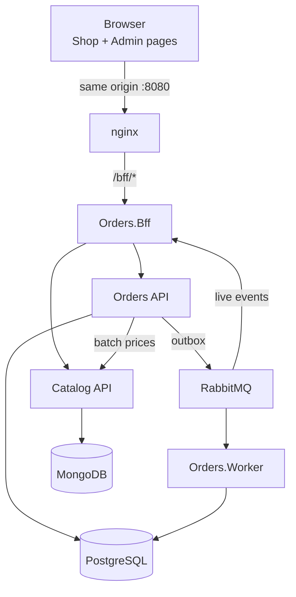

# Plataforma de Pedidos e Catálogo

🌐 [English (en-US)](README-en-us.md) · **Português (pt-BR)**

Uma plataforma RESTful de pedidos construída com .NET 10: uma **Orders API** (PostgreSQL, CQRS, RabbitMQ), um **serviço Catalog** (MongoDB), um **BFF** que é a única porta de entrada do navegador e duas páginas de front-end (Shop e Admin) escritas em HTML, TypeScript e Bootstrap puros.

> **Status:** planejamento concluído, implementação não iniciada. O trabalho avança etapa por etapa pelo [Guia de execução](docs/pt-br/02-execution-guide.md), começando pela etapa C01. Os comandos de [Primeiros passos](#primeiros-passos) descrevem o ambiente final e se tornam executáveis conforme as etapas são entregues (compose em C06–C07, front-end em C45, smoke test em C54).

## Entregáveis do desafio

| Entregável | Onde |
| --- | --- |
| Código-fonte dos dois serviços, com instruções de configuração e execução | `orders/` (Orders API, Worker, BFF), `catalog/` (Catalog API), `web/` (front-end); instruções em [Primeiros passos](#primeiros-passos) |
| Ferramenta de desenvolvimento com IA: qual, por quê e como foi usada em cada etapa | [Desenvolvimento assistido por IA](docs/pt-br/05-ai-development.md) (pt-BR) · [en-US](docs/en-us/05-ai-development.md) |
| Guia de code review / governança | [Guia de code review](docs/pt-br/03-code-review-guide.md) (pt-BR) · [en-US](docs/en-us/03-code-review-guide.md) |
| Dimensionamento da proposta (diferenciais) | [Dimensionamento técnico](docs/pt-br/04-tech-dimensioning.md) (pt-BR) · [en-US](docs/en-us/04-tech-dimensioning.md) |
| Link das sessões de chat com IA (obrigatório) | [Links das conversas com IA](#links-das-conversas-com-ia) e as tabelas de evidências em [Desenvolvimento assistido por IA](docs/pt-br/05-ai-development.md#evidências) |
| Apresentação (desejável) | `docs/pt-br/presentation/` e `docs/en-us/presentation/` (produzida na etapa C58) |

## Primeiros passos

### Pré-requisitos

- Docker Desktop (WSL 2 no Windows) com pelo menos 6 GB de RAM para o Docker; 16 GB de RAM na máquina
- .NET SDK 10.0.x (versão fixada em `global.json`)
- Node.js 22 e npm (apenas para trabalhar no front-end fora do Docker)
- Git; Bash para os `scripts/*.sh` (Git Bash no Windows)

### Configurar

```bash
git clone <repository-url>
cd StefaniniTestProject
cp .env.example .env
```

O `.env` guarda valores apenas locais: senhas dos bancos, o usuário do RabbitMQ e as senhas dos usuários `shopper` e `admin` do Keycloak criados na carga inicial. Os padrões funcionam como estão no desenvolvimento local; nunca faça commit do `.env`.

### Executar

```bash
docker compose up -d --build --wait
```

| O quê | URL |
| --- | --- |
| Página Shop | http://localhost:8080/shop.html |
| Página Admin | http://localhost:8080/admin.html |
| Login (usuários `shopper` e `admin` da carga inicial) | http://localhost:8080/bff/login |

Somente o nginx publica uma porta no host; todos os outros serviços são acessados por meio dele. Perfis opcionais:

```bash
docker compose --profile observability up -d --wait
```

Adiciona o OpenTelemetry Collector e o Aspire Dashboard para traces, métricas e logs.

```bash
docker compose down -v
```

Para tudo e apaga os volumes (os dados são recriados na próxima inicialização).

No compose, o Catalog carrega 50 produtos (BRL e USD) na inicialização (`Catalog__Seed__Enabled`, nunca definido em staging ou produção). Compilar o `Catalog.Api` reescreve `catalog/openapi/catalog.v1.json`; faça commit dele quando a API mudar, porque o CI falha quando ele difere do gerado e o Orders gera seu client do Catalog a partir dele.

### Testar

```bash
dotnet test orders/Orders.slnx
```

```bash
dotnet test catalog/Catalog.slnx
```

```bash
cd web && npm ci && npm test
```

```bash
bash scripts/smoke.sh http://localhost:8080
```

Os testes de integração usam Testcontainers, então o Docker precisa estar em execução. Filtre por categoria com `--filter Category=Unit`, `Integration`, `Architecture` ou `Resilience`.

## Documentação

A documentação é mantida em dois idiomas, com os mesmos nomes de arquivo: [`docs/pt-br/`](docs/pt-br/) (português do Brasil, a fonte da verdade) e [`docs/en-us/`](docs/en-us/) (espelho em inglês). As mudanças são escritas primeiro em pt-BR e espelhadas em en-US no mesmo PR; quando divergem, vale o pt-BR. Este README é espelhado por [`README-en-us.md`](README-en-us.md) (en-US). As regras para agentes estão em [AGENTS.md](AGENTS.md).

| Documento (pt-BR) | Inglês | O que cobre |
| --- | --- | --- |
| [Plano de implementação](docs/pt-br/01-implementation-plan.md) | [en-US](docs/en-us/01-implementation-plan.md) | Decisões, arquitetura, BFF, superfície da API, modelo de dados e idempotência, regras de desconto e de confirmação, front-end, observabilidade, testes, fases, rastreabilidade |
| [Guia de execução](docs/pt-br/02-execution-guide.md) | [en-US](docs/en-us/02-execution-guide.md) | 58 etapas do tamanho de um commit (C01–C58) com o prompt do agente, definição de pronto e a configuração de CI/CD no GitHub Actions com o gate de deploy obrigatório |
| [Guia de code review](docs/pt-br/03-code-review-guide.md) | [en-US](docs/en-us/03-code-review-guide.md) | Governança: princípios de clean code, critérios de aceite de PR, o que bloqueia um PR, fluxo de revisão, checklists por stack, artefatos e pipelines |
| [Dimensionamento técnico](docs/pt-br/04-tech-dimensioning.md) | [en-US](docs/en-us/04-tech-dimensioning.md) | Premissas, dimensionamento de runtime, esforço por fase, composição e senioridade da equipe, cronograma de entrega, riscos da estimativa |
| [Desenvolvimento assistido por IA](docs/pt-br/05-ai-development.md) | [en-US](docs/en-us/05-ai-development.md) | Escolha da ferramenta (Claude Code com Opus 5.5 e Sonnet 5.5), motivos, uso em cada etapa do ciclo de vida, salvaguardas, evidências das sessões |

## Links das conversas com IA

Todas as fases foram feitas com o Claude Code; uma sessão compartilhada por fase ou etapa. A lista completa, com o PR que cada sessão de implementação gerou, está em [Desenvolvimento assistido por IA](docs/pt-br/05-ai-development.md#evidências).

| Sessão | Link |
| --- | --- |
| Planejamento: requisitos, arquitetura, guia de execução, governança, dimensionamento | _add link_ |
| Organização do repositório e da documentação | _add link_ |
| Implementação, uma sessão por etapa (C01–C58) | veja a [tabela de evidências](docs/pt-br/05-ai-development.md#sessões-de-implementação) |

## Arquitetura em resumo



## Stack tecnológica

- **Back end:** .NET 10 LTS, ASP.NET Core Minimal APIs, EF Core + Npgsql, driver C# do MongoDB, Wolverine (handlers CQRS, outbox/inbox, RabbitMQ), YARP no BFF
- **Dados e mensageria:** PostgreSQL 17, MongoDB 8 (replica set), RabbitMQ 4 (quorum queues, retentativas, DLQ)
- **Front end:** TypeScript (strict), Vite, Vitest, Bootstrap 5.3 e Bootstrap Icons
- **Qualidade:** xUnit v3, NSubstitute, Shouldly, Testcontainers, NetArchTest, axe-core, Stryker.NET
- **Operação:** Docker Compose, OpenTelemetry, GitHub Actions com um gate de deploy antes de cada deploy

## Contribuindo

Toda mudança é uma etapa do guia de execução: uma branch, um commit, um pull request, com merge somente quando o check `ci / gate` está verde e os critérios do [Guia de code review](docs/pt-br/03-code-review-guide.md) são atendidos. As mensagens de commit seguem [Conventional Commits](https://www.conventionalcommits.org/). As mudanças de documentação são feitas primeiro em `docs/pt-br/` e espelhadas em `docs/en-us/`. PRs produzidos com IA linkam a sessão e adicionam uma linha à [tabela de evidências](docs/pt-br/05-ai-development.md#sessões-de-implementação).
