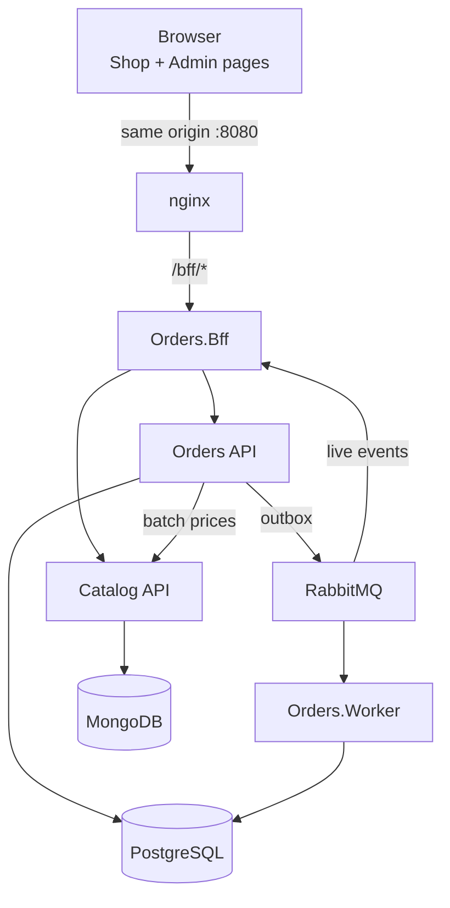

# Plataforma de Pedidos e Catálogo

🌐 [English (en-US)](README-en-us.md) · **Português (pt-BR)**

Uma plataforma RESTful de pedidos construída com .NET 10: uma **Orders API** (PostgreSQL, CQRS, RabbitMQ), um **serviço Catalog** (MongoDB), um **BFF** que é a única porta de entrada do navegador e duas páginas de front-end (Shop e Admin) escritas em HTML, TypeScript e Bootstrap puros.

> **Status:** etapas C01–C56 e C58 (documentação da release) entregues; a **C57** (baseline do Stryker.NET) não foi feita e a tag **v1.0.0** ainda não foi criada. O trabalho avançou etapa por etapa pelo [Guia de execução](docs/pt-br/02-execution-guide.md); o que falta antes da release (teste de mutação, gates de cobertura do .NET, metas de carga medidas) está em [Qualidade](docs/pt-br/quality.md). Os comandos de [Primeiros passos](#primeiros-passos) rodam com o Docker Compose; nada do compose real foi executado pelas sessões de IA sem Docker (veja as [evidências](docs/pt-br/05-ai-development.md#sessões-de-implementação)).

## Entregáveis do desafio

| Entregável | Onde |
| --- | --- |
| Código-fonte dos dois serviços, com instruções de configuração e execução | `orders/` (Orders API, Worker, BFF), `catalog/` (Catalog API), `web/` (front-end); instruções em [Primeiros passos](#primeiros-passos) |
| Ferramenta de desenvolvimento com IA: qual, por quê e como foi usada em cada etapa | [Desenvolvimento assistido por IA](docs/pt-br/05-ai-development.md) (pt-BR) · [en-US](docs/en-us/05-ai-development.md) |
| Guia de code review / governança | [Guia de code review](docs/pt-br/03-code-review-guide.md) (pt-BR) · [en-US](docs/en-us/03-code-review-guide.md) |
| Dimensionamento da proposta (diferenciais) | [Dimensionamento técnico](docs/pt-br/04-tech-dimensioning.md) (pt-BR) · [en-US](docs/en-us/04-tech-dimensioning.md) |
| Link das sessões de chat com IA (obrigatório) | [Links das conversas com IA](#links-das-conversas-com-ia) e as tabelas de evidências em [Desenvolvimento assistido por IA](docs/pt-br/05-ai-development.md#evidências) |
| Apresentação (desejável) | [Apresentação](docs/pt-br/presentation/presentation.md) (pt-BR) · [en-US](docs/en-us/presentation/presentation.md) |

## Primeiros passos

### Pré-requisitos

- Docker Desktop (WSL 2 no Windows) com pelo menos 6 GB de RAM para o Docker; 16 GB de RAM na máquina
- .NET SDK 10.0.x (versão fixada em `global.json`)
- Node.js 22 e npm (apenas para trabalhar no front-end fora do Docker)
- Git; Bash para os `scripts/*.sh` (Git Bash no Windows)

### Configurar

```bash
git clone https://github.com/pleshw/StefaniniTest1.git
cd StefaniniTest1
cp .env.example .env
```

O `.env` guarda valores apenas locais: usuário e senha do PostgreSQL (o MongoDB local não tem autenticação), a chave com que o BFF assina os tokens enviados aos serviços (`SERVICE_TOKEN_SIGNING_KEY`), o usuário do RabbitMQ e as senhas dos usuários de desenvolvimento `shopper` e `admin` do login do BFF (`BFF_SHOPPER_PASSWORD`, `BFF_ADMIN_PASSWORD`), além de dois valores opcionais: `LOAD_DURATION` (duração do teste de carga) e `ASPIRE_DASHBOARD_PORT` (porta do Aspire Dashboard). Os padrões funcionam como estão no desenvolvimento local; nunca faça commit do `.env`.

### Executar

```bash
docker compose up -d --build --wait
```

| O quê | URL |
| --- | --- |
| Página Shop | http://localhost:8080/shop.html |
| Página Admin | http://localhost:8080/admin.html |
| Login (usuários `shopper` e `admin` da carga inicial) | http://localhost:8080/bff/login |

O login é **provisório**: um formulário do próprio BFF com dois usuários fixos cujas senhas vêm do `.env`, ligado só no compose de desenvolvimento (`Bff__DevLogin__Enabled`). Ele abre a mesma sessão por cookie (HttpOnly, Secure, SameSite=Strict) que um provedor de identidade abriria. Uma melhoria natural é trocar esse formulário por um provedor de identidade como o Keycloak, com o realm (clients, roles e usuários) versionado em arquivos de realm e o BFF usando OpenID Connect (code flow + PKCE) e token exchange para as chamadas aos serviços.

No perfil padrão, somente o nginx publica uma porta no host; todos os outros serviços são acessados por meio dele. Perfis opcionais:

```bash
docker compose --profile observability up -d --wait
```

Adiciona o OpenTelemetry Collector e o Aspire Dashboard (http://localhost:18888, publicado só em `127.0.0.1`) para traces, métricas e logs. Limitação atual: os serviços só exportam telemetria quando `OTEL_EXPORTER_OTLP_ENDPOINT` está definida, e o `docker-compose.yml` ainda não a define; até lá, defina `OTEL_EXPORTER_OTLP_ENDPOINT=http://otel-collector:4317` nos serviços `orders-api`, `orders-worker`, `orders-bff` e `catalog-api` (por exemplo, num `docker-compose.override.yml` local).

```bash
docker compose down -v
```

Para tudo e apaga os volumes (os dados são recriados na próxima inicialização).

No compose, o Catalog carrega 50 produtos (BRL e USD) na inicialização (`Catalog__Seed__Enabled`, nunca definido em staging ou produção). Compilar o `Catalog.Api` reescreve `catalog/openapi/catalog.v1.json`; faça commit dele quando a API mudar, porque o CI falha quando ele difere do gerado e o Orders gera seu client do Catalog a partir dele. Da mesma forma, compilar o `Orders.Api` reescreve `orders/openapi/orders.v1.json`, do qual o `Orders.Bff` gera seu client do Orders (e o do Catalog, a partir de `catalog.v1.json`).

### Testar

```bash
dotnet test --solution orders/Orders.slnx
```

```bash
dotnet test --solution catalog/Catalog.slnx
```

```bash
cd web && npm ci && npm test
```

```bash
bash scripts/smoke.sh http://localhost:8080
```

Os testes de integração usam Testcontainers, então o Docker precisa estar em execução. O runner é o Microsoft.Testing.Platform (veja `global.json`), então filtre por categoria com `--filter-trait "Category=Unit"` (ou `Integration`, `Architecture`, `Resilience`; repetir a opção soma as categorias) e acrescente `--ignore-exit-code 8` para que os projetos sem testes daquela categoria não falhem a execução.

O smoke test (`scripts/smoke.sh`) passa só pelo BFF: entra como `shopper` e como `admin` pelo login de desenvolvimento, faz um pedido, confere que ele chega ao stream de eventos do admin e termina em `Confirmed` ou `OnHold`, e repete a mesma `Idempotency-Key` para receber o mesmo número de pedido. Com a pilha de desenvolvimento no ar basta rodá-lo; com `--up` ele sobe a pilha antes (`docker compose up -d --build --wait`). Ele depende do login de desenvolvimento, que só o `docker-compose.yml` liga, então ainda não roda contra staging nem produção.

O teste de carga usa o k6 no profile `load` do compose e cobra as metas de latência do dimensionamento (criar pedido < 300 ms, lote de preços < 50 ms, listar pedidos < 200 ms, p95): com a pilha no ar, `docker compose --profile load run --rm k6`. `LOAD_DURATION` no `.env` encurta a execução (por exemplo `30s`). Os planos `EXPLAIN` das consultas do Orders estão em `docs/perf/`.

### Solução de problemas

| Sintoma | Causa provável e o que fazer |
| --- | --- |
| `docker compose up` falha com "set SERVICE_TOKEN_SIGNING_KEY in .env" (ou outra variável) | O `.env` não existe ou está incompleto: `cp .env.example .env` |
| `/bff/login` não responde 200 | A pilha ainda sobe: use `--wait` e veja `docker compose ps`; o login de desenvolvimento só existe no compose de desenvolvimento |
| O catálogo da Shop está vazio | O seed do Catalog (`Catalog__Seed__Enabled`) está desligado ou o MongoDB não iniciou o replica set: veja `docker compose logs mongo catalog-api` |
| Criar pedido responde 503 | O Catalog está fora do ar ou o circuit breaker abriu; espere o `break` de 15 s e veja a saúde em `docker compose ps` |
| O Admin só mostra "Aguardando eventos…" | A tabela ao vivo começa vazia e só mostra o que acontece depois de aberta (não lê o histórico): faça um pedido na Shop e ele aparece em poucos segundos. Se nada aparecer, veja `docker compose logs orders-bff orders-worker` (procure "Live events: the event log could not be read") e se o RabbitMQ está saudável |
| Um pedido fica em `OnHold` | Uma regra de confirmação o reteve; confirme-o no Admin (veja o [runbook](docs/pt-br/operations/runbook.md)) |
| Mensagens na DLQ | Veja o replay no [runbook](docs/pt-br/operations/runbook.md) e os limites em [Métricas e alertas](docs/pt-br/operations/alerts.md) |
| Os testes de integração falham ao iniciar | O Docker não está em execução (Testcontainers) |
| `dotnet restore --locked-mode` falha | Um pacote mudou sem regenerar os arquivos de lock: `dotnet restore` e faça commit dos `packages.lock.json` |

## Documentação

A documentação é mantida em dois idiomas, com os mesmos nomes de arquivo: [`docs/pt-br/`](docs/pt-br/) (português do Brasil, a fonte da verdade) e [`docs/en-us/`](docs/en-us/) (espelho em inglês). As mudanças são escritas primeiro em pt-BR e espelhadas em en-US no mesmo PR; quando divergem, vale o pt-BR. Este README é espelhado por [`README-en-us.md`](README-en-us.md) (en-US). As regras para agentes estão em [AGENTS.md](AGENTS.md).

| Documento (pt-BR) | Inglês | O que cobre |
| --- | --- | --- |
| [Plano de implementação](docs/pt-br/01-implementation-plan.md) | [en-US](docs/en-us/01-implementation-plan.md) | Decisões, arquitetura, BFF, superfície da API, modelo de dados e idempotência, regras de desconto e de confirmação, front-end, observabilidade, testes, fases, rastreabilidade |
| [Guia de execução](docs/pt-br/02-execution-guide.md) | [en-US](docs/en-us/02-execution-guide.md) | 58 etapas do tamanho de um commit (C01–C58) com o prompt do agente, definição de pronto e a configuração de CI/CD no GitHub Actions com o gate de deploy obrigatório |
| [Guia de code review](docs/pt-br/03-code-review-guide.md) | [en-US](docs/en-us/03-code-review-guide.md) | Governança: princípios de clean code, critérios de aceite de PR, o que bloqueia um PR, fluxo de revisão, checklists por stack, artefatos e pipelines |
| [Dimensionamento técnico](docs/pt-br/04-tech-dimensioning.md) | [en-US](docs/en-us/04-tech-dimensioning.md) | Premissas, dimensionamento de runtime, esforço por fase, composição e senioridade da equipe, cronograma de entrega, riscos da estimativa |
| [Desenvolvimento assistido por IA](docs/pt-br/05-ai-development.md) | [en-US](docs/en-us/05-ai-development.md) | Escolha da ferramenta (Claude Code com Opus 5.5 e Sonnet 5.5), motivos, uso em cada etapa do ciclo de vida, salvaguardas, evidências das sessões |
| [Qualidade](docs/pt-br/quality.md) | [en-US](docs/en-us/quality.md) | Tabela de evidências dos critérios de aceite, metas de latência, estado do teste de mutação |
| [ADRs](docs/pt-br/adr/0001-bff.md) | [en-US](docs/en-us/adr/0001-bff.md) | Decisões: BFF, Wolverine, replica set do MongoDB, várias moedas, regras de confirmação (0001–0005) |
| [Operação](docs/pt-br/operations/runbook.md) | [en-US](docs/en-us/operations/runbook.md) | Runbook (replay da DLQ, mudanças de regras, reversão) e [métricas e alertas](docs/pt-br/operations/alerts.md) |

## Links das conversas com IA

Todas as fases foram feitas com o Claude Code; uma sessão compartilhada por fase ou etapa. A lista completa, com o PR que cada sessão de implementação gerou, está em [Desenvolvimento assistido por IA](docs/pt-br/05-ai-development.md#evidências).

| Sessão | Link |
| --- | --- |
| Planejamento: requisitos, arquitetura, guia de execução, governança, dimensionamento | _add link_ |
| Organização do repositório e da documentação | _add link_ |
| Implementação, uma sessão por etapa (C01–C58) | veja a [tabela de evidências](docs/pt-br/05-ai-development.md#sessões-de-implementação) |

## Arquitetura em resumo



## Stack tecnológica

- **Back end:** .NET 10 LTS, ASP.NET Core Minimal APIs, EF Core + Npgsql, driver C# do MongoDB, Wolverine (handlers CQRS, outbox/inbox, RabbitMQ), YARP no BFF, FluentValidation, Mapperly, clients gerados com NSwag a partir do OpenAPI, Microsoft.Extensions.Http.Resilience, Scalar
- **Dados e mensageria:** PostgreSQL 17, MongoDB 8 (replica set), RabbitMQ 4 (quorum queues, retentativas, DLQ)
- **Front end:** TypeScript (strict), Vite, Vitest, Testing Library, MSW, Bootstrap 5.3 e Bootstrap Icons; interface em pt-BR
- **Qualidade:** xUnit v3 (Microsoft.Testing.Platform), NSubstitute, Shouldly, Testcontainers, WireMock.Net, NetArchTest, axe-core, k6 (carga); o teste de mutação (Stryker.NET) não foi feito
- **Operação:** Docker Compose, OpenTelemetry, GitHub Actions com um gate de deploy antes de cada deploy

## Contribuindo

Toda mudança é uma etapa do guia de execução: uma branch, um commit, um pull request, com merge somente quando os checks `gate` (exibido como `ci / gate`) e `CodeQL` estão verdes e os critérios do [Guia de code review](docs/pt-br/03-code-review-guide.md) são atendidos. As mensagens de commit seguem [Conventional Commits](https://www.conventionalcommits.org/). As mudanças de documentação são feitas primeiro em `docs/pt-br/` e espelhadas em `docs/en-us/`. PRs produzidos com IA linkam a sessão e adicionam uma linha à [tabela de evidências](docs/pt-br/05-ai-development.md#sessões-de-implementação).
