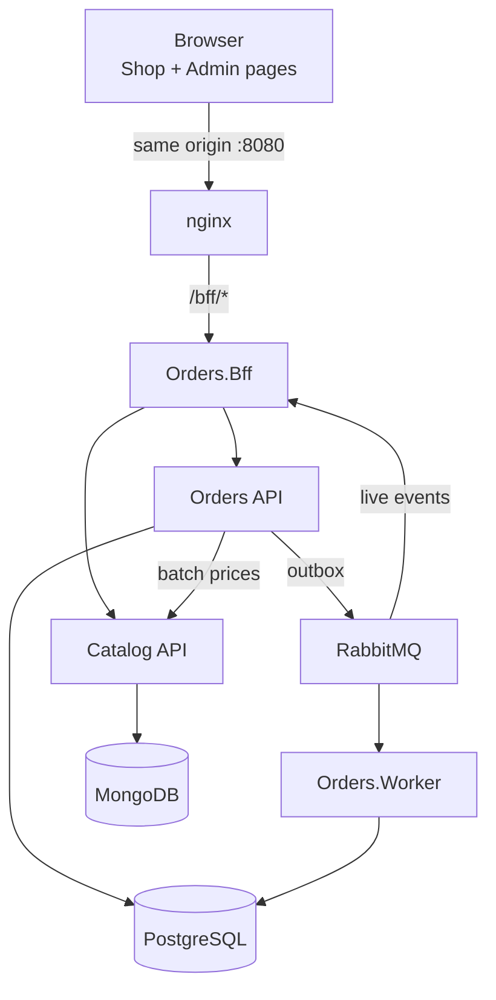

# Orders & Catalog Platform

A RESTful order platform built with .NET 10: an **Orders API** (PostgreSQL, CQRS, RabbitMQ), a **Catalog service** (MongoDB), a **BFF** that is the browser's only entry point, and two front-end pages (Shop and Admin) written in plain HTML, TypeScript and Bootstrap.

> **Status:** planning complete, implementation not started. Work proceeds step by step through the [Execution guide](docs/02-execution-guide.md), starting with step C01.

## Documentation

| Document | What it covers |
| --- | --- |
| [Implementation plan](docs/01-implementation-plan.md) | Decisions, architecture, BFF, API surface, data model and idempotency, discount and confirmation rules, front-end, observability, testing, phases, traceability |
| [Execution guide](docs/02-execution-guide.md) | 58 commit-sized steps (C01–C58) with the agent prompt, definition of done, and the GitHub Actions CI/CD setup with the mandatory deploy gate |
| [Code review guide](docs/03-code-review-guide.md) | Clean code principles, PR acceptance criteria, what blocks a PR, review workflow, stack checklists, artifacts and pipelines |
| [Tech dimensioning](docs/04-tech-dimensioning.md) | Premises, runtime sizing, effort by phase, team composition and seniority, delivery timeline, estimate risks |

## Architecture at a glance

## Tech stack

- **Back end:** .NET 10 LTS, ASP.NET Core Minimal APIs, EF Core + Npgsql, MongoDB C# driver, Wolverine (CQRS handlers, outbox/inbox, RabbitMQ), YARP in the BFF
- **Data and messaging:** PostgreSQL 17, MongoDB 8 (replica set), RabbitMQ 4 (quorum queues, retries, DLQ)
- **Front end:** TypeScript (strict), Vite, Vitest, Bootstrap 5.3 and Bootstrap Icons
- **Quality:** xUnit v3, NSubstitute, Shouldly, Testcontainers, NetArchTest, axe-core, Stryker.NET
- **Operations:** Docker Compose, OpenTelemetry, GitHub Actions with a deploy gate before every deploy

## Contributing

Every change is one step of the execution guide: one branch, one commit, one pull request, merged only when the `ci / gate` check is green and the [Code review guide](docs/03-code-review-guide.md) criteria are met. Commit messages follow [Conventional Commits](https://www.conventionalcommits.org/).
