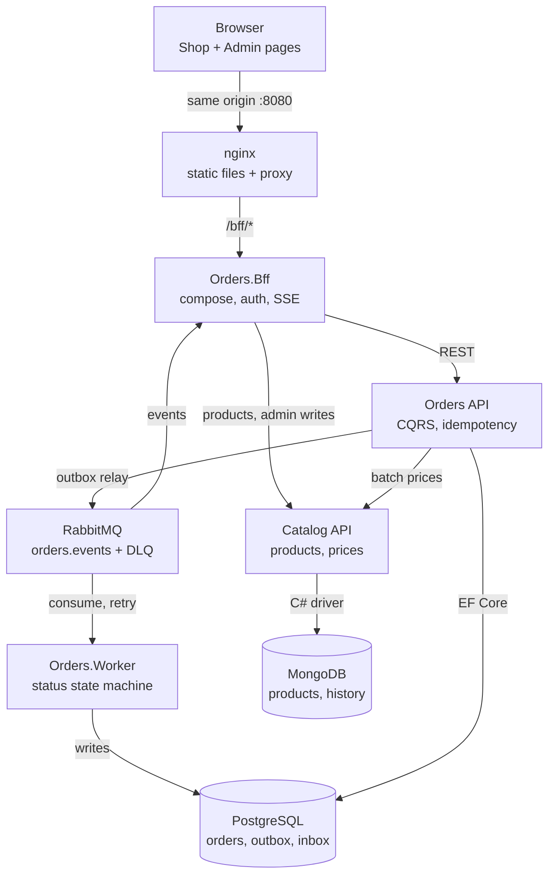
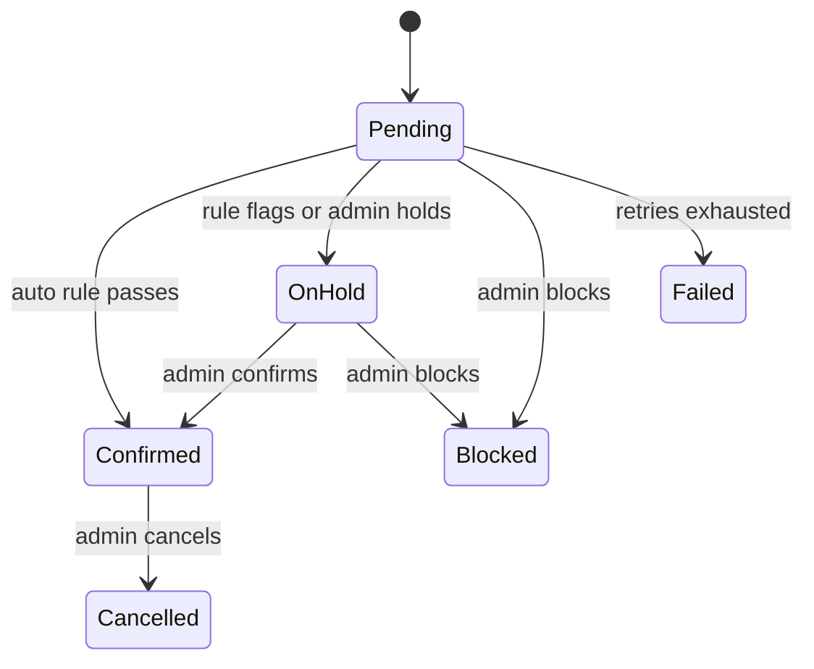

# Orders & Catalog Platform — Tech Dimensioning

Oct 26, 2026 · Elyton Victor

## Summary

A squad of 6 people (4.75 FTE) delivers the platform in 8 weeks for an estimated 128 person-days, which already includes a 10% contingency. Implementation is AI-assisted: Sonnet 5.5 writes each commit from the execution guide, and engineers review, test and merge. The runtime footprint is 10 containers, needing about 5 vCPU and 5.5 GB RAM on a developer machine, and is sized for 100 concurrent users and 50 orders per minute at peak.

| Figure | Value |
| --- | --- |
| Duration | 8 weeks (40 working days) |
| Effort | 116 person-days + 12 contingency = 128 person-days |
| Team | 6 people, 4.75 FTE average |
| Containers | 10 locally (2 more under the observability profile) |
| Peak load target | 100 concurrent users, 50 orders/min, 20 price lookups/s |
| Latency targets (p95) | Create order < 300 ms, price batch < 50 ms, list orders < 200 ms |

The full scope and phases live in the implementation plan; this document sizes them.

## Premises

The estimates hold only while these premises hold; any change to one is a re-estimate trigger. Scope reference: [Implementation plan](01-implementation-plan.md).

**Scope**

- Scope is fixed to the implementation plan: Orders API, Orders.Worker, Orders.Bff, Catalog API, Shop page, Admin page, Docker Compose, GitHub Actions.
- Both shoppers and admins create orders. Admins create orders on behalf of a client and can confirm or block orders from the Admin page.
- Multi-currency: each order carries one currency, and Catalog holds a price per SKU per currency. BRL is the default.
- Order confirmation is automatic by rule in Orders.Worker; admins can override (confirm or block) from the UI.
- Retention: idempotency keys 24 h, published outbox rows 30 days.
- Out of scope: payment gateway, stock reservation, e-mail notifications, production cloud infrastructure (only a container-ready staging target is assumed).

**Load and data**

- 10,000 active SKUs, 2 currencies at launch.
- 50,000 orders per month, average 3 lines per order; peak 50 orders/min, 100 concurrent users.
- Order row plus items is about 2 KB; with indexes about 5 KB per order, so about 250 MB of Postgres growth per month.

**Delivery**

- 5 working days per week, 6 productive hours per day; 25% of capacity goes to ceremonies, reviews and support.
- Implementation is AI-assisted: Sonnet 5.5 produces each commit from the execution guide; a human reviews every PR. Without AI assistance, multiply effort by about 1.6.
- One repository, trunk-based development, GitHub Actions as CI/CD, GitHub Environments for `staging` and `production` with required reviewers.
- The team has Docker-capable machines with 16 GB RAM or more.
- A Product Owner from the business is available for 4 hours a week for acceptance and for decisions on discount rules and confirmation rules.

## Architecture

Nine runtime components, of which only nginx is exposed on the host. Synchronous calls carry requests and price checks; RabbitMQ carries side effects to the Worker and the Admin live feed.

The BFF is the single entry for the browser; Orders API calls Catalog once per order for all prices.

### Order lifecycle

Orders.Worker applies the confirmation rule automatically. Orders the rule flags (for example a total above a configured threshold) wait in OnHold until an admin confirms or blocks them from the Admin page; an admin can also hold or block a Pending order. Every transition writes a status history row with the actor.

## Runtime sizing

Locally the stack needs about 5 vCPU and 5.5 GB RAM; a production-like staging doubles the stateless services and runs data stores in their highly available form. Limits below are compose `deploy.resources.limits` and the starting point for staging.

| Component | Replicas local / staging | CPU limit | Memory limit | Storage | Throughput target |
| --- | --- | --- | --- | --- | --- |
| nginx | 1 / 2 | 0.25 | 64 MB | - | 200 req/s |
| Orders.Bff | 1 / 2 | 0.5 | 256 MB | - | 100 req/s, 200 SSE connections |
| Orders API | 1 / 2 | 0.5 | 384 MB | - | 50 orders/min, p95 < 300 ms |
| Orders.Worker | 1 / 2 | 0.25 | 256 MB | - | 10 msg/s, prefetch 20 |
| Catalog API | 1 / 2 | 0.5 | 256 MB | - | 20 batch lookups/s, p95 < 50 ms |
| PostgreSQL 17 | 1 / 1 primary + 1 replica | 1.0 | 1 GB | 10 GB volume, +250 MB/month | 200 connections max, pool 20 per service |
| MongoDB 8 | 1 (rs0) / 3-node replica set | 1.0 | 1 GB | 5 GB volume | 10,000 SKUs in working set |
| RabbitMQ 4 | 1 / 3 nodes (quorum) | 0.5 | 512 MB | 2 GB volume | 50 msg/s sustained |
| Keycloak (dev identity) | 1 / 1 | 0.5 | 768 MB | uses Postgres | - |
| OTel Collector + Aspire Dashboard (profile) | 1 / 1 | 0.5 | 512 MB | in-memory | - |

Capacity notes:

- Data growth: Postgres grows about 250 MB a month at 50,000 orders; idempotency rows (24 h) stay under 5 MB and published outbox rows (30 days) under 100 MB thanks to the cleanup job.
- Connection budget: 2 Orders API + 2 Worker + 1 migrator + Keycloak stay under 100 Postgres connections with pools of 20.
- Scale-out path: Orders API, BFF, Worker and Catalog are stateless and scale horizontally; SSE connections pin to a BFF instance, and each instance has its own RabbitMQ feed queue.
- Developer machine: 16 GB RAM minimum, Docker Desktop with WSL 2 set to at least 6 GB.

## Effort by phase

Orders core and the front-end are the two largest phases at 22 person-days each; together with messaging they hold half of the 116 person-days. Effort covers AI-assisted implementation, review, tests and CI for each commit in the execution guide.

| Phase | Commits | Effort (person-days) | Lead role | Seniority needed | Exit gate |
| --- | --- | --- | --- | --- | --- |
| 0 Foundations | 8 | 8 | Tech Lead + DevOps | Senior | Compose infra healthy, CI green, deploy gate in place |
| 1 Catalog service | 7 | 12 | Back-end (mid) | Mid, senior review | Price edit returns new resource; batch lookup single query |
| 2 Orders core | 9 | 22 | Back-end (senior) | Senior | Concurrent duplicates create one order |
| 3 Discount engine | 6 | 12 | Back-end (senior) | Senior | Rule change reflected in next quote without deploy |
| 4 Messaging and confirmation | 8 | 18 | Back-end (senior) + DevOps | Senior | Worker restart loses nothing; admin confirm/block works |
| 5 BFF and auth | 6 | 12 | Back-end (mid) | Mid, senior review | Shop and admin routes enforce roles via nginx |
| 6 Front-end | 9 | 22 | Front-end | Mid-senior | Shopper orders, admin sees it live, axe clean |
| 7 Hardening and release | 5 | 10 | Whole squad | - | Every acceptance criterion verified; production deploy approved |
| **Total** | **58** | **116** |  |  |  |

Contingency of 10% (12 person-days) is held by the Tech Lead and released only for re-estimates triggered by a premise change.

## Team composition and seniority

Six people at 4.75 FTE give 142 productive person-days over 8 weeks, against 128 needed, about 90% utilisation. The Tech Lead and the senior back-end engineer cover the risky parts (idempotency, messaging, discount engine); mid-level engineers own Catalog, BFF and the UI with senior review.

| Role | Seniority | Allocation | Weeks | Productive person-days | Owns |
| --- | --- | --- | --- | --- | --- |
| Tech Lead / Software Architect | Senior / Staff, .NET + distributed systems | 100% | 1-8 | 30 | Architecture decisions (ADRs), Phase 0, reviews of every PR touching Domain or messaging, AI agent prompts and guide upkeep, contingency |
| Back-end engineer | Senior, .NET, EF Core, RabbitMQ | 100% | 1-8 | 30 | Orders core, discount engine, messaging, Worker, confirmation flow |
| Back-end engineer | Mid, .NET, MongoDB | 100% | 1-8 | 30 | Catalog service, BFF, auth integration |
| Front-end engineer | Mid-senior, TypeScript, accessibility | 100% | 3-8 | 22.5 | Shop and Admin pages, front-end tests, SSE client |
| QA / SDET | Mid, xUnit, Testcontainers, Vitest | 50% | 1-8 | 15 | Test strategy, integration and smoke suites, acceptance verification |
| DevOps / Platform engineer | Senior, GitHub Actions, Docker | 50% | 1-8 | 15 | Compose, CI/CD workflows, deploy gate, environments, image security |
| Product Owner (business) | - | 4 h/week | 1-8 | not counted | Acceptance, discount and confirmation rules |

Minimum viable squad if budget is tight: Tech Lead, senior back-end, front-end, with QA and DevOps duties shared; duration then grows to about 11 weeks.

## Delivery timeline

The critical path is Foundations → Orders core → Discount engine → Messaging → Hardening; Catalog, BFF and the front-end run beside it. Staging deploys continuously from week 2; production needs the gate at the end of week 8.

| Phase | W1 | W2 | W3 | W4 | W5 | W6 | W7 | W8 |
| --- | --- | --- | --- | --- | --- | --- | --- | --- |
| 0 Foundations | ■ | | | | | | | |
| 1 Catalog service | | ■ | ■ | | | | | |
| 2 Orders core | | ■ | ■ | ■ | | | | |
| 3 Discount engine | | | | ■ | ■ | | | |
| 4 Messaging + confirmation | | | | | ■ | ■ | | |
| 5 BFF and auth | | | | | ■ | ■ | | |
| 6 Front-end | | | ■ | ■ | ■ | ■ | ■ | |
| 7 Hardening and release | | | | | | | | ■ |

Production deploy gate (approval required) closes at the end of week 8.

The front-end starts in week 3 against BFF contract stubs, so it does not wait for Phase 5.

## Estimate risks and contingency

The 12 person-day contingency covers one medium risk; two or more materialising push the gate by a week.

| Risk | Likelihood | Effort impact (person-days) | Mitigation |
| --- | --- | --- | --- |
| Multi-currency rules grow (conversion, rounding per currency) | Medium | +5 | Keep one currency per order, no conversion; price per SKU per currency in Catalog |
| Confirmation rules become a rule engine of their own | Medium | +6 | Reuse the discount engine's specification model for confirmation conditions |
| AI-generated commits need heavy rework | Medium | +8 | Small commits, strict definition of done, Tech Lead reviews Domain and messaging PRs |
| Keycloak or auth integration friction | Low | +3 | Pre-built realm export committed in Phase 0 |
| Front-end accessibility fixes late | Low | +3 | axe checks from the first view, not at the end |
| Mid-level engineer unavailable for 2+ weeks | Low | +10 | Senior back-end picks up Catalog/BFF; front-end start slips to week 4 |

Re-estimate triggers: any premise change, a phase exceeding its effort by more than 20%, or a new external integration (payment, stock, e-mail).
