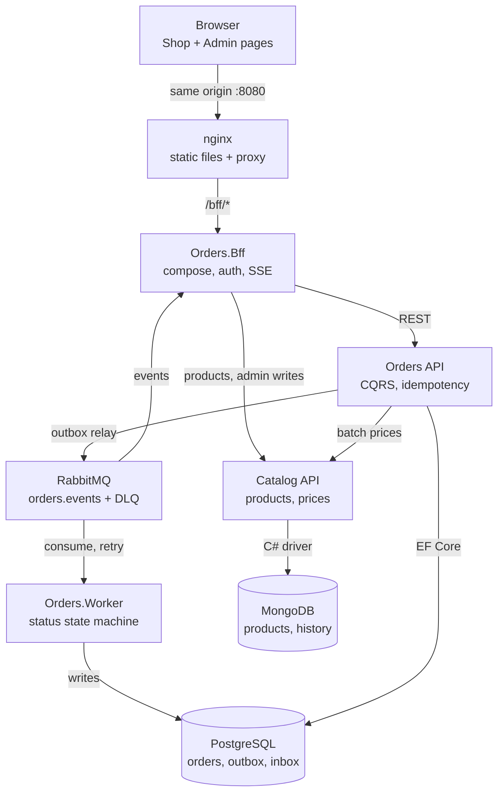

# Orders & Catalog Platform — Implementation Plan

Oct 26, 2026 · Elyton Victor

## Overview

We build an order platform in .NET 10 with three back-end parts: the Orders API (PostgreSQL, CQRS, RabbitMQ), the Catalog service (MongoDB) and a BFF that is the only entry point for the browser. Two front-end pages sit on top: a Shop page for customer-like flows and an Admin page that manages catalog, discounts and watches order events live. Everything runs locally with Docker Compose and is delivered in 8 phases (see Phased implementation plan).

Confirmed decisions:

| Topic | Decision |
| --- | --- |
| Order "amount" (AC2) | Means quantity. The order stores `itemCount` (sum of item quantities) and each item stores `quantity`. Money fields are `subtotal`, `discountTotal`, `total`. |
| Front-end access | The browser talks only to the BFF, which belongs to the Orders side. The browser never calls Catalog directly. |
| BFF | Accepted: one BFF host, `Orders.Bff`, with two route groups, `/bff/shop` and `/bff/admin`. Rationale in Architecture. |
| Front-end pages | Shop page (browse, cart, checkout, my orders) and Admin page (live order events, order actions, DLQ, discounts, confirmation rules, catalog). |
| Runtime | .NET 10 LTS, C# 14, SDK pinned with `global.json`. |
| Currency | Multi-currency: each order has exactly one ISO 4217 currency; Catalog keeps one price per SKU per currency; BRL is the default; no conversion. |
| Who creates orders | Signed-in shoppers for themselves, and admins on behalf of a client. Every order stores `created_by` and `channel` (`shop` or `admin`). |
| Order confirmation | Automatic in Orders.Worker by configurable confirmation rules; admins can confirm, hold or block orders from the Admin page. |
| Order events | Consumed by Orders.Worker (status state machine) and by the BFF (live feed for Admin). |
| Prices | Catalog is the price authority. Orders fetches prices server side in one batch call and never trusts client prices. |
| Retention | Idempotency keys 24 h; Admin event log (`order_event_log`) 30 days. Outbox rows belong to Wolverine, which deletes them as soon as the broker confirms the publish. |
| CI/CD | GitHub Actions; every deploy passes a mandatory gate (see the [Execution guide](02-execution-guide.md#cicd-with-github-actions)). |
| Audit | Stored as domain data in each service, not derived from logs. |

## Architecture

Requests flow browser → nginx → BFF → Orders API, and Orders API calls Catalog synchronously for prices. Side effects flow asynchronously: Orders writes events to an outbox, a relay publishes them to RabbitMQ, and Orders.Worker and the BFF consume them.



Only nginx is exposed on the host; the BFF is the single entry for the browser, and RabbitMQ feeds both the Worker and the Admin live view.

### Why a BFF

A BFF fits this project for four reasons:

- **One door for the browser.** The Shop page must browse products, but the browser may only talk to the Orders side. The BFF reads Catalog on its behalf, so Orders API stays a pure domain service instead of a catalog proxy.
- **Two front-ends, different shapes.** Shop needs small, customer-shaped payloads. Admin needs aggregates (order + status history + events) and a live feed. Route groups `/bff/shop` and `/bff/admin` keep each contract tailored.
- **Live events.** The BFF subscribes to the `orders.events` exchange and pushes to the Admin page with Server-Sent Events (`TypedResults.ServerSentEvents`, built into .NET 10). No broker access from the browser.
- **Security.** The BFF holds the session cookie (BFF security pattern). Tokens never reach the browser, and admin routes require the `Admin` role.

Rules that keep the BFF thin: no domain logic, no database, no price or discount math. It only composes, maps to view models and forwards. It lives in the Orders repository as its own host, `Orders.Bff`, so it deploys apart from Orders API. Pass-through routes use YARP; composed routes use typed HttpClients.

### Communication

| From → To | Style | Why |
| --- | --- | --- |
| Browser → BFF | REST + SSE over same origin (nginx) | No CORS, cookie auth |
| BFF → Orders API | REST (typed client) | Commands and queries |
| BFF → Catalog | REST, read-only for Shop; admin writes forwarded | Browser never sees Catalog |
| Orders API → Catalog | REST, one batch price call per order | Immediate, up-to-date prices (Req 4, AC11) |
| Orders API → RabbitMQ | Wolverine durable outbox in Postgres + publisher confirms | No lost events, no dual writes |
| RabbitMQ → Orders.Worker | Quorum queue `orders.worker.placed` read through the durable inbox; retries scheduled by Wolverine (5 s / 30 s / 5 min), then `orders.dlq` through `orders.dlx` | Status state machine, retries (Req 2) |
| RabbitMQ → BFF | Own non-durable queue per instance | Live Admin feed |

### Tech stack

| Concern | Choice | Note |
| --- | --- | --- |
| Runtime | .NET 10 LTS, ASP.NET Core Minimal APIs | Supported until Nov 2028 |
| Orders DB | PostgreSQL 17, EF Core 10 + Npgsql | Dapper allowed for read projections |
| Catalog DB | MongoDB 8, official C# driver | Single-node replica set in Docker |
| Messaging | RabbitMQ 4 | Quorum queues, publisher confirms |
| CQRS + messaging library | Wolverine (MIT) | Handlers, Postgres outbox/inbox, RabbitMQ transport. Fallback: source-generated Mediator + RabbitMQ.Client 7 |
| Resilience | Microsoft.Extensions.Http.Resilience | Timeout, retry, circuit breaker on Catalog calls |
| Gateway in BFF | YARP | Pass-through routes |
| Generated HTTP clients | NSwag (`NSwag.ApiDescription.Client`, `OpenApiReference`) | C# clients generated at build from `catalog/openapi/catalog.v1.json` (Orders and BFF) and `orders/openapi/orders.v1.json` (BFF) |
| Live feed in the BFF | RabbitMQ.Client 7 | The BFF's exclusive queue on `orders.events`; same version the Wolverine transport uses |
| Service-to-service authentication | Microsoft.AspNetCore.Authentication.JwtBearer | 5-minute JWT the BFF signs for each service (HMAC-SHA256, key from `.env`); placeholder until an identity provider's token exchange |
| API docs | Microsoft.AspNetCore.OpenApi + Scalar | OpenAPI 3.1 |
| Validation | FluentValidation 12 (Apache-2.0) | The only way to validate input, in every layer; see [Design rules](02-execution-guide.md#design-rules-for-every-step) |
| Object mapping | Mapperly (Riok.Mapperly, MIT, source-generated) | Chosen over AutoMapper: 14.x (last MIT) has advisory GHSA-rvv3-g6hj-g44x and fails the build, 15+ is commercial |
| Errors | ProblemDetails (RFC 9457) | Same shape in all services |
| Observability | OpenTelemetry → OTel Collector → Aspire Dashboard | Compose profile `observability`; ASP.NET Core, HttpClient and Runtime instrumentation |
| Back-end tests | xUnit v3, NSubstitute, Shouldly, Testcontainers, NetArchTest, WireMock.Net | Avoid FluentAssertions v8 (commercial licence); WireMock.Net stands in for Catalog in the Orders integration tests |
| Load test | k6 (`grafana/k6` image, Compose profile `load`) | Runs `tests/load/orders.js` with the sizing document's peak profile; no npm or NuGet package; the thresholds are the latency targets |
| Front-end | TypeScript, Vite, Vitest + jsdom, Bootstrap 5.3 + Bootstrap Icons via npm | axe-core for accessibility checks; development tools: ESLint (typescript-eslint) + Prettier, @testing-library/dom, MSW for BFF stubs, @vitest/coverage-v8 |

## Repository and solution structure

One Git repository holds two .NET solutions (`.slnx`) and one front-end package. Services share no domain code; Orders talks to Catalog through a client generated from Catalog's OpenAPI document.

```text
/
├─ global.json                     # pins .NET 10 SDK
├─ Directory.Build.props           # nullable, warnings as errors, analyzers (EF1002 = error)
├─ Directory.Packages.props        # central package versions
├─ .gitattributes                  # *.sh text eol=lf
├─ .config/dotnet-tools.json       # pins dotnet-ef
├─ docker-compose.yml  .env.example
├─ deploy/nginx/  deploy/otel/  deploy/mongo/  deploy/rabbitmq/
├─ deploy/compose.staging.yml  deploy/compose.production.yml  deploy/images.txt
├─ scripts/                        # check-docs.mjs, smoke.sh, deploy.sh, images.sh
├─ tests/load/orders.js            # k6 load test (Compose profile load)
├─ shared/ServiceDefaults/         # shared OTel, health checks, resilience, service tokens; in both .slnx
├─ orders/Orders.slnx
│  ├─ openapi/orders.v1.json        # generated at build
│  ├─ src/Orders.Domain             # aggregates, value objects, discount strategies, no dependencies but FluentValidation
│  ├─ src/Orders.Application        # commands, queries, handlers, ports (ICatalogClient, IClock...)
│  ├─ src/Orders.Infrastructure     # EF Core, migrations, Catalog client, Wolverine outbox/inbox, RabbitMQ
│  ├─ src/Orders.Contracts          # event records (OrderPlacedV1, OrderStatusChangedV1)
│  ├─ src/Orders.Api                # Minimal API endpoints, ProblemDetails, auth
│  ├─ src/Orders.Worker             # RabbitMQ consumers, status state machine
│  ├─ src/Orders.Bff                # BFF host: YARP, composition, SSE, cookie auth
│  └─ tests/ Orders.Domain.UnitTests  Orders.Application.UnitTests  Orders.Bff.UnitTests
│            Orders.IntegrationTests  Orders.ArchitectureTests
├─ catalog/Catalog.slnx
│  ├─ openapi/catalog.v1.json       # generated at build
│  ├─ src/Catalog.Domain  Catalog.Application  Catalog.Infrastructure  Catalog.Api
│  └─ tests/ Catalog.Domain.UnitTests  Catalog.Application.UnitTests  Catalog.IntegrationTests  Catalog.ArchitectureTests
└─ web/
   ├─ index.html  shop.html  admin.html
   ├─ src/shared/  (api/ domain/ ui/: http client, ProblemDetails, SSE, idempotency, formatting, shared views)
   ├─ src/shop/    (api/ domain/ ui/: catalog, cart, orders)
   ├─ src/admin/   (api/ domain/ ui/: live events, inspector, rules, catalog editor)
   ├─ mocks/       (MSW handlers for the BFF)
   └─ tests/
```

Dependency rule, enforced by NetArchTest in `ArchitectureTests`: Domain depends on nothing, Application depends on Domain, Infrastructure and hosts depend inward. The same layering applies in `web/`: `ui` may import `domain` and `api`, never the reverse.

## API surface

All APIs are versioned under `/api/v1`, return ProblemDetails on errors, and are documented with OpenAPI 3.1. The `Idempotency-Key` header (UUID) is required on order creation (`POST /api/v1/orders` and `POST /api/v1/admin/orders`); other writes are protected by `If-Match` on the version or by upsert, and rule creation does not use the key.

### Orders API (internal, called by the BFF)

| Method | Path | Purpose | AC |
| --- | --- | --- | --- |
| POST | `/api/v1/orders` | Create order; header `Idempotency-Key`; returns 201 + order | AC1, AC3 |
| GET | `/api/v1/orders` | List with filters `clientId`, `status`, `from`, `to`, `q` (full text); keyset paging `after`, `limit` | AC1 |
| GET | `/api/v1/orders/{id}` | Order detail: client, items, itemCount, subtotal, discountTotal, total, status | AC1, AC2 |
| GET | `/api/v1/orders/{id}/history` | Status history (audit) | AC1 |
| POST | `/api/v1/admin/orders/{id}/cancel` | Admin cancel, only from Confirmed; reason required; `If-Match` on the order version (428 without it, 412 when stale) | - |
| GET | `/api/v1/admin/events` | Order event log, keyset paged | Admin page |
| GET | `/api/v1/admin/dead-letters` | Messages parked in the DLQ | Req 2 |
| POST | `/api/v1/admin/dead-letters/{messageId}/replay` | Re-publish a parked message | Req 2 |
| GET/POST/PUT | `/api/v1/admin/discount-rules[/{id}]` | Manage discount rules; the list GET takes the `active` filter; PUT requires `If-Match` (428 without it, 412 when stale) | AC5 |
| POST | `/api/v1/admin/discount-rules/{id}/deactivate` | Store a new, inactive version of the rule; `If-Match` optional (412 when stale) | AC5 |
| POST | `/api/v1/admin/discount-rules/preview` | Dry-run rules against a sample cart | AC5 |
| POST | `/api/v1/admin/orders` | Admin creates an order on behalf of a client; same idempotent flow, `Idempotency-Key` scoped by the client, channel = admin | AC1, AC3 |
| POST | `/api/v1/admin/orders/{id}/confirm \| /hold \| /block` | Admin overrides the automatic flow; reason required for hold and block; `If-Match` on the order version (428 without it, 412 when stale) | Decision |
| GET/POST/PUT | `/api/v1/admin/confirmation-rules[/{id}]` | Manage automatic confirmation rules (versioned); the list GET takes the `active` filter; PUT requires `If-Match` | Decision |
| POST | `/api/v1/admin/confirmation-rules/{id}/deactivate` | Store a new, inactive version of the rule; `If-Match` optional (412 when stale) | Decision |

### Catalog API (internal, called by Orders API and the BFF)

| Method | Path | Purpose | AC |
| --- | --- | --- | --- |
| GET | `/api/v1/products` | Search and page products with current prices (`q`, `category`, `after`, `limit`) | AC9, AC10 |
| GET | `/api/v1/products/{sku}` | One product; returns `ETag` | AC9 |
| POST | `/api/v1/products/prices:query` | Batch price lookup, body `{ currency, skus: [...] }`, max 100 SKUs, one `$in` query | AC11 |
| PUT | `/api/v1/admin/products/{sku}` | Create or replace product (idempotent upsert); `If-Match` on update | Item 9 |
| PATCH | `/api/v1/admin/products/{sku}/price` | Change price; `If-Match`; writes price history | Item 9 |
| POST | `/api/v1/admin/products/{sku}/deactivate` | Take a product off sale | - |

### BFF (public, the only API the browser sees)

| Method | Path | Maps to |
| --- | --- | --- |
| GET | `/bff/user` | The session user: subject, name and roles; 401 without a session |
| GET, POST | `/bff/login` | Development sign-in form; exists only when `Bff__DevLogin__Enabled` is on |
| POST | `/bff/logout` | Ends the session; requires the `X-CSRF` header |
| GET | `/bff/shop/products` | Catalog `GET /products` (view model) |
| POST | `/bff/shop/cart/quote` | Orders preview: prices + discounts for the cart, nothing persisted |
| POST | `/bff/shop/orders` | Orders `POST /orders`, forwards `Idempotency-Key` |
| GET | `/bff/shop/orders`, `/bff/shop/orders/{id}` | Orders queries, scoped to the signed-in client |
| GET | `/bff/admin/events` | Orders `GET /admin/events`: event log, used as the live feed's backfill |
| GET | `/bff/admin/events/stream` | SSE live feed: the RabbitMQ message only names the order, and the BFF sends the new event log entries |
| GET | `/bff/admin/orders` | Composed: OnHold queue (oldest first, up to 100) + one page of orders with the filters |
| GET | `/bff/admin/orders/{id}` | Composed: order + history + last 50 events |
| POST | `/bff/admin/orders` | Orders `POST /admin/orders`, forwards `Idempotency-Key` |
| POST | `/bff/admin/orders/{id}/(confirm\|hold\|block\|cancel)` | Orders admin actions (YARP) |
| \* | `/bff/admin/discount-rules/**`, `/bff/admin/confirmation-rules/**`, `/bff/admin/dead-letters/**` | Orders admin routes (YARP) |
| GET | `/bff/admin/products/{sku}` | Catalog `GET /products/{sku}`: reads the product with the version (`ETag`) the editor sends back as `If-Match` (YARP, Admin policy) |
| \* | `/bff/admin/products/{sku}/{**rest}` | Catalog admin routes (YARP): product `PUT`, `PATCH .../price`, `POST .../deactivate` |

Note: `/bff/shop/cart/quote` needs a matching Orders endpoint, `POST /api/v1/orders/quote`, that runs the same pricing and discount code path as order creation without persisting.

## Data model and idempotency

Idempotency is enforced at four layers: the browser reuses one key per checkout, Orders API stores the key with the response, discount redemptions carry unique constraints, and Worker consumers dedupe through an inbox. Money is `numeric(19,4)` in Postgres, `decimal` in C#, `Decimal128` in Mongo, always with an ISO 4217 currency code. Rounding: two decimals, `MidpointRounding.AwayFromZero`, applied once per line and once on the total.

| Project | Threat | Mechanism | Store |
| --- | --- | --- | --- |
| Orders API | Double submit or retry of `POST /orders` | `Idempotency-Key` scoped per client + SHA-256 request hash | `idempotency_requests` |
| Orders API | Same discount applied twice | Unique constraints; rule id + version snapshotted on the order | `discount_redemptions` |
| Orders API | Lost events | Outbox in the same transaction as the order | `outbox_messages` |
| Orders.Worker / BFF | RabbitMQ redelivery | Inbox keyed by message id + consumer | `inbox_messages` (Worker only; BFF feed is display-only) |
| Catalog | Repeated admin writes | `PUT` upsert on unique `sku` + `If-Match`; the key collection was created with indexes for a future POST, but no endpoint uses it | `idempotency_requests` collection |
| Front-end | Double click, timeout then retry | One `crypto.randomUUID()` per checkout attempt, kept in `sessionStorage` | Browser |

### Orders (PostgreSQL)

```sql
CREATE TABLE orders (
    id              uuid          PRIMARY KEY,
    number          text          NOT NULL UNIQUE,          -- human-readable, from the id, e.g. ORD-2026-3F9A1C2B7D40
    client_id       uuid          NOT NULL,
    client_name     text          NOT NULL,                 -- snapshot
    created_by      text          NOT NULL,                 -- shopper id or admin id
    channel         text          NOT NULL,                 -- shop | admin
    status          text          NOT NULL,                 -- Pending | OnHold | Confirmed | Blocked | Cancelled | Failed
    item_count      int           NOT NULL CHECK (item_count > 0),   -- AC2 "amount" = quantity
    currency        char(3)       NOT NULL,
    subtotal        numeric(19,4) NOT NULL,
    discount_total  numeric(19,4) NOT NULL DEFAULT 0,
    total           numeric(19,4) NOT NULL,
    created_at      timestamptz   NOT NULL,
    updated_at      timestamptz   NOT NULL,
    row_version     int           NOT NULL DEFAULT 0,       -- optimistic concurrency
    search_vector   tsvector GENERATED ALWAYS AS
        (to_tsvector('simple', number || ' ' || client_name)) STORED
);
CREATE INDEX ix_orders_client_created ON orders (client_id, created_at DESC, id);
CREATE INDEX ix_orders_status_created ON orders (status, created_at DESC, id);
CREATE INDEX ix_orders_created ON orders (created_at DESC, id);          -- migration 0004
CREATE INDEX ix_orders_search ON orders USING GIN (search_vector);
CREATE INDEX ix_orders_client_trgm ON orders USING GIN (client_name gin_trgm_ops);

CREATE TABLE order_items (
    order_id        uuid          NOT NULL REFERENCES orders (id),
    line_no         int           NOT NULL,
    sku             text          NOT NULL,
    product_name    text          NOT NULL,                 -- snapshot
    unit_price      numeric(19,4) NOT NULL,                 -- snapshot from Catalog
    catalog_version int           NOT NULL,
    quantity        int           NOT NULL CHECK (quantity > 0),
    line_discount   numeric(19,4) NOT NULL DEFAULT 0,
    line_total      numeric(19,4) NOT NULL,
    PRIMARY KEY (order_id, line_no)
);

CREATE TABLE order_status_history (                       -- audit
    order_id    uuid        NOT NULL REFERENCES orders (id),
    seq         int         NOT NULL,
    from_status text,
    to_status   text        NOT NULL,
    reason      text,
    actor       text        NOT NULL,                     -- user id or 'system:worker'
    trace_id    text,
    changed_at  timestamptz NOT NULL,
    PRIMARY KEY (order_id, seq)
);

CREATE TABLE discount_rules (
    id              uuid        NOT NULL,
    version         int         NOT NULL,
    name            text        NOT NULL,
    type            text        NOT NULL,                 -- Percentage | FixedAmount | BuyXGetY | Tiered
    parameters      jsonb       NOT NULL,                 -- validated per type
    conditions      jsonb       NOT NULL DEFAULT '[]',    -- min subtotal, SKUs, categories, client segment (never matches yet)
    priority        int         NOT NULL,
    stackable       boolean     NOT NULL DEFAULT false,
    once_per_client boolean     NOT NULL DEFAULT false,
    valid_from      timestamptz NOT NULL,
    valid_to        timestamptz,
    is_active       boolean     NOT NULL DEFAULT true,
    created_by      text        NOT NULL,
    created_at      timestamptz NOT NULL,
    PRIMARY KEY (id, version)                             -- each edit = new version, history kept
);

CREATE TABLE order_discounts (
    order_id         uuid          NOT NULL REFERENCES orders (id),
    discount_rule_id uuid          NOT NULL,
    rule_version     int           NOT NULL,
    amount           numeric(19,4) NOT NULL,
    PRIMARY KEY (order_id, discount_rule_id),
    FOREIGN KEY (discount_rule_id, rule_version) REFERENCES discount_rules (id, version)
);

CREATE TABLE idempotency_requests (
    client_id       uuid        NOT NULL,
    idempotency_key uuid        NOT NULL,
    request_hash    bytea       NOT NULL,
    response_status smallint    NOT NULL,
    response_body   jsonb       NOT NULL,
    order_id        uuid        NOT NULL,
    created_at      timestamptz NOT NULL DEFAULT now(),
    expires_at      timestamptz NOT NULL,                 -- created_at + 24 h
    PRIMARY KEY (client_id, idempotency_key)
);
CREATE INDEX ix_idempotency_expires ON idempotency_requests (expires_at);

CREATE TABLE discount_redemptions (
    discount_rule_id uuid        NOT NULL,
    client_id        uuid        NOT NULL,
    order_id         uuid        NOT NULL REFERENCES orders (id),
    once_per_client  boolean     NOT NULL,
    redeemed_at      timestamptz NOT NULL DEFAULT now(),
    PRIMARY KEY (discount_rule_id, order_id)
);
CREATE UNIQUE INDEX ux_redemption_once_per_client
    ON discount_redemptions (discount_rule_id, client_id) WHERE once_per_client;

CREATE TABLE outbox_messages (
    id           uuid        PRIMARY KEY,
    type         text        NOT NULL,                    -- OrderPlaced.v1, OrderStatusChanged.v1
    payload      jsonb       NOT NULL,
    trace_parent text,
    occurred_at  timestamptz NOT NULL,
    published_at timestamptz,
    attempts     int         NOT NULL DEFAULT 0
);
CREATE INDEX ix_outbox_pending ON outbox_messages (occurred_at) WHERE published_at IS NULL;

CREATE TABLE inbox_messages (
    message_id   uuid        NOT NULL,
    consumer     text        NOT NULL,
    processed_at timestamptz NOT NULL DEFAULT now(),
    PRIMARY KEY (message_id, consumer)
);
```

Wolverine is adopted, so it creates and manages its own outbox and inbox tables (schema `wolverine`); `outbox_messages` and `inbox_messages` above document the shape only and are not in our migrations. The Admin event log (`GET /admin/events`) reads from an append-only `order_event_log` table written in the same transaction as each status change and kept 30 days.

### Catalog (MongoDB)

```js
// products: { _id, sku, name, description, category, attributes: {}, prices: [{ currency, amount: Decimal128 }],
//             isActive, version, updatedAt, updatedBy }
db.products.createIndex({ sku: 1 }, { unique: true });
db.products.createIndex({ category: 1, name: 1 });
db.products.createIndex({ name: "text", description: "text" });

// price_history (audit): { sku, oldPrice, newPrice, currency, version, changedBy, changedAt, traceId }
db.price_history.createIndex({ sku: 1, changedAt: -1 });

// idempotency_requests: { scope, key, requestHash, responseStatus, responseBody, resourceId, createdAt, expiresAt }
db.idempotency_requests.createIndex({ scope: 1, key: 1 }, { unique: true });
db.idempotency_requests.createIndex({ expiresAt: 1 }, { expireAfterSeconds: 0 });
```

Price change = one transaction (replica set) that updates `products` with a filter on `{ sku, version }` and inserts into `price_history`. A version mismatch returns 412 Precondition Failed.

### Front-end idempotency key

1. A key is generated with `crypto.randomUUID()` when the user opens checkout and saved in `sessionStorage` under the cart id.
2. Every submit and every retry after a timeout or network error sends the same key.
3. The submit button is disabled while a request is in flight.
4. On 201 the key is cleared. If the cart changes, a new key is generated.
5. On 409 or 422 the page shows the error and keeps the key until the user changes the cart.

### Create-order flow (Orders API)

1. **Fast path.** Look up `(client_id, key)`. Same hash → replay the stored response. Different hash → 422.
2. **Prices.** One call to `POST /products/prices:query` with all SKUs. Missing or inactive SKU → 422 listing them.
3. **Discounts.** Load active rules (cached), evaluate in the domain, produce applied rules with versions.
4. **Transaction.** `INSERT idempotency_requests ... ON CONFLICT DO NOTHING`. A concurrent duplicate blocks on the primary key until the first commits, then sees the conflict and replays.
5. **Same transaction.** Insert the order, items, `order_discounts`, `discount_redemptions`, the first status history row and the `OrderPlaced.v1` outbox row, then commit.
6. **Unique violation on redemption** → roll back, return 409 "discount already used".

No HTTP call happens while a database transaction is open.

## Discount rules engine

Discounts are data, not code: admins create and version rules through the API, and the code holds a fixed set of rule types. This meets AC5 without a scripting engine.

- **Rule types (Strategy).** One `IDiscountStrategy` per `type`: `Percentage`, `FixedAmount`, `BuyXGetY`, `Tiered`. Each validates its own `parameters` JSON on save and computes line or order discounts.
- **Conditions (Specification).** `MinSubtotal`, `SkuIn`, `CategoryIn`, `MinQuantity`, `ClientSegment`, `DateWindow`. Combined with AND. Unknown condition kinds fail validation on save. `ClientSegment` passes validation but never matches yet: there is no source of client segments.
- **Flow.** Admin-configurable ordering through `priority` (lower runs first) and `stackable`. The engine applies the best non-stackable rule, then every stackable rule in priority order. A cap (`maxDiscountPercent`, setting, default 50%) stops runaway stacking.
- **Determinism.** The engine is a pure domain service: input = cart lines with catalog prices, client info, active rule set, the time from `TimeProvider`. Output = applied rules with versions and amounts. Same input, same output.
- **Versioning.** Every edit inserts a new `(id, version)` row; orders reference the version they used, so history stays explainable and a replay never recalculates.
- **Caching.** Active rules cached in memory (`IMemoryCache`, per process) for 60 s; an admin write invalidates the key in the API instance that handled it, and other instances see the change when their own entry expires. Confirmation rules use the same cache for 5 s, so the Worker picks up a change quickly. The original plan's `HybridCache` was not adopted.
- **Preview.** `POST /admin/discount-rules/preview` and `/orders/quote` reuse the exact engine path used at order creation.

Example `parameters` and `conditions`:

```json
{
  "type": "Percentage",
  "parameters": { "percent": 10, "appliesTo": "order" },
  "conditions": [ { "kind": "MinSubtotal", "amount": 200.00, "currency": "BRL" } ],
  "priority": 10, "stackable": false, "oncePerClient": true
}
```

### Order confirmation rules

Confirmation follows the same data-driven model as discounts. Orders.Worker evaluates active rules on `OrderPlaced`: if any `Hold` rule matches, the order goes to OnHold and waits for an admin; otherwise it is Confirmed. Admins can confirm or block a Pending or OnHold order, hold only a Pending order (from OnHold an order goes only to Confirmed or Blocked) and cancel only a Confirmed order. The development seed adds one rule, "Large BRL order" (`TotalAbove` 5000 BRL).

```sql
CREATE TABLE confirmation_rules (
    id          uuid        NOT NULL,
    version     int         NOT NULL,
    name        text        NOT NULL,
    action      text        NOT NULL CHECK (action IN ('Hold')),
    conditions  jsonb       NOT NULL,          -- e.g. TotalAbove {amount, currency}, FirstOrderOfClient, ChannelIs
    priority    int         NOT NULL,
    is_active   boolean     NOT NULL DEFAULT true,
    created_by  text        NOT NULL,
    created_at  timestamptz NOT NULL,
    PRIMARY KEY (id, version)
);
```

Conditions reuse the Specification classes from the discount engine. Admin actions write `order_status_history` with the admin as actor and publish `OrderStatusChanged.v1`.

## Front-end

Two pages, `shop.html` and `admin.html`, built with Vite from plain HTML and TypeScript, styled with Bootstrap 5.3 and Bootstrap Icons from npm. Both run at `http://localhost:8080` behind nginx and call only `/bff/*`. The admin page is a separate entry, so its code is never shipped to shop users.

The interface is in Brazilian Portuguese (`lang="pt-BR"`), as plain text with no i18n library; amounts and dates use `pt-BR` by default. Error messages that come from the APIs (ProblemDetails) are shown as they arrive; the front end writes in pt-BR only the messages it generates itself.

### Shop page (customer-like flows)

| View / state | What it does | BFF call |
| --- | --- | --- |
| Catalog | Search, filter by category, paged product cards with current price | `GET /bff/shop/products` |
| Cart | Add, remove, change quantity; live quote with subtotal, discounts and total | `POST /bff/shop/cart/quote` |
| Checkout | Confirm and place order with the stored idempotency key; button disabled while sending | `POST /bff/shop/orders` |
| My orders | List with status badges, keyset "load more" | `GET /bff/shop/orders` |
| Order detail | Items, itemCount, subtotal, discount, total, status timeline | `GET /bff/shop/orders/{id}` |

Cart state is client-side (in-memory + `sessionStorage`). Prices shown are always from the last quote; the server recalculates on order creation.

### Admin page (order events and management)

| View / state | What it does | BFF call |
| --- | --- | --- |
| Live events | Streaming table of `OrderPlaced.v1`, `OrderStatusChanged.v1` and `DeadLetterReplayed.v1`; filter by type and status; pause/resume; reconnects with `Last-Event-ID` | `GET /bff/admin/events/stream` (SSE) + `GET /bff/admin/events` for backfill |
| Order inspector | One order with status history and its events; cancel action | `GET /bff/admin/orders/{id}` |
| Dead letters | Parked messages with error and attempt count; replay one | `/bff/admin/dead-letters/**` |
| Discount rules | List, create, edit (new version), deactivate, preview against a sample cart | `/bff/admin/discount-rules/**` |
| Catalog | Edit product and price with immediate confirmation; 412 shows "Este produto foi alterado por outra pessoa. Recarregue-o para ver o estado atual." (changed by someone else, reload) | `/bff/admin/products/**` |
| Order actions | Create an order for a client; OnHold queue (oldest first); confirm, hold or block with a reason | `/bff/admin/orders/**` |
| Confirmation rules | List, create, edit and deactivate automatic confirmation rules (thresholds per currency, conditions) | `/bff/admin/confirmation-rules/**` |

### Code layout and accessibility

- Each folder (`shared`, `shop`, `admin`) has `api/`, `domain/` and `ui/`. `shared/api`: typed fetch client, ProblemDetails parsing, retry with the same idempotency key, SSE wrapper. `shared/domain`: idempotency key lifecycle, status mapping, timeline, formatting with `Intl.NumberFormat`. `shop/domain/cart.ts`: cart math for display. `admin/domain`: event feed, actions allowed per status, rules. `shop/api`, `admin/api`: each page's BFF calls. `shared/ui`, `shop/ui`, `admin/ui`: DOM rendering only.
- Accessibility: semantic landmarks, labelled form controls, visible focus, keyboard-only flows, `aria-live="polite"` for status and new events, Bootstrap contrast-safe colours, `prefers-reduced-motion` respected. axe-core runs in the Vitest suite on each rendered view.

## Observability, audit and security

Every service exports OpenTelemetry traces, metrics and logs; audit lives in each service's own database; admin routes require authentication and the `Admin` role.

**Observability**

- `ServiceDefaults` project (`shared/ServiceDefaults/`) wires OTel with ASP.NET Core and HttpClient instrumentation (traces and metrics) and Runtime instrumentation (metrics), plus the `Orders` meter in Orders API and the Worker, exporting OTLP to the Collector when `OTEL_EXPORTER_OTLP_ENDPOINT` is set (`docker-compose.yml` does not set it yet). Local view: Aspire Dashboard container (`docker compose --profile observability up`). The EF Core/Npgsql, MongoDB driver, RabbitMQ and Wolverine instrumentation the plan called for is not registered (future work).
- Trace context crosses HTTP automatically. The RabbitMQ side does not show in traces yet, because no Wolverine or RabbitMQ source is registered; the original idea of carrying `traceparent` in outbox rows was not followed, since the outbox belongs to Wolverine.
- Logs: `ILogger` with source-generated `LoggerMessage`, JSON console output, trace id on every entry. No personal data or full request bodies in logs.
- Custom metrics: `orders.created`, `orders.duplicate_replayed`, `orders.on_hold`, `orders.on_hold.oldest_age`, `discount.applied`, `catalog.price_lookup.duration`, `rabbitmq.dlq.depth`, with the alert thresholds in [Metrics and alerts](operations/alerts.md).
- Health: `/health/live` and `/health/ready`, used by compose healthchecks (the app's own `healthcheck` command calls ready). Only the `self` check is registered, tagged `live`; `/health/ready` does not check dependencies (DB, broker, Catalog reachable) yet and answers healthy as soon as the process is up.

**Audit**

- Orders: `order_status_history` (actor, reason, trace id), versioned `discount_rules` with `created_by`.
- Catalog: `price_history` and `updatedBy` on products.
- Audit rows are written in the same transaction as the change they describe.

**Security**

- BFF: cookie session (HttpOnly, Secure, SameSite=Strict) + `X-CSRF` header on unsafe methods. The sign-in is a placeholder: the BFF serves a development sign-in (`/bff/login`) with users `shopper` and `admin`, passwords from `.env` (`Bff__DevLogin__*`), turned on only by the development compose (`docker-compose.yml`); the staging and production compose files do not turn it on. Credentials never live in code.
- BFF → services: the BFF signs for each service a 5-minute JWT with the user's `sub`, name and roles (HMAC-SHA256, key `SERVICE_TOKEN_SIGNING_KEY` from `.env`), so the user identity reaches each service; Orders and Catalog validate issuer, audience, lifetime and roles. Services are not published on host ports except through nginx.
- **Future work:** the original plan's seeded identity provider (Keycloak container, realm in realm files) was not built. The planned improvement is OpenID Connect (code flow + PKCE) in the BFF and Keycloak token exchange instead of the JWT the BFF signs.
- Input validation with FluentValidation: one validator per command and query, run by its handler before any I/O; limits on page size (100) and batch size (100 SKUs).
- Queries: EF Core LINQ or `FromSql` interpolation only (parameterized); `FromSqlRaw` with concatenation is banned and EF1002 is a build error (AC6). Mongo uses typed `Builders<T>` filters only.

## Testing and CI/CD

Unit tests carry the weight: at least one test per code path; integration tests stay few and focus on database, broker and idempotency behaviour. The branch-coverage gate is enforced only on the front-end (`web/vitest.config.ts`); .NET coverage is not collected yet (see the comment in `.github/workflows/ci.yml` and [Quality](quality.md)), so the gates marked as planned below do not run.

| Layer | Tool | Scope | Gate |
| --- | --- | --- | --- |
| Domain unit | xUnit v3, Shouldly | Order aggregate, state machine, money, every discount strategy and condition | Planned: branch coverage ≥ 90% (not enforced) |
| Application unit | xUnit v3, NSubstitute | Each command/query handler path: success, validation, missing SKU, replay, hash mismatch, redemption conflict | Planned: branch coverage ≥ 85% (not enforced) |
| BFF unit | xUnit v3, NSubstitute | Composition, mapping, auth policies, SSE serialization | Planned: branch coverage ≥ 80% (not enforced) |
| Architecture | NetArchTest | Dependency rule, no Infrastructure types in Domain/Application | Must pass |
| Integration | Testcontainers (Postgres, Mongo, RabbitMQ), WebApplicationFactory | Create order end-to-end, 10 concurrent identical requests → 1 order + 1 redemption, batch price query, retry → DLQ after N attempts, Mongo optimistic concurrency | Must pass |
| Front-end unit | Vitest, jsdom, axe-core | api client (retry keeps key), cart math, idempotency key lifecycle, SSE reconnect, each view renders and has no axe violations | Branch coverage ≥ 80% |
| Smoke | docker compose + `scripts/smoke.sh` | Stack starts healthy, shop places an order, admin feed receives it, the same key returns the same order | Does not run in CI: run by hand on the local stack and in `deploy.yml` after each deploy, against `vars.APP_URL`; uses the development sign-in, which only the development compose turns on |

Keeping tests lean: one behaviour per test, builders for test data, no testing of framework code, no mocks of types we own in Domain. The plan had Stryker.NET running weekly on Domain to show the tests catch real changes; step C57 (baseline and `mutation.yml`) was not done, and the reason is in [Quality](quality.md).

**Git and CI pipeline** (GitHub Actions or equivalent)

1. Trunk-based: one step of the Execution guide per short branch and PR to `main`, Conventional Commits, squash merge, required review.
2. `ci.yml` on every PR: format, build with warnings as errors, unit + architecture tests (no .NET coverage collection for now), integration tests with Testcontainers, front-end lint + Vitest, dependency and secret scans, a check that the two documentation trees are in sync (`scripts/check-docs.mjs`), then the required `gate` job.
3. `cd.yml` after `ci` passes on `main`: build images once, attest provenance, scan with Trivy, pass `deploy-gate`, deploy staging, smoke test, roll back on failure.
4. Release tag `v*.*.*`: promote the same images, pass `deploy-gate` plus the production approval, deploy production, smoke test. No tag has been created yet (there is no `v1.0.0`).
5. Database: the `orders-migrator` service runs `dotnet Orders.Api.dll migrate` (image from `orders/src/Orders.Infrastructure/Migrator.Dockerfile`), which applies the EF Core migrations, creates the Wolverine tables and, in the development compose, seeds the confirmation rule, before `orders-api` starts; migrations stay backward compatible (expand, then contract).

**Docker Compose services:** `nginx` (web + reverse proxy, :8080), `orders-bff`, `orders-api`, `orders-worker`, `orders-migrator`, `catalog-api`, `postgres`, `mongo` (replica set `rs0` + init script), `rabbitmq` (management UI, definitions file for exchanges, queues, DLX), under profile `observability`: `otel-collector`, `aspire-dashboard`, and under profile `load`: `k6`. All with healthchecks and `depends_on: condition: service_healthy`; data in named volumes. Seed only in the development compose: 50 Catalog products (prices in BRL and USD) and one confirmation rule, "Large BRL order" (`TotalAbove` 5000 BRL); no discount rules. The original plan's `keycloak` does not exist (see Security). Staging and production use `deploy/compose.staging.yml` and `deploy/compose.production.yml`, with no seed and no development sign-in.

## Phased implementation plan

Eight phases, each ending in a merged, green `main` with a demoable result. Phases 1 and 2 can run in parallel once Phase 0 lands, because Orders codes against a Catalog contract stub first.

Commit-by-commit steps and the GitHub Actions setup: [Execution guide](02-execution-guide.md). Review rules: [Code review guide](03-code-review-guide.md). Effort, team and sizing: [Tech dimensioning](04-tech-dimensioning.md). AI tool and process: [AI-assisted development](05-ai-development.md).

### Phase 0 — Foundations

- [x] Create repository, `.gitignore`, `.gitattributes` (`*.sh text eol=lf`), `global.json`, `Directory.Build.props`, `Directory.Packages.props`
- [x] Scaffold `Orders.slnx` and `Catalog.slnx` with Clean Architecture projects and empty test projects
- [x] `ServiceDefaults` (in `shared/ServiceDefaults/`): OTel, health checks, ProblemDetails, resilience defaults
- [x] Compose infrastructure: postgres, mongo (replica set init), rabbitmq (definitions file), nginx, otel profile
- [x] CI pipeline: build, format check, unit tests, front-end job placeholder
- [ ] .NET coverage gates — not done: coverage is not collected (see [Quality](quality.md))
- [x] Architecture tests for the dependency rule

Done when: `docker compose up` starts infrastructure healthy and CI is green on an empty solution.

### Phase 1 — Catalog service

- [x] Product aggregate with `Decimal128` price, currency, version
- [x] Mongo repository with typed filters, indexes created on startup
- [x] `GET /products`, `GET /products/{sku}` with `ETag`
- [x] `POST /products/prices:query` (single `$in` query, projection, max 100 SKUs)
- [x] Admin `PUT /admin/products/{sku}`, `PATCH .../price` with `If-Match` + `price_history` in one transaction
- [x] Seed data (50 products), OpenAPI document generated at build into `catalog/openapi/catalog.v1.json`
- [x] Unit tests per path + integration tests (Testcontainers Mongo): batch query, 412 on stale version

Done when: Catalog runs in compose, OpenAPI is published, and a price edit returns the new resource immediately.

### Phase 2 — Orders core

- [x] Domain: `Order` aggregate, `OrderItem`, `Money`, status state machine, `itemCount`
- [x] EF Core mappings + first migration (orders, items, history, idempotency); outbox and inbox live in Wolverine's own tables
- [x] Catalog client generated from OpenAPI (NSwag) + resilience handler
- [x] `CreateOrder` command with the six-step idempotent flow
- [x] `GET /orders` (filters, full-text `q`, keyset paging), `GET /orders/{id}`, `/history`, `POST /orders/quote`
- [x] Unit tests for every handler path; integration test with 10 concurrent identical requests

Done when: an order can be created, listed and fetched; duplicates replay the stored response.

### Phase 3 — Discount engine and admin rules

- [x] Strategies: Percentage, FixedAmount, BuyXGetY, Tiered; condition specifications
- [x] Engine with priority, stackable, cap; `TimeProvider` injected
- [x] Versioned `discount_rules`, `order_discounts`, `discount_redemptions` migrations
- [x] Admin endpoints + preview; 60 s `IMemoryCache` with invalidation on write (instead of `HybridCache`)
- [x] Tests: each strategy and condition, stacking order, cap, once-per-client conflict → 409

Done when: an admin changes a rule and the next quote reflects it without a deploy.

### Phase 4 — Messaging, retries and DLQ

- [x] Wolverine durable outbox publishing `OrderPlaced.v1` and `OrderStatusChanged.v1` (contracts in `Orders.Contracts`) with publisher confirms; the plan's `OrderFailed.v1` does not exist
- [x] Exchange/queue topology: `orders.events` topic exchange, quorum queue `orders.worker.placed`, retries scheduled by Wolverine at 5 s / 30 s / 5 min from the durable inbox (no TTL retry queues), then the `orders.dlq` parking queue through `orders.dlx`
- [x] `Orders.Worker`: inbox dedupe, status transitions Pending → Confirmed / OnHold by the confirmation rules, history rows
- [x] Admin `GET /admin/dead-letters` and replay (recorded as `DeadLetterReplayed.v1` in the event log); `GET /admin/events`
- [x] Integration tests: redelivery processed once; poison message lands in DLQ after the last retry; replay works

Done when: killing the worker mid-flow loses nothing and processes nothing twice.

### Phase 5 — BFF and authentication

- [x] `Orders.Bff` host with YARP routes and composed endpoints
- [x] Cookie session + antiforgery (`X-CSRF`); the BFF's development sign-in (`/bff/login`) with `shopper` and `admin`
- [ ] Keycloak dev realm and token exchange — not done; instead, the development sign-in above and the service JWT the BFF signs (see Security)
- [x] 5-minute service JWT to Orders and Catalog; role policies on admin routes
- [x] RabbitMQ subscription + SSE endpoint `/bff/admin/events/stream` with `Last-Event-ID` backfill
- [x] Unit tests for mapping, composition, policies; integration test for SSE

Done when: shop and admin routes work end to end through nginx with the right roles.

### Phase 6 — Front-end

- [x] Vite multi-page setup, Bootstrap 5.3 + Icons from npm, shared api client
- [x] Shop: catalog, cart + quote, checkout with idempotency key, my orders, order detail
- [x] Admin: live events, order inspector, dead letters, discount rules, confirmation rules, OnHold queue, order creation, catalog editor
- [x] Vitest + jsdom + axe tests for every view and every client-side path
- [x] nginx config serving `dist/` and proxying `/bff`

Done when: a shopper places an order on `localhost:8080` and the admin sees it arrive live.

### Phase 7 — Hardening

- [x] Compose smoke test in `scripts/smoke.sh`, run by hand and in `deploy.yml` after each deploy
- [ ] Compose smoke test in CI on `main` — not done
- [x] Custom metrics and alert thresholds documented in [Metrics and alerts](operations/alerts.md), DLQ depth included
- [ ] Own dashboards for the custom metrics — not done; the Aspire Dashboard shows the metrics
- [x] Query review: `EXPLAIN ANALYZE` on list and search queries (`docs/perf/`, index `ix_orders_created` in migration 0004); confirm one Catalog call per order
- [x] k6 load test (`tests/load/orders.js`, profile `load`)
- [ ] Stryker.NET baseline on Domain — not done (step C57; see [Quality](quality.md))
- [x] README: run, test, architecture diagram, ADRs for BFF, Wolverine, Mongo replica set

Done when: every acceptance criterion in the table below has a passing test or a documented check.

## Traceability, risks and open questions

Every requirement and acceptance criterion maps to a phase and a verifying test.

| Item | Covered by | Phase | Verified by |
| --- | --- | --- | --- |
| Req 1 Relational DB for Orders | PostgreSQL + EF Core | 0, 2 | Integration tests |
| Req 2 RabbitMQ retries + DLQ, idempotency tables | Wolverine scheduled retries, `orders.dlq`, idempotency/inbox/redemption tables | 2, 4 | Redelivery and DLQ integration tests |
| Req 3 Catalog owns products and prices | Catalog service, price authority | 1 | Catalog unit tests |
| Req 4 Orders consumes Catalog directly | Generated REST client | 2 | Create-order integration test |
| Req 5 Clean Code + Clean Architecture | Layered projects, `web/` layering | 0 | NetArchTest, lint |
| AC1 Create, list, check orders | Orders endpoints | 2 | Handler + endpoint tests |
| AC2 Order fields (amount = quantity) | `item_count`, money fields, status | 2 | Domain tests |
| AC3 Idempotency for orders and discounts | Six-step flow, unique constraints | 2, 3 | Concurrency integration test, conflict tests |
| AC4 Lean unit suite, one test per path | Front-end coverage gate; .NET gates and Stryker not done | all | CI gates (front-end only); see [Quality](quality.md) |
| AC5 Configurable discounts | Versioned rules, admin API | 3 | Strategy and engine tests |
| AC6 Parameterized queries | EF Core LINQ/`FromSql`, EF1002 as error | 2 | Build fails on violation |
| AC7 Tests for orders, catalog, front-end | xUnit, Vitest | 1, 2, 6 | CI |
| AC8 Git | Trunk-based, PRs, Conventional Commits | 0 | Branch protection |
| AC9 Product queries with current prices | `GET /products` | 1 | Catalog tests |
| AC10 Catalog REST API for Orders | Catalog API + OpenAPI | 1 | Contract via generated client |
| AC11 Efficient price checks | One batch `$in` call per order | 1, 2 | Test asserts one call; `EXPLAIN` review |
| AC12 Modern, accessible localhost front-end | Shop + Admin via BFF on :8080 | 6 | Vitest + axe, smoke test |

### Risks

| Risk | Impact | Mitigation |
| --- | --- | --- |
| Catalog down blocks order creation | No new orders | Circuit breaker, clear 503 ProblemDetails; the health indicator on the admin page was not built |
| Price changes between quote and order | Customer sees a different total | Order uses the server price and the response carries the stored total; the 409 with the new quote when the total differs from the last one was not built |
| Wolverine does not fit a need | Rework of messaging layer | Keep handlers behind Application ports; fallback is Mediator + RabbitMQ.Client 7 |
| Mongo without replica set in some environment | No transactions for price history | Compose init script; startup check fails fast |
| BFF grows domain logic | Duplicated rules | Architecture test: BFF references only contracts; review checklist |
| Test suite bloats | Slow CI, brittle tests | One behaviour per test, builders, mutation testing over raw counts |

### Decisions (former open questions)

- **Currency:** multi-currency, one currency per order, price per SKU per currency, BRL default.
- **Order creators:** shoppers for themselves and admins on behalf of a client.
- **Confirmation:** automatic by rule in Orders.Worker; admins confirm, hold or block from the Admin page.
- **Retention:** idempotency keys 24 h, `order_event_log` 30 days (retention job in the Worker); outbox rows are left to Wolverine.
- **CI platform:** GitHub Actions, with a mandatory gate before every deploy.
