# Execution guide

58 commits in 8 phases, each one small, testable and green on CI before the next starts. Hand one step at a time to Sonnet 5.5 with the prompt below; a human reviews and merges each PR.

## How to use this guide

Run one step per agent session: paste the prompt, replace `{STEP}`, and let Sonnet 5.5 deliver a branch, a single commit and a PR. The next step starts only after the previous PR is merged and `main` is green. The code blocks in this guide, the agent prompt included, are identical in both documentation trees and stay in English; only the surrounding prose is translated.

### Agent prompt (copy for every step)

```text
You are implementing step {STEP} of the Orders & Catalog Platform.

Read before coding (docs/pt-br/ is the source of truth; docs/en-us/ is its English mirror with the same file names):
- docs/pt-br/01-implementation-plan.md: Architecture, API surface, Data model and idempotency, Discount rules engine, Front-end.
- docs/pt-br/02-execution-guide.md: the rules below (including "Design rules for every step") and step {STEP}.
- docs/pt-br/03-code-review-guide.md: acceptance criteria and blockers.

Do exactly this:
1. git switch main && git pull, then git switch -c step/{STEP}-<short-slug>.
2. Implement only what step {STEP} lists. No extra features, no refactors outside its scope.
3. Write the tests listed in the step first, see them fail, then implement until they pass.
4. Run the step's Verify commands plus: dotnet build -warnaserror, dotnet test, and npm test when web/ changed.
5. Create ONE commit with the step's commit message as the subject and a body listing what changed and how to verify.
6. Push and open a PR with the repository PR template filled in, including the "AI session" field.
7. In the same commit, add a row for step {STEP} to the "Implementation sessions" table in docs/pt-br/05-ai-development.md
   and the same row, in English, in docs/en-us/05-ai-development.md (model, PR placeholder, notes on decisions you
   asked about); the human adds the session link before merging.
8. Every documentation change is written in docs/pt-br/ first and mirrored in docs/en-us/ in the same commit.

Stop and ask instead of guessing when: the step contradicts the plan, a test can only pass by changing an earlier step,
a package outside the tech stack table seems needed, or a decision is not written in the docs.
```

### Rules for every step

- One step = one commit = one PR, squash-merged. Commit subjects follow Conventional Commits (`feat`, `fix`, `test`, `chore`, `ci`, `docs`, `refactor`).
- `main` stays deployable after every merge: `docker compose up` works and every pipeline is green.
- Never disable analyzers, skip or delete tests, add `[Skip]`, or lower a coverage gate to get green.
- C#: file-scoped namespaces, `sealed` classes by default, records for DTOs and value objects, `TimeProvider` instead of `DateTime.Now`, `CancellationToken` on every async boundary, no `async void`.
- TypeScript: `strict: true`, no `any`, ES modules, no framework.
- No secrets in code or compose files; new settings go to `.env.example` and `appsettings.json` with safe defaults.
- Every new endpoint appears in OpenAPI and has request validation and ProblemDetails errors.
- Documentation lives in two trees with the same file names: `docs/pt-br/` (Brazilian Portuguese, the source of truth) and `docs/en-us/` (English mirror). Change pt-BR first, mirror en-US in the same commit; when the two disagree, pt-BR wins and en-US is fixed. Language-neutral artifacts (query plans, images) stay outside both trees, for example `docs/perf/`.

### Design rules for every step

These rules bind every implementation agent and every human contributor, in both solutions. A step that cannot follow
one of them stops and asks instead of working around it.

- **Commands and queries are `public sealed record`s** (`*Command`, `*Query`) in the Application project. An
  architecture test fails on a command or query that is a class, non-public or not sealed, or that has no validator.
- **FluentValidation is the only validation mechanism.** No hand-written `RequireText`-style guards, `if`/`return
  Invalid(...)` chains or `Validate`/`Ensure` helpers for required fields, formats, ranges or lengths.
  - Application: one `AbstractValidator<T>` per command and query, declared next to it in the feature file, injected
    into the handler as `IValidator<T>` and run first; a failure becomes `validation.ToFailure<T>()` (a 400
    ProblemDetails with every message). Nested inputs get their own validator (`SetValidator`).
  - Domain: value objects and aggregates validate their raw input with a private validator and
    `validator.EnsureValid(value)` (throws `DomainException`). Behaviour rules that depend on state, such as "a
    deactivated product cannot change price", stay plain domain logic.
  - Reuse shared rules instead of repeating them: catalog identifiers through `CatalogRules` (`ValidSku()`,
    `SupportedCurrency(policy)`) in `Catalog.Domain.Validation`; a new cross-cutting rule goes there (or in the
    equivalent `Orders.Domain.Validation`) as a rule-builder extension.
  - Validators are registered with `AddValidatorsFromAssemblyContaining<...>()` inside the Application's
    `Add<Service>Application()` extension, never one by one in `Program.cs`.
- **Mapperly does all object mapping** (DTOs, request to command, document to read model). Mappers are
  `[Mapper] static partial` classes; no hand-written `From(...)`/`ToDocument(...)` member-by-member copies. An unmapped
  member is a build error: ignore it explicitly with `[MapperIgnoreSource]`/`[MapperIgnoreTarget]`. Aggregates are
  rebuilt only through their domain factory (`Product.Restore`) so invariants run on every read. AutoMapper is not
  used (licence and advisory, see the tech stack table).

### Definition of done (checked in each PR)

- [ ] Builds with warnings as errors; formatters report no changes
- [ ] Tests named in the step exist and pass; at least one unit test per new code path
- [ ] Coverage gates and architecture tests pass
- [ ] OpenAPI, README or `.env.example` updated when behaviour or config changed
- [ ] Doc changes made in `docs/pt-br/` and mirrored in `docs/en-us/`
- [ ] AI session link in the PR and a row in the [AI-assisted development](05-ai-development.md#implementation-sessions) evidence table
- [ ] CI green; required approvals in place (two for Domain, messaging, security or CI changes)

### Step format

Each step below gives the commit subject, what to build, the tests to write, and the commands that prove it works. Paths are relative to the repository root.

## Phase 0 — Foundations (C01–C08)

Ends with an empty but fully wired repository: two solutions, shared defaults, infrastructure in compose, and CI/CD with the deploy gate.

**C01 `chore: bootstrap repository`**

- Build: `README.md` (pt-BR) and `README-en-us.md` (purpose, how to run), `.gitignore` (dotnet + node), `.gitattributes` (`* text=auto`, `*.sh text eol=lf`), `.editorconfig` (C# and TS style), `global.json` (SDK 10.0.x, `rollForward: latestFeature`), `Directory.Build.props` (`Nullable`, `ImplicitUsings`, `TreatWarningsAsErrors`, `AnalysisLevel=latest-recommended`, `EnforceCodeStyleInBuild`, `WarningsAsErrors` includes `EF1002`), `Directory.Packages.props` (central versions), `.github/pull_request_template.md` (definition of done checklist plus an "AI session" field: model and shared session link), `.github/CODEOWNERS`.
- Tests: none.
- Verify: `dotnet --version` prints 10.0.x.

**C02 `chore(orders): scaffold Orders solution`**

- Build: `orders/Orders.slnx` with `Orders.Domain`, `Orders.Application`, `Orders.Infrastructure`, `Orders.Api`, `Orders.Worker`, `Orders.Bff` and test projects `Orders.Domain.UnitTests`, `Orders.Application.UnitTests`, `Orders.Bff.UnitTests`, `Orders.IntegrationTests`, `Orders.ArchitectureTests` (xUnit v3, Shouldly, NSubstitute). References point inward only.
- Tests: one placeholder test per test project so the runner is proven.
- Verify: `dotnet build orders/Orders.slnx -warnaserror` and `dotnet test --solution orders/Orders.slnx`.

**C03 `chore(catalog): scaffold Catalog solution and shared defaults`**

- Build: `catalog/Catalog.slnx` with Domain, Application, Infrastructure, Api and test projects. Create `shared/ServiceDefaults/ServiceDefaults.csproj` (infrastructure-only, no domain code) and add it to both `.slnx` files.
- Tests: placeholder per test project.
- Verify: `dotnet build catalog/Catalog.slnx -warnaserror` and `dotnet test --solution catalog/Catalog.slnx`.

**C04 `feat: add service defaults and health endpoints`**

- Build: `AddServiceDefaults()` extension: OpenTelemetry (ASP.NET Core, HttpClient, runtime; OTLP exporter from `OTEL_EXPORTER_OTLP_ENDPOINT`), JSON console logging, ProblemDetails, `/health/live` and `/health/ready`, standard resilience handler for HttpClients, OpenAPI + Scalar in Development. Minimal `Program.cs` in `Orders.Api`, `Orders.Bff`, `Catalog.Api` and a worker `Program.cs` in `Orders.Worker` using it.
- Tests: `WebApplicationFactory` test per API asserting `/health/live` returns 200 and an unknown route returns ProblemDetails JSON.
- Verify: `dotnet test` in both solutions.

**C05 `test: enforce clean architecture rules`**

- Build: NetArchTest rules in both `ArchitectureTests` projects: Domain references no other project and no EF Core, MongoDB, ASP.NET or messaging packages; Application does not reference Infrastructure or hosts; hosts do not reference each other; `Orders.Bff` references no Domain or Infrastructure project.
- Tests: the rules themselves.
- Verify: `dotnet test --solution orders/Orders.slnx --filter-trait "Category=Architecture" --ignore-exit-code 8` / `dotnet test --solution catalog/Catalog.slnx --filter-trait "Category=Architecture" --ignore-exit-code 8`.

**C06 `chore(infra): add compose infrastructure`**

- Build: `docker-compose.yml` with `postgres:17`, `mongo:8` started with `--replSet rs0` plus `deploy/mongo/init-replica.js`, `rabbitmq:4-management` with `deploy/rabbitmq/definitions.json` (exchanges `orders.events`, `orders.retry`, `orders.dlx`; queue `orders.dlq`), healthchecks on all three, named volumes, `.env.example`. Profile `observability`: `otel-collector` with `deploy/otel/collector.yaml` and `aspire-dashboard`.
- Tests: none.
- Verify: `docker compose config -q` then `docker compose up -d --wait` reports all healthy; `docker compose --profile observability up -d --wait`.

**C07 `chore(infra): containerize services`**

- Build: multi-stage Dockerfiles for `Orders.Api`, `Orders.Worker`, `Orders.Bff`, `Catalog.Api` (SDK image to build, `aspnet:10.0-noble-chiseled` to run, non-root user). Chiseled images have no shell or curl, so each host supports a `healthcheck` argument that calls its own `/health/ready` and exits 0 or 1; compose uses `["CMD", "dotnet", "<App>.dll", "healthcheck"]`. Add `deploy/nginx/nginx.conf` serving a placeholder page on :8080 and proxying `/bff/` to `orders-bff`. Add the services to compose with `depends_on: condition: service_healthy`. Only nginx publishes a host port.
- Tests: unit test for the `healthcheck` argument handler (healthy → 0, unhealthy or timeout → 1).
- Verify: `docker compose up -d --build --wait` and `curl -fsS http://localhost:8080/` returns the placeholder.

**C08 `ci: add GitHub Actions pipelines and deploy gate`**

- Build: `.github/workflows/ci.yml` (including the `integration` job), `codeql.yml`, `cd.yml`, `deploy.yml` and `.github/dependabot.yml` as in the CI/CD section of this guide (the listings in that section are copies of the repository files); `.config/dotnet-tools.json` with `dotnet-ef`; `scripts/check-docs.mjs` (bilingual check used by the `docs` CI job); first version of `scripts/deploy.sh` and `deploy/compose.staging.yml` / `deploy/compose.production.yml` referencing images by tag. Apply the repository settings listed in that section (branch protection, environments, Actions permissions, tag protection).
- Tests: the pipelines run the existing suites.
- Verify: the PR shows `gate` (displayed as `ci / gate`) and `CodeQL` green; after merge, `cd` builds images, passes `deploy-gate` and deploys staging; a test tag `v0.0.1` stops at the `production` approval.

## Phase 1 — Catalog service (C09–C15)

Ends with Catalog running in compose, serving current prices per currency and accepting admin edits with immediate confirmation.

**C09 `feat(catalog): add product domain`**

- Build: `Sku` (non-empty, upper-case, max 32), `Currency` (ISO 4217, allow-list from config), `Money` (decimal, 2-decimal rounding `AwayFromZero`), `Product` aggregate with name, description, category, attributes, `prices` (one per currency, no duplicates), `isActive`, `version`. Methods `ChangePrice`, `Rename`, `Deactivate` increment `version` and raise `PriceChanged` with old and new value.
- Tests: every invariant (invalid SKU, duplicate currency, negative price, deactivated product cannot change price) and every method path.
- Verify: `dotnet test --solution catalog/Catalog.slnx --filter-trait "Category=Unit" --ignore-exit-code 8`.

**C10 `feat(catalog): add MongoDB persistence`**

- Build: class maps with `Decimal128` serializer for money, `ProductRepository` (get by SKU, get many by SKUs with projection, upsert with version filter, insert price history in the same session transaction), hosted service creating indexes (`sku` unique, `{category, name}`, text on name/description, `price_history {sku, changedAt}`, idempotency TTL). Typed `Builders<T>` filters only.
- Tests: integration tests with Testcontainers MongoDB in replica-set mode: upsert, version conflict returns a concurrency error, many-by-SKUs runs one query (assert through command monitoring events).
- Verify: `dotnet test --solution catalog/Catalog.slnx --filter-trait "Category=Integration" --ignore-exit-code 8`.

**C11 `feat(catalog): add product query endpoints`**

- Build: `GET /api/v1/products` (`q`, `category`, `currency`, `after`, `limit` max 100, keyset on `name, sku`) and `GET /api/v1/products/{sku}` returning `ETag: "<version>"`. Response includes price in the requested currency.
- Tests: handler unit tests (filters, paging cursor, unknown currency → 400, missing SKU → 404); one endpoint integration test.
- Verify: `dotnet test` and Scalar UI lists both endpoints.

**C12 `feat(catalog): add batch price query`**

- Build: `POST /api/v1/products/prices:query` with `{ currency, skus }` (1–100 distinct SKUs). Returns `{ sku, name, category, unitPrice, currency, version, isActive }` per found SKU plus `missing: []`. Exactly one MongoDB query.
- Tests: validation paths (empty, >100, duplicates), missing and inactive SKUs, currency without price → listed in `missing`; integration test asserting a single `find` command.
- Verify: `dotnet test`.

**C13 `feat(catalog): add admin product upsert`**

- Build: `PUT /api/v1/admin/products/{sku}`: creates when absent (201), replaces when `If-Match` equals current version (200), 412 on mismatch, 428 when `If-Match` is missing on an existing product. Requires `Admin` policy (JWT validation; test scheme in tests until Phase 5). Writes `updatedBy`.
- Tests: create, replace, 412, 428, validation errors, 403 for non-admin.
- Verify: `dotnet test`.

**C14 `feat(catalog): add admin price change and deactivate`**

- Build: `PATCH /api/v1/admin/products/{sku}/price` (`{ currency, amount }`, `If-Match`) updating the product and inserting `price_history` in one transaction; returns the updated product and new `ETag`. `POST /api/v1/admin/products/{sku}/deactivate`.
- Tests: unit paths for each outcome; integration test that a failed history insert rolls back the price.
- Verify: `dotnet test`.

**C15 `chore(catalog): seed data and publish OpenAPI`**

- Build: seed job (Development and compose only) with 50 products in BRL and USD; OpenAPI document generated at build time (`Microsoft.Extensions.ApiDescription.Server`) to `catalog/openapi/catalog.v1.json` and committed; CI fails if the committed file differs from the generated one.
- Tests: snapshot test of the OpenAPI document.
- Verify: `docker compose up -d --build --wait`, then from the BFF container `curl catalog-api:8080/api/v1/products?currency=BRL` returns products.

## Phase 2 — Orders core (C16–C24)

Ends with orders created idempotently by shoppers and admins, listed, searched and fetched. Messaging library decision for every later step: **Wolverine** with its PostgreSQL durable outbox and inbox; do not create `outbox_messages` or `inbox_messages` yourself.

**C16 `feat(orders): add order domain`**

- Build: `Money`, `Currency`, `ClientRef` (id, name), `OrderItem` (SKU, name, unit price, catalog version, quantity > 0, line discount, line total), `Order` aggregate (one currency for all lines, `ItemCount` = sum of quantities, subtotal, discount total, total ≥ 0, `CreatedBy`, `Channel` shop|admin). `OrderStatus` state machine: Pending → Confirmed | OnHold | Blocked | Failed; OnHold → Confirmed | Blocked; Confirmed → Cancelled. Each transition records actor and reason and raises `OrderStatusChanged`; creation raises `OrderPlaced`.
- Tests: every allowed and every forbidden transition, totals and rounding, mixed-currency lines rejected, empty order rejected.
- Verify: `dotnet test --solution orders/Orders.slnx --filter-trait "Category=Unit" --ignore-exit-code 8`.

**C17 `feat(orders): add PostgreSQL persistence`**

- Build: `OrdersDbContext` with mappings for orders, items, `order_status_history`, `idempotency_requests` (DDL in the plan), `row_version` concurrency token, generated `search_vector` column + GIN index, `pg_trgm` extension. Migration `0001_Initial`. Wolverine Postgres persistence configured (`PersistMessagesWithPostgresql`, schema `wolverine`). `orders-migrator` compose service runs the EF migrations bundle and `wolverine resources setup`, and `orders-api` depends on it completing.
- Tests: integration (Testcontainers Postgres): round-trip an order with items and history; concurrency token conflict.
- Verify: `docker compose up -d --build --wait` and `docker compose logs orders-migrator` shows migrations applied.

**C18 `feat(orders): add Catalog client`**

- Build: client generated from `catalog/openapi/catalog.v1.json` (NSwag via `OpenApiReference`) behind the Application port `ICatalogPriceProvider.GetPricesAsync(currency, skus)`. Typed HttpClient with the standard resilience handler (timeout 2 s, 2 retries on transient errors, circuit breaker). Adds WireMock.Net to test packages (approved).
- Tests: WireMock-based tests for success, missing SKUs, 5xx then success, timeout → `CatalogUnavailable`, open circuit.
- Verify: `dotnet test`.

**C19 `feat(orders): add pricing service`**

- Build: Application `PricingService` that de-duplicates SKUs, calls the provider once, maps to priced lines, and returns errors for missing, inactive or wrong-currency SKUs.
- Tests: one call per order (NSubstitute `Received(1)`), each error path, duplicate SKUs merged by summing quantities.
- Verify: `dotnet test`.

**C20 `feat(orders): add idempotency store`**

- Build: canonical request hash (SHA-256 of normalized JSON: sorted properties, invariant decimals), `IIdempotencyStore` with `TryGetAsync` (fast path) and `TryReserveAsync` (`INSERT ... ON CONFLICT DO NOTHING` via `Database.ExecuteSqlAsync($"...")`, parameterized), `CompleteAsync` storing status and body, `expires_at` = now + 24 h. Requests without `Idempotency-Key` on create endpoints → 400.
- Tests: hash stability across property order, replay, hash mismatch → 422, missing header → 400; integration test for `ON CONFLICT`.
- Verify: `dotnet test`.

**C21 `feat(orders): create order for shoppers`**

- Build: `CreateOrder` command and `POST /api/v1/orders` implementing the six-step flow from the plan (discount step returns no discounts until C29). Client is taken from the authenticated user, `channel = shop`. In one transaction: idempotency row, order, items, first history row, `OrderPlaced` through the Wolverine outbox (routed to a local durable queue for now). Returns 201 with `Location`.
- Tests: handler unit tests for every path; integration test firing 10 identical requests in parallel → exactly 1 order, 10 identical responses; a different body with the same key → 422.
- Verify: `dotnet test --solution orders/Orders.slnx --filter-trait "Category=Integration" --ignore-exit-code 8`.

**C22 `feat(orders): create order on behalf of a client`**

- Build: `POST /api/v1/admin/orders` with `clientId` and `clientName` in the body, `Admin` policy, `channel = admin`, `created_by` = admin id; idempotency scoped by target client. Reuses the `CreateOrder` handler.
- Tests: admin path, non-admin → 403, shopper cannot set `clientId` on the shop endpoint.
- Verify: `dotnet test`.

**C23 `feat(orders): add order queries`**

- Build: `GET /api/v1/orders` (`clientId`, `status`, `from`, `to`, `q`, `after`, `limit` max 100; shoppers only see their own orders), `GET /api/v1/orders/{id}`, `GET /api/v1/orders/{id}/history`. `AsNoTracking` projections; full text via `EF.Functions.WebSearchToTsQuery("simple", q)`; partial names via trigram `ILike`. Keyset on `(created_at, id)`.
- Tests: each filter, cursor paging, ownership check → 404 for another client's order; integration test that `q` matches order number and client name.
- Verify: `dotnet test` and run `EXPLAIN` on the list query in the integration test output (index scan expected).

**C24 `feat(orders): add order quote endpoint`**

- Build: `POST /api/v1/orders/quote` running the same pricing (and later discount) path without persisting or requiring an idempotency key.
- Tests: quote equals the totals of a created order for the same cart; error paths shared with create.
- Verify: `dotnet test`.

## Phase 3 — Discount engine (C25–C30)

Ends with admin-managed, versioned discount rules applied once and only once per order, with no rule hardcoded.

**C25 `feat(orders): add discount strategies`**

- Build: `IDiscountStrategy` with `Validate(parameters)` and `Calculate(cart)`; implementations `Percentage` (order or line), `FixedAmount` (per currency, never below zero), `BuyXGetY` (cheapest free units), `Tiered` (subtotal bands). Parameters are typed records deserialized from JSON; unknown fields fail validation.
- Tests: each strategy's maths, rounding, currency mismatch, invalid parameters per strategy.
- Verify: `dotnet test --solution orders/Orders.slnx --filter-trait "Category=Unit" --ignore-exit-code 8`.

**C26 `feat(orders): add rule condition specifications`**

- Build: `ISpecification<RuleContext>` with `MinSubtotal`, `SkuIn`, `CategoryIn`, `MinQuantity`, `ClientSegment`, `DateWindow`, `TotalAbove`, `FirstOrderOfClient`, `ChannelIs`, combined with AND; JSON polymorphic deserialization by `kind`. The last three are used by confirmation rules in Phase 4.
- Tests: each condition true and false, combination, unknown `kind` rejected.
- Verify: `dotnet test`.

**C27 `feat(orders): add discount engine`**

- Build: pure domain service: filter active rules by conditions, apply the best non-stackable rule, then stackable rules by ascending priority, cap total discount at `MaxDiscountPercent` (setting, default 50), output applied rules with id, version and amount. Time from `TimeProvider`.
- Tests: priority order, stacking, cap, ties broken by rule id, determinism (same input → same output 100 times), no rules → zero.
- Verify: `dotnet test`.

**C28 `feat(orders): persist discount rules`**

- Build: migration `0002_Discounts` with `discount_rules`, `order_discounts`, `discount_redemptions` (DDL in the plan); repository loading active rules for a currency; `HybridCache` entry `discount-rules:active` (60 s) with explicit invalidation method.
- Tests: integration: new version supersedes the old one, inactive rules ignored, partial unique index blocks a second once-per-client redemption.
- Verify: `dotnet test --solution orders/Orders.slnx --filter-trait "Category=Integration" --ignore-exit-code 8`.

**C29 `feat(orders): apply discounts on create and quote`**

- Build: plug the engine into `CreateOrder` and quote; persist `order_discounts` and `discount_redemptions` in the same transaction; unique violation on redemption → roll back and return 409 `discount-already-used`.
- Tests: unit paths for applied, none, conflict; integration: two different idempotency keys racing for a once-per-client rule → one 201, one 409; replaying the same key never recalculates.
- Verify: `dotnet test`.

**C30 `feat(orders): add admin discount rules API`**

- Build: `GET/POST /api/v1/admin/discount-rules`, `GET/PUT /api/v1/admin/discount-rules/{id}` (`If-Match` = version, PUT creates a new version), `POST .../{id}/deactivate`, `POST /api/v1/admin/discount-rules/preview` with a sample cart. Every write invalidates the cache.
- Tests: CRUD paths, 412 on stale version, validation by strategy, preview equals quote, cache invalidated (next quote sees the change).
- Verify: `dotnet test` and Scalar UI shows the admin group.

## Phase 4 — Messaging, confirmation and admin actions (C31–C38)

Ends with events flowing through RabbitMQ, automatic confirmation by rule, admin overrides, and failed messages parked and replayable.

**C31 `feat(orders): route events through RabbitMQ`**

- Build: Wolverine RabbitMQ transport; publish `OrderPlaced.v1` and `OrderStatusChanged.v1` to topic exchange `orders.events` (routing keys `order.placed`, `order.status-changed`) with publisher confirms; message headers carry `traceparent`, `message-id`, `occurred-at`. Event contracts live in `Orders.Contracts` (records only, versioned names).
- Tests: contract serialization snapshot; integration test (Testcontainers RabbitMQ) that creating an order publishes one message with the right routing key and trace header.
- Verify: create an order in compose and see the message in the RabbitMQ management UI.

**C32 `feat(orders): add worker consumer with retries and DLQ`**

- Build: `Orders.Worker` consumes quorum queue `orders.worker.placed` with Wolverine durable inbox (dedupe by message id). Retry policy: 3 delayed retries at 5 s, 30 s, 5 min, then dead-letter natively to RabbitMQ `orders.dlq` with error headers (`x-exception-type`, `x-exception-message`, `x-attempts`). Delays read from config so tests can shorten them.
- Tests: integration: the same message delivered twice is handled once; a poison message reaches `orders.dlq` after the last retry; a transient failure succeeds on retry 2.
- Verify: `dotnet test --solution orders/Orders.slnx --filter-trait "Category=Integration" --ignore-exit-code 8`.

**C33 `feat(orders): add automatic confirmation rules`**

- Build: migration `0003_Confirmation` with `confirmation_rules` (DDL in the plan) and `order_event_log` (`id`, `order_id`, `type`, `payload jsonb`, `occurred_at`, index on `(occurred_at, id)`); Worker handler on `OrderPlaced`: evaluate active Hold rules with the condition specifications → OnHold (reason = rule name) or Confirmed (actor `system:worker`); write history, event log row and `OrderStatusChanged.v1` in one transaction. Seed one rule: hold BRL orders above 5,000.00.
- Tests: rule matches → OnHold; no rule → Confirmed; order no longer Pending (admin acted first) → no-op; replay of the same event → no second transition.
- Verify: create a large order in compose and see it OnHold.

**C34 `feat(orders): add admin order actions`**

- Build: `POST /api/v1/admin/orders/{id}/confirm`, `/hold`, `/block`, `/cancel` with `If-Match` (row version), reason required for hold, block and cancel; transitions via the domain state machine; history with the admin as actor; event log row and `OrderStatusChanged.v1`.
- Tests: every allowed and forbidden transition through the API (409 `invalid-transition`), 412 stale version, 403 non-admin, reason validation.
- Verify: `dotnet test`.

**C35 `feat(orders): add admin confirmation rules API`**

- Build: `GET/POST /api/v1/admin/confirmation-rules`, `GET/PUT .../{id}` (new version on PUT, `If-Match`), `POST .../{id}/deactivate`; cache with invalidation like discounts.
- Tests: CRUD paths, validation of conditions, the Worker uses the new version on the next order.
- Verify: `dotnet test`.

**C36 `feat(orders): add dead-letter inspection and replay`**

- Build: `GET /api/v1/admin/dead-letters` (peek up to 100 messages from `orders.dlq` with RabbitMQ.Client, `basic.get` + `nack requeue`), `POST /api/v1/admin/dead-letters/{messageId}/replay` (fetch, republish to the original exchange with `x-replayed-by`, ack). Replays are logged in `order_event_log`.
- Tests: integration: list shows a parked message with error headers; replay moves it back and the Worker processes it once.
- Verify: `dotnet test --solution orders/Orders.slnx --filter-trait "Category=Integration" --ignore-exit-code 8`.

**C37 `feat(orders): add event log endpoint and retention jobs`**

- Build: `GET /api/v1/admin/events` (`after`, `limit`, `type`, `orderId`) over `order_event_log`; background service deleting expired `idempotency_requests` (24 h) and event log rows older than 30 days, in batches of 1,000.
- Tests: paging and filters; cleanup deletes only expired rows (time via `FakeTimeProvider`).
- Verify: `dotnet test`.

**C38 `test(orders): add messaging resilience suite`**

- Build: integration scenarios: Worker stopped while orders are created, then started → all processed once; RabbitMQ restarted mid-flow → outbox delivers after reconnect; concurrent admin confirm and automatic rule → exactly one final state.
- Tests: the scenarios above.
- Verify: `dotnet test --solution orders/Orders.slnx --filter-trait "Category=Resilience" --ignore-exit-code 8` (runs in the `integration` job of `ci.yml`).

## Phase 5 — BFF and authentication (C39–C44)

Ends with the browser-facing BFF: cookie sessions, role-protected admin routes, composed views and a live event stream. The BFF holds no domain logic and references only `Orders.Contracts` and generated clients.

**C39 `feat(bff): add BFF host and routing`**

- Build: `Orders.Bff` with YARP routes for the pass-through admin groups (`/bff/admin/discount-rules/**`, `/bff/admin/confirmation-rules/**`, `/bff/admin/dead-letters/**`, `/bff/admin/orders/{id}/(confirm|hold|block|cancel)`, `/bff/admin/products/**`), typed clients for Orders (from its OpenAPI, committed like Catalog's) and Catalog; ProblemDetails from downstream passed through unchanged; request size limits.
- Tests: route table unit tests (each public path maps to the right cluster and path), ProblemDetails passthrough.
- Verify: `dotnet test --project orders/tests/Orders.Bff.UnitTests`.

**C40 `feat(bff): add Keycloak dev realm and cookie sessions`**

- Build: `keycloak` compose service importing `deploy/keycloak/realm-orders.json` (clients `orders-bff` confidential, `orders-api` and `catalog-api` audiences; roles `shopper`, `admin`; users `shopper` and `admin` whose passwords come from `.env`). BFF: OpenID Connect code flow + PKCE, cookie `HttpOnly`, `Secure`, `SameSite=Strict`, endpoints `/bff/login`, `/bff/logout`, `/bff/user`; antiforgery header `X-CSRF` required on unsafe methods.
- Tests: unauthenticated API call → 401 (not a redirect) for `/bff/*` XHR; missing CSRF header → 400; `/bff/user` returns roles.
- Verify: `docker compose up -d --build --wait`, log in at `http://localhost:8080/bff/login` with the seeded shopper.

**C41 `feat: secure service-to-service calls`**

- Build: BFF obtains tokens for downstream calls via token exchange of the user's token (user identity preserved) with caching; Orders and Catalog validate issuer, audience and roles, replacing the test-only scheme in compose (tests keep the test scheme). Orders reads `clientId` from the `sub` claim for shoppers.
- Tests: policy unit tests per endpoint group; integration: shopper token on admin route → 403.
- Verify: `dotnet test` in both solutions.

**C42 `feat(bff): add shop endpoints`**

- Build: `GET /bff/shop/products` (Catalog → shop view model), `POST /bff/shop/cart/quote`, `POST /bff/shop/orders` (forwards `Idempotency-Key`), `GET /bff/shop/orders`, `GET /bff/shop/orders/{id}`; currency from the user's preference or `BRL`.
- Tests: mapping and forwarding unit tests (key forwarded unchanged, 409/422 passed through), Catalog unavailable → 503 ProblemDetails.
- Verify: `dotnet test`.

**C43 `feat(bff): add admin composition endpoints`**

- Build: `GET /bff/admin/orders/{id}` (order + history + last 50 events in parallel calls), `GET /bff/admin/orders` (OnHold queue first), `POST /bff/admin/orders` (create for a client, forwards `Idempotency-Key`), `GET /bff/admin/events` (backfill); `Admin` role policy on the whole `/bff/admin` group.
- Tests: composition with one downstream failing → partial result marked, not a 500; policy tests.
- Verify: `dotnet test`.

**C44 `feat(bff): add live event stream`**

- Build: per-instance exclusive auto-delete queue bound to `orders.events` (`#`), in-memory channel fan-out, `GET /bff/admin/events/stream` returning `TypedResults.ServerSentEvents` with event id = event log id; on reconnect with `Last-Event-ID`, backfill from `/api/v1/admin/events?after=` before streaming; heartbeat every 15 s.
- Tests: unit tests for fan-out and backfill ordering; integration: publish an event and receive it on the stream.
- Verify: create an order in compose and watch `curl -N` on the stream (with an admin cookie) print it.

## Phase 6 — Front-end (C45–C53)

Ends with the Shop and Admin pages on `http://localhost:8080`, built from plain HTML and strict TypeScript, unit-tested and accessible. Until C42–C44 are merged, the front-end steps may run against a BFF stub (`web/mocks`, MSW) so they do not block on Phase 5.

**C45 `chore(web): scaffold front-end build`**

- Build: `web/` with Vite multi-page (`shop.html`, `admin.html`), TypeScript `strict`, ESLint (typescript-eslint strict) and Prettier, Vitest + jsdom + `@testing-library/dom` + `axe-core`, `bootstrap@5.3` and `bootstrap-icons` from npm, MSW for stubs, coverage thresholds in `vitest.config.ts`. Dockerfile: `node:22` build stage → `nginx` stage serving `dist/` with the existing proxy config.
- Tests: smoke test that each page mounts and passes axe.
- Verify: `npm ci && npm run lint && npm test && npm run build` in `web/`.

**C46 `feat(web): add shared API client`**

- Build: `shared/api/http.ts` (fetch wrapper: JSON, `X-CSRF` header, ProblemDetails parsing into typed errors, 401 → redirect to `/bff/login`), retry on network error or 503 up to 2 times with the same `Idempotency-Key`, `shared/api/sse.ts` (EventSource wrapper with reconnect and last id).
- Tests: each error mapping, retry keeps the key, no retry on 4xx, SSE reconnect sends the last id.
- Verify: `npm test`.

**C47 `feat(web): add shared domain helpers`**

- Build: `money.ts` (`Intl.NumberFormat` per currency and `pt-BR`/`en-US` locale), `status.ts` (status → label, Bootstrap badge class, icon), `idempotency.ts` (key per cart in `sessionStorage`: create, reuse, clear on 201, rotate on cart change).
- Tests: every function path, including `sessionStorage` unavailable (falls back to memory).
- Verify: `npm test`.

**C48 `feat(web): add shop catalog view`**

- Build: search box, category filter, product cards with price, "load more" keyset paging, empty and error states, add-to-cart buttons with accessible names.
- Tests: render with data, empty, error, paging appends, axe clean.
- Verify: `npm test`; manual check on `localhost:8080/shop.html`.

**C49 `feat(web): add cart, quote and checkout`**

- Build: cart state module (add, remove, quantity, persisted per tab), debounced quote call showing subtotal, discounts per rule, total; checkout button disabled while sending; success shows order number; 409 discount conflict and 422 errors shown inline; `aria-live` for totals.
- Tests: cart maths display, quote refresh, double click sends one request, retry after timeout reuses the key, error rendering, axe.
- Verify: `npm test`.

**C50 `feat(web): add my orders and order detail`**

- Build: orders list with status badges and paging; detail with items, item count, subtotal, discount, total, currency and a status timeline from history.
- Tests: list, empty, detail rendering of every status, axe.
- Verify: `npm test`.

**C51 `feat(web): add admin live events and order actions`**

- Build: live events table fed by SSE (pause/resume, filter by type and status, max 500 rows kept), OnHold queue, order inspector (order, history, events), actions confirm/hold/block/cancel with reason dialog and `If-Match`, create order for a client (client picker + cart reuse + idempotency key).
- Tests: SSE event renders, pause buffers, 412 shows reload prompt, invalid transition message, reason required, axe.
- Verify: `npm test`.

**C52 `feat(web): add admin rules and dead letters`**

- Build: discount rules list/editor (form per strategy type, conditions builder, preview against a sample cart), confirmation rules list/editor, dead letters table with error details and replay button (confirm dialog).
- Tests: form validation per strategy, preview display, new version on save, replay confirm flow, axe.
- Verify: `npm test`.

**C53 `feat(web): add admin catalog editor`**

- Build: product search, edit form (name, category, prices per currency), save with `If-Match`; immediate confirmation shows the returned product; 412 shows "changed by someone else" with reload.
- Tests: save success, 412, validation, axe.
- Verify: `npm test`; end to end in compose: change a price, quote in Shop reflects it.

## Phase 7 — Hardening and release (C54–C58)

Ends with every acceptance criterion verified, load targets met, and v1.0.0 deployed to production through the gate. Current state: C57 was not done, the `v1.0.0` tag has not been created yet and the load targets have not been measured (see [Quality](quality.md)).

**C54 `test: add end-to-end smoke test`**

- Build: `scripts/smoke.sh` (bash, LF): with `--up`, `docker compose up -d --build --wait`; log in as shopper and admin through the BFF, place an order, assert it appears in the admin event stream and reaches Confirmed or OnHold, replay the same idempotency key and assert the same order number. Used by `deploy.yml` after each deploy with the environment's URL (`vars.APP_URL`); since it depends on the development sign-in, which only `docker-compose.yml` turns on, it does not pass against staging or production yet.
- Tests: the script itself; no `ci.yml` job runs it.
- Verify: `bash scripts/smoke.sh http://localhost:8080` exits 0.

**C55 `perf: add load test and query review`**

- Build: `tests/load/orders.js` (k6, compose profile `load`): 100 virtual users, 50 orders/min, 20 price lookups/s for 10 minutes; thresholds = latency targets from the dimensioning doc. Capture `EXPLAIN (ANALYZE, BUFFERS)` for list, search and create queries into `docs/perf/` and fix any sequential scan on large tables.
- Tests: k6 thresholds fail the run if targets are missed.
- Verify: `docker compose --profile load run --rm k6`.

**C56 `feat: add custom metrics and alerts`**

- Build: meters `orders.created`, `orders.duplicate_replayed`, `orders.on_hold`, `discount.applied`, `catalog.price_lookup.duration`, `rabbitmq.dlq.depth` (polled), plus `operations/alerts.md` in both `docs/pt-br/` and `docs/en-us/` with thresholds (DLQ depth > 0 for 10 min, OnHold older than 4 h, p95 create order > 300 ms).
- Tests: metric emission unit tests with `MetricCollector<T>`.
- Verify: values visible in the Aspire Dashboard under the observability profile.

**C57 `test: add mutation testing baseline`**

- Build: Stryker.NET config for `Orders.Domain` and `Catalog.Domain`, scheduled workflow `mutation.yml` (weekly, report as artifact), baseline score recorded in `quality.md` in both `docs/pt-br/` and `docs/en-us/`; threshold `break` at 70%.
- Tests: none new; surviving mutants above the threshold become issues.
- Verify: `dotnet stryker` in each Domain test project.

**C58 `docs: release v1.0.0`**

- Build: README in both languages (run, test, troubleshoot), ADRs in `docs/pt-br/adr/` and `docs/en-us/adr/` (BFF, Wolverine, Mongo replica set, multi-currency, confirmation rules), runbook (DLQ replay, rule changes, rollback), acceptance criteria evidence table linking tests, `05-ai-development.md` evidence tables complete in both languages, short presentation in `docs/pt-br/presentation/` with its English copy in `docs/en-us/presentation/` (architecture, decisions, differentials, demo script). Tag `v1.0.0`.
- Tests: none new.
- Verify: the tag triggers `cd.yml`; staging passes smoke; production waits for the gate approval and deploys.

## CI/CD with GitHub Actions

Every deploy, to staging or production, runs behind the same mandatory `deploy-gate` job, and production adds a human approval on the GitHub Environment. Images are built once per commit on `main`, signed with provenance, scanned, and promoted unchanged; a release tag never rebuilds.

```mermaid
flowchart LR
    pr["Pull request<br/>one step, one commit"] --> ci["ci + CodeQL<br/>build, tests, scans"] --> gate["gate<br/>required check"] --> merge["Merge to main"]
    merge -->|ci passes on main| build["Build once<br/>build, attest, scan"] --> g1{{"deploy-gate<br/>6 checks"}} --> stg["Staging<br/>deploy by digest"] --> smoke["Smoke test<br/>rollback on failure"]
    smoke -->|maintainer tags a commit that passed staging| tag["Release tag v*.*.*"] --> promote["Promote<br/>re-tag, no rebuild"] --> g2{{"deploy-gate<br/>+ human approval"}} --> prod["Production<br/>smoke, rollback"]
```



The same images flow from staging to production; only the tag changes. Known gap: `cd.yml` builds the `web` image, but `deploy/compose.staging.yml` and `deploy/compose.production.yml` still serve the placeholder page from `deploy/nginx/html` with the stock `nginx` image.

### Workflows

| File | Trigger | Purpose | Required for |
| --- | --- | --- | --- |
| `ci.yml` | pull request, push to `main`, tags `v*.*.*` | Build, format, unit + architecture tests (.NET coverage not collected yet), integration tests, front-end, security scans, bilingual documentation sync, then the `gate` job | Merge (branch protection) and every deploy |
| `codeql.yml` | pull request, push to `main`, weekly | CodeQL for C# and TypeScript | Merge |
| `cd.yml` | `workflow_run` of `ci` succeeded on `main` or a `v*` tag | `main`: build, attest, scan, deploy staging. Tag: promote images, deploy production | - |
| `deploy.yml` | `workflow_call` from `cd.yml` | Reusable: `deploy-gate` → `deploy` (environment) → smoke → rollback on failure | - |
| `mutation.yml` (planned in C57, not created) | weekly schedule | Stryker.NET report as artifact | - |
| `.github/dependabot.yml` | weekly | NuGet, GitHub Actions, Docker base images of the four .NET hosts (npm and the `web` and `orders-migrator` images are not covered yet) | - |

### The mandatory deploy gate

No job can deploy without `needs: deploy-gate`, and `deploy.yml` is the only workflow holding environment secrets. The gate fails the deploy when any check fails:

1. `ci` concluded `success` for the exact commit (enforced by `workflow_run` and re-checked by SHA).
2. Deploy freeze is off (`vars.DEPLOY_FREEZE != 'true'`).
3. Every image for the commit exists and its build provenance attestation verifies (`gh attestation verify`).
4. Every image passed Trivy with no fixable HIGH or CRITICAL findings (the `images` job fails otherwise, so nothing unscanned reaches the gate).
5. The idempotent migration script contains no destructive statement (`DROP TABLE`, `DROP COLUMN`, renames). The only override is the environment variable `ALLOW_DESTRUCTIVE_MIGRATION=true`, set for one deploy after an ADR; destructive changes normally use expand-then-contract over two releases.
6. Production only: the same commit was deployed to staging with a passing smoke test (checked by `deploy.yml`), the ref is a `v*` tag (enforced by the `production` environment's deployment-ref rule, not by the workflow), and a required reviewer (Tech Lead or PO, not the tag author) approves the `production` environment.

### Repository settings (done once in C08)

- Branch protection on `main`: PR required, 1 approval (2 through CODEOWNERS for `*/Domain/**`, messaging, `.github/**`, `deploy/**`), dismiss stale approvals, required checks `gate` (displayed as `ci / gate`) and `CodeQL`, linear history, no force pushes, no bypass for admins.
- Environments: `staging` (deployment branches: `main` only), `production` (deployment refs: tags `v*` only, required reviewers: Tech Lead + Product Owner, prevent self-review, wait timer 5 minutes). Secrets per environment: `DEPLOY_HOST`, `DEPLOY_SSH_KEY`, `ENV_FILE`; variables: `APP_URL`.
- Actions: default `GITHUB_TOKEN` read-only, allow only GitHub-owned and verified actions, every third-party action pinned to a full commit SHA (the comment next to each SHA in the listings below gives the tag).
- Tag protection: only maintainers create `v*` tags.

### ci.yml

```yaml
name: ci
on:
  pull_request:
  push:
    branches: [main]
    tags: ['v*.*.*']
permissions:
  contents: read
concurrency:
  group: ci-${{ github.ref }}
  cancel-in-progress: ${{ github.event_name == 'pull_request' }}

jobs:
  dotnet:
    runs-on: ubuntu-latest
    strategy:
      fail-fast: false
      matrix:
        solution: [orders/Orders.slnx, catalog/Catalog.slnx]
    steps:
      - uses: actions/checkout@11d5960a326750d5838078e36cf38b85af677262 # v4
      - uses: actions/setup-dotnet@67a3573c9a986a3f9c594539f4ab511d57bb3ce9 # v4
        with: { global-json-file: global.json }
      - run: dotnet restore ${{ matrix.solution }} --locked-mode
      - run: dotnet format ${{ matrix.solution }} --verify-no-changes --no-restore
      - run: dotnet build ${{ matrix.solution }} -c Release --no-restore -warnaserror
      - name: OpenAPI documents are up to date
        run: git diff --exit-code -- '*/openapi/*.json'
      # The solutions use the Microsoft.Testing.Platform runner (global.json), so traits are filtered with
      # --filter-trait (repeated means OR). Exit code 8 (no test matched in a project) is expected for projects
      # without that category and is ignored.
      # Coverage is NOT collected yet: the guide's /p:CollectCoverage (coverlet.msbuild) flags are rejected by the
      # Microsoft.Testing.Platform runner (exit code 5) and no coverage package is in the tech stack table.
      # The gates (Domain 90 %, Application 85 %, Bff 80 %) need a decision before they can be enforced.
      - name: Unit and architecture tests with coverage gates
        run: >
          dotnet test --solution ${{ matrix.solution }} -c Release --no-build
          --filter-trait "Category=Unit" --filter-trait "Category=Architecture"
          --ignore-exit-code 8
      - uses: actions/upload-artifact@ea165f8d65b6e75b540449e92b4886f43607fa02 # v4
        if: always()
        with:
          name: coverage-${{ strategy.job-index }}
          path: '**/coverage.cobertura.xml'
          if-no-files-found: ignore
          retention-days: 14

  integration:
    runs-on: ubuntu-latest
    needs: dotnet
    steps:
      - uses: actions/checkout@11d5960a326750d5838078e36cf38b85af677262 # v4
      - uses: actions/setup-dotnet@67a3573c9a986a3f9c594539f4ab511d57bb3ce9 # v4
        with: { global-json-file: global.json }
      - run: >
          dotnet test --solution orders/Orders.slnx -c Release
          --filter-trait "Category=Integration" --filter-trait "Category=Resilience"
          --ignore-exit-code 8
      - run: >
          dotnet test --solution catalog/Catalog.slnx -c Release
          --filter-trait "Category=Integration"
          --ignore-exit-code 8

  web:
    runs-on: ubuntu-latest
    steps:
      - uses: actions/checkout@11d5960a326750d5838078e36cf38b85af677262 # v4
      # Phase 0 placeholder: web/ is scaffolded in C45; until then this job passes without checks.
      - id: present
        run: echo "exists=$([[ -f web/package.json ]] && echo true || echo false)" >> "$GITHUB_OUTPUT"
      - if: steps.present.outputs.exists != 'true'
        run: echo "web/ does not exist yet (scaffolded in C45); nothing to check."
      - uses: actions/setup-node@49933ea5288caeca8642d1e84afbd3f7d6820020 # v4
        if: steps.present.outputs.exists == 'true'
        with: { node-version: 22, cache: npm, cache-dependency-path: web/package-lock.json }
      - if: steps.present.outputs.exists == 'true'
        working-directory: web
        run: npm ci
      - if: steps.present.outputs.exists == 'true'
        working-directory: web
        run: npm run lint
      - if: steps.present.outputs.exists == 'true'
        working-directory: web
        run: npm run typecheck
      - if: steps.present.outputs.exists == 'true'
        working-directory: web
        run: npm test -- --coverage   # thresholds in vitest.config.ts
      - if: steps.present.outputs.exists == 'true'
        working-directory: web
        run: npm run build

  security:
    runs-on: ubuntu-latest
    steps:
      - uses: actions/checkout@11d5960a326750d5838078e36cf38b85af677262 # v4
        with: { fetch-depth: 0 }
      - uses: actions/setup-dotnet@67a3573c9a986a3f9c594539f4ab511d57bb3ce9 # v4
        with: { global-json-file: global.json }
      - name: Vulnerable NuGet packages
        run: |
          for s in orders/Orders.slnx catalog/Catalog.slnx; do
            dotnet restore "$s"
            dotnet list "$s" package --vulnerable --include-transitive | tee out.txt
            if grep -q 'has the following vulnerable packages' out.txt; then exit 1; fi
          done
      - name: Vulnerable npm packages
        if: hashFiles('web/package-lock.json') != ''
        working-directory: web
        run: npm ci && npm audit --audit-level=high
      - name: Secret scan
        run: docker run --rm -v "$PWD:/repo" zricethezav/gitleaks:v8.21.2 detect --source /repo --no-banner
      - name: Compose file is valid
        run: cp .env.example .env && docker compose config -q

  docs:
    runs-on: ubuntu-latest
    steps:
      - uses: actions/checkout@11d5960a326750d5838078e36cf38b85af677262 # v4
      - name: Bilingual docs are in sync (pt-BR source, en-US mirror)
        run: node scripts/check-docs.mjs

  gate:
    if: always()
    needs: [dotnet, integration, web, security, docs]
    runs-on: ubuntu-latest
    steps:
      - name: Every required job succeeded
        run: |
          echo '${{ toJSON(needs) }}' | jq -e 'to_entries | all(.value.result == "success")'
```

### cd.yml

```yaml
name: cd
on:
  workflow_run:
    workflows: [ci]
    types: [completed]
permissions:
  contents: read
concurrency:
  group: cd-${{ github.event.workflow_run.head_branch }}
  cancel-in-progress: false

jobs:
  context:
    if: >
      github.event.workflow_run.conclusion == 'success' &&
      github.event.workflow_run.event == 'push' &&
      (github.event.workflow_run.head_branch == 'main' ||
       startsWith(github.event.workflow_run.head_branch, 'v'))
    runs-on: ubuntu-latest
    outputs:
      sha: ${{ steps.c.outputs.sha }}
      release: ${{ steps.c.outputs.release }}
      tag: ${{ steps.c.outputs.tag }}
      repo: ${{ steps.c.outputs.repo }}
      images: ${{ steps.c.outputs.images }}
    steps:
      - uses: actions/checkout@11d5960a326750d5838078e36cf38b85af677262 # v4
        with: { ref: '${{ github.event.workflow_run.head_sha }}' }
      - id: c
        env:
          HEAD_SHA: ${{ github.event.workflow_run.head_sha }}
          HEAD_BRANCH: ${{ github.event.workflow_run.head_branch }}
        run: |
          {
            echo "sha=${HEAD_SHA}"
            echo "repo=${GITHUB_REPOSITORY,,}"   # GHCR needs lowercase
            if [[ "$HEAD_BRANCH" == v* ]]; then echo "release=true"; echo "tag=${HEAD_BRANCH}"; else echo "release=false"; fi
            echo "images=$(bash scripts/images.sh | jq -Rcn '[inputs | split(" ") | {name: .[0], file: .[1]}]')"
          } >> "$GITHUB_OUTPUT"

  images:                       # build once, only on main
    needs: context
    if: needs.context.outputs.release == 'false'
    runs-on: ubuntu-latest
    permissions:
      contents: read
      packages: write
      id-token: write
      attestations: write
    strategy:
      fail-fast: false
      matrix:
        include: ${{ fromJSON(needs.context.outputs.images) }}
    steps:
      - uses: actions/checkout@11d5960a326750d5838078e36cf38b85af677262 # v4
        with: { ref: '${{ needs.context.outputs.sha }}' }
      - uses: docker/setup-buildx-action@8d2750c68a42422c14e847fe6c8ac0403b4cbd6f # v3
      - uses: docker/login-action@c94ce9fb468520275223c153574b00df6fe4bcc9 # v3
        with: { registry: ghcr.io, username: '${{ github.actor }}', password: '${{ secrets.GITHUB_TOKEN }}' }
      - id: build
        uses: docker/build-push-action@10e90e3645eae34f1e60eeb005ba3a3d33f178e8 # v6
        with:
          context: .
          file: ${{ matrix.file }}
          push: true
          sbom: true
          provenance: mode=max
          tags: ghcr.io/${{ needs.context.outputs.repo }}/${{ matrix.name }}:sha-${{ needs.context.outputs.sha }}
      - uses: actions/attest-build-provenance@e8998f949152b193b063cb0ec769d69d929409be # v2
        with:
          subject-name: ghcr.io/${{ needs.context.outputs.repo }}/${{ matrix.name }}
          subject-digest: ${{ steps.build.outputs.digest }}
          push-to-registry: true
      - uses: aquasecurity/trivy-action@915b19bbe73b92a6cf82a1bc12b087c9a19a5fe2 # v0.28.0
        env:
          TRIVY_USERNAME: ${{ github.actor }}
          TRIVY_PASSWORD: ${{ secrets.GITHUB_TOKEN }}
        with:
          image-ref: ghcr.io/${{ needs.context.outputs.repo }}/${{ matrix.name }}@${{ steps.build.outputs.digest }}
          severity: HIGH,CRITICAL
          ignore-unfixed: true
          exit-code: '1'

  staging:
    needs: [context, images]
    permissions:
      contents: read
      packages: read
      attestations: read
      checks: read
      deployments: read
    uses: ./.github/workflows/deploy.yml
    with: { environment: staging, sha: '${{ needs.context.outputs.sha }}', repo: '${{ needs.context.outputs.repo }}' }
    secrets: inherit

  promote:                      # release tag: re-tag the tested images, never rebuild
    needs: context
    if: needs.context.outputs.release == 'true'
    runs-on: ubuntu-latest
    permissions:
      contents: read
      packages: write
    steps:
      - uses: actions/checkout@11d5960a326750d5838078e36cf38b85af677262 # v4
        with: { ref: '${{ needs.context.outputs.sha }}' }
      - uses: docker/login-action@c94ce9fb468520275223c153574b00df6fe4bcc9 # v3
        with: { registry: ghcr.io, username: '${{ github.actor }}', password: '${{ secrets.GITHUB_TOKEN }}' }
      - env:
          REPO: ${{ needs.context.outputs.repo }}
          SHA: ${{ needs.context.outputs.sha }}
          TAG: ${{ needs.context.outputs.tag }}
        run: |
          for img in $(bash scripts/images.sh | cut -d' ' -f1); do
            docker buildx imagetools create -t "ghcr.io/${REPO}/${img}:${TAG}" "ghcr.io/${REPO}/${img}:sha-${SHA}"
          done

  production:
    needs: [context, promote]
    permissions:
      contents: read
      packages: read
      attestations: read
      checks: read
      deployments: read
    uses: ./.github/workflows/deploy.yml
    with: { environment: production, sha: '${{ needs.context.outputs.sha }}', repo: '${{ needs.context.outputs.repo }}' }
    secrets: inherit
```

### deploy.yml (reusable, holds the gate)

```yaml
name: deploy
on:
  workflow_call:
    inputs:
      environment: { type: string, required: true }
      sha:         { type: string, required: true }
      repo:        { type: string, required: true }
permissions:
  contents: read
  packages: read
  attestations: read
  checks: read
  deployments: read

jobs:
  deploy-gate:
    runs-on: ubuntu-latest
    steps:
      - uses: actions/checkout@11d5960a326750d5838078e36cf38b85af677262 # v4
        with: { ref: '${{ inputs.sha }}' }
      - name: Deploy freeze
        if: vars.DEPLOY_FREEZE == 'true'
        run: |
          echo "Deploys are frozen"
          exit 1
      - name: CI gate passed for this commit
        env:
          GH_TOKEN: ${{ github.token }}
          SHA: ${{ inputs.sha }}
        run: |
          gh api "repos/${GITHUB_REPOSITORY}/commits/${SHA}/check-runs?check_name=gate" \
            --jq '.check_runs | map(.conclusion) | index("success") != null' | grep -qx true
      - name: Images exist and provenance verifies
        env:
          GH_TOKEN: ${{ github.token }}
          REPO: ${{ inputs.repo }}
          SHA: ${{ inputs.sha }}
        run: |
          for img in $(bash scripts/images.sh | cut -d' ' -f1); do
            gh attestation verify "oci://ghcr.io/${REPO}/${img}:sha-${SHA}" --repo "$GITHUB_REPOSITORY"
          done
      - uses: actions/setup-dotnet@67a3573c9a986a3f9c594539f4ab511d57bb3ce9 # v4
        with: { global-json-file: global.json }
      - name: Migration safety
        env:
          ALLOW_DESTRUCTIVE_MIGRATION: ${{ vars.ALLOW_DESTRUCTIVE_MIGRATION }}
        run: |
          if [[ ! -d orders/src/Orders.Infrastructure/Migrations ]]; then
            echo "No migrations yet (first migration arrives with C17); nothing to check."
            exit 0
          fi
          dotnet tool restore
          dotnet ef migrations script --idempotent \
            --project orders/src/Orders.Infrastructure --startup-project orders/src/Orders.Api -o migration.sql
          if grep -Eiq 'DROP (TABLE|COLUMN)|RENAME (TO|COLUMN)' migration.sql \
             && [[ "${ALLOW_DESTRUCTIVE_MIGRATION}" != 'true' ]]; then
            echo "Destructive migration: needs an ADR and an expand/contract release"; exit 1
          fi
      - name: Production requires a successful staging deploy of the same commit
        if: inputs.environment == 'production'
        env:
          GH_TOKEN: ${{ github.token }}
          SHA: ${{ inputs.sha }}
        run: |
          id=$(gh api "repos/${GITHUB_REPOSITORY}/deployments?sha=${SHA}&environment=staging" --jq '.[0].id')
          [[ -n "$id" ]] || { echo "Commit never reached staging"; exit 1; }
          gh api "repos/${GITHUB_REPOSITORY}/deployments/$id/statuses" --jq '.[0].state' | grep -qx success

  deploy:
    needs: deploy-gate
    runs-on: ubuntu-latest
    environment: ${{ inputs.environment }}     # production: required reviewers approve here
    steps:
      - uses: actions/checkout@11d5960a326750d5838078e36cf38b85af677262 # v4
        with: { ref: '${{ inputs.sha }}' }
      - uses: docker/login-action@c94ce9fb468520275223c153574b00df6fe4bcc9 # v3
        with: { registry: ghcr.io, username: '${{ github.actor }}', password: '${{ secrets.GITHUB_TOKEN }}' }
      - name: Deploy by digest
        env:
          DEPLOY_HOST: ${{ secrets.DEPLOY_HOST }}
          DEPLOY_SSH_KEY: ${{ secrets.DEPLOY_SSH_KEY }}
          ENV_FILE: ${{ secrets.ENV_FILE }}
          TARGET_ENVIRONMENT: ${{ inputs.environment }}
          REPO: ${{ inputs.repo }}
          SHA: ${{ inputs.sha }}
        run: bash scripts/deploy.sh "$TARGET_ENVIRONMENT" "$REPO" "sha-${SHA}"
      - name: Smoke test
        env:
          APP_URL: ${{ vars.APP_URL }}
        run: bash scripts/smoke.sh "$APP_URL"
      - name: Roll back to the previous release
        if: failure()
        env:
          DEPLOY_HOST: ${{ secrets.DEPLOY_HOST }}
          DEPLOY_SSH_KEY: ${{ secrets.DEPLOY_SSH_KEY }}
          TARGET_ENVIRONMENT: ${{ inputs.environment }}
        run: bash scripts/deploy.sh "$TARGET_ENVIRONMENT" --rollback
```

`scripts/deploy.sh` (written in C08, completed in C54): copies `deploy/compose.<env>.yml` and the env file to the host over SSH, resolves each image tag to its digest, records the previous digests in `releases/previous.env`, runs the migrator, then `docker compose up -d --wait`; `--rollback` re-applies `releases/previous.env`. Database migrations are backward compatible, so rolling back the services never needs a database rollback.
