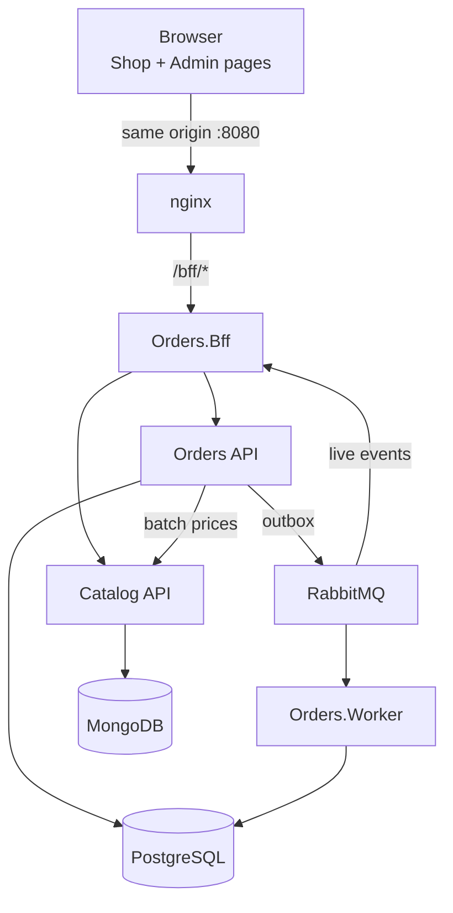

# Orders and Catalog Platform — Presentation

An orders platform in .NET 10 with an orders service (PostgreSQL), a catalog service (MongoDB), a BFF and two pages, Shop and Admin. This short presentation covers the architecture, the decisions, the differentiators and a demo script.

## Architecture

- The browser talks only to the BFF, through nginx, on the same origin; Catalog is never exposed.
- Orders stores orders in PostgreSQL and publishes events through a transactional outbox; the Worker confirms or holds each order by rules; the BFF shows the events live in the Admin.
- Catalog is the price authority; Orders asks for prices in a single batch call.

## Decisions

| Decision | Why | Record |
| --- | --- | --- |
| A BFF in front of everything | The browser sees neither Catalog nor the tokens; one contract per page | [ADR 0001](../adr/0001-bff.md) |
| Wolverine for CQRS, outbox and RabbitMQ | Event published in the same transaction as the order; idempotent consumption, retries and DLQ | [ADR 0002](../adr/0002-wolverine.md) |
| MongoDB as a replica set | Change the price and write the history in a single transaction | [ADR 0003](../adr/0003-mongo-replica-set.md) |
| Several currencies, one per order | One price per SKU per currency; no conversion; money is always `decimal` | [ADR 0004](../adr/0004-multiple-currencies.md) |
| Confirmation by configurable rules | The rule changes without a deploy; held orders wait for a person | [ADR 0005](../adr/0005-confirmation-rules.md) |

## Differentiators

- **End-to-end idempotency:** the same `Idempotency-Key` returns the same order (ten parallel requests create just one), and a once-per-client discount is not spent twice.
- **Rules as data:** discount and confirmation rules are versioned, with preview and history, without a deploy.
- **Operations:** retries, a DLQ with a replay confirmed on screen, custom metrics and [alert thresholds](../operations/alerts.md), a [runbook](../operations/runbook.md), add-only migrations so a rollback is safe.
- **Quality:** architecture tests, parameterized queries (EF1002 is a build error), `EXPLAIN` plans kept in `docs/perf/`, a front end with axe-core and a coverage threshold; see the [evidence table](../quality.md).
- **Governance:** documentation in two languages checked by CI, one step per commit, and the record of AI use in each step in [AI-assisted development](../05-ai-development.md).

## Demo script

1. `cp .env.example .env && docker compose up -d --build --wait`.
2. Open `http://localhost:8080/shop.html`, sign in as `shopper` (password from `.env`), add products to the cart and see the quote.
3. In another tab, open `http://localhost:8080/admin.html` as `admin` and keep the live events table in view.
4. Place the order in the Shop: it shows up in the Admin and ends `Confirmed`, or `OnHold` if it matches the development rule (BRL above 5,000.00); in the Admin, confirm it.
5. Repeat the order with the same key (the smoke test does this): the order number is the same.
6. In the Admin, change a discount rule with the preview, save, and quote again in the Shop.
7. Show "Mensagens mortas" (dead letters) and, with `--profile observability`, the metrics in the Aspire Dashboard (`http://localhost:18888`).
8. `bash scripts/smoke.sh http://localhost:8080` repeats steps 2 to 5 from the command line.
