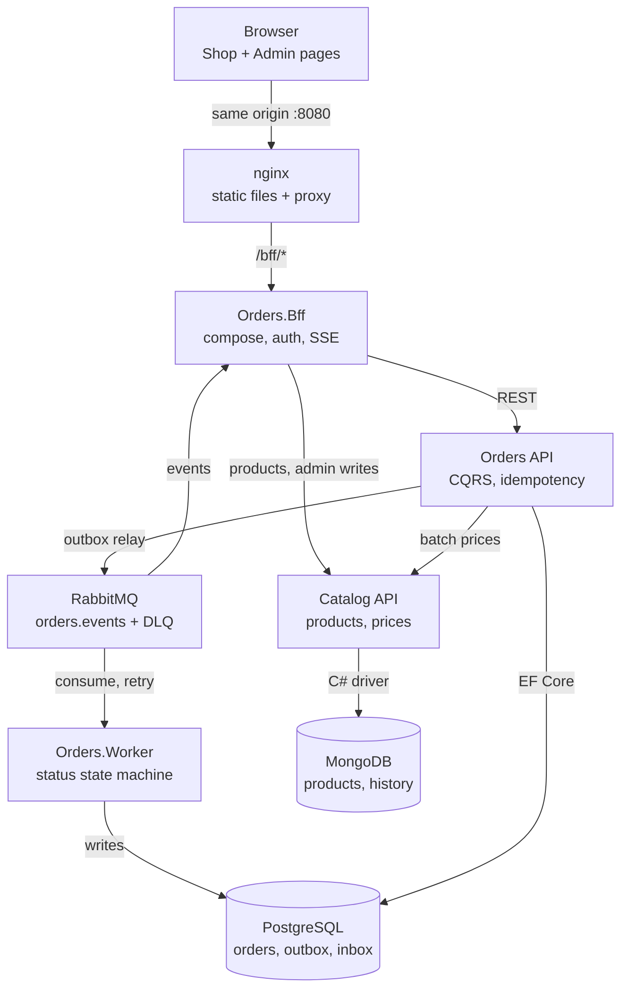

# Plataforma de Pedidos e Catálogo — Plano de implementação

26 de out. de 2026 · Elyton Victor

## Visão geral

Construímos uma plataforma de pedidos em .NET 10 com três partes de back-end: a Orders API (PostgreSQL, CQRS, RabbitMQ), o serviço Catalog (MongoDB) e um BFF que é o único ponto de entrada para o navegador. Duas páginas de front-end ficam por cima: uma página Shop para fluxos de cliente e uma página Admin que gerencia catálogo e descontos e acompanha os eventos de pedidos ao vivo. Tudo roda localmente com Docker Compose e é entregue em 8 fases (veja Plano de implementação em fases).

Decisões confirmadas:

| Tema | Decisão |
| --- | --- |
| "amount" do pedido (AC2) | Significa quantidade. O pedido armazena `itemCount` (soma das quantidades dos itens) e cada item armazena `quantity`. Os campos monetários são `subtotal`, `discountTotal`, `total`. |
| Acesso do front-end | O navegador conversa apenas com o BFF, que pertence ao lado Orders. O navegador nunca chama o Catalog diretamente. |
| BFF | Aceito: um único host de BFF, `Orders.Bff`, com dois grupos de rotas, `/bff/shop` e `/bff/admin`. Justificativa em Arquitetura. |
| Páginas de front-end | Página Shop (navegar, carrinho, checkout, meus pedidos) e página Admin (eventos de pedidos ao vivo, ações sobre pedidos, DLQ, descontos, regras de confirmação, catálogo). |
| Runtime | .NET 10 LTS, C# 14, SDK fixado com `global.json`. |
| Moeda | Multimoeda: cada pedido tem exatamente uma moeda ISO 4217; o Catalog mantém um preço por SKU por moeda; BRL é o padrão; sem conversão. |
| Quem cria pedidos | Compradores autenticados, para si mesmos, e admins em nome de um cliente. Todo pedido armazena `created_by` e `channel` (`shop` ou `admin`). |
| Confirmação de pedidos | Automática no Orders.Worker, por regras de confirmação configuráveis; admins podem confirmar, colocar em espera ou bloquear pedidos pela página Admin. |
| Eventos de pedidos | Consumidos pelo Orders.Worker (máquina de estados de status) e pelo BFF (feed ao vivo para o Admin). |
| Preços | O Catalog é a autoridade de preços. O Orders busca os preços no servidor em uma única chamada em lote e nunca confia em preços vindos do cliente. |
| Retenção | Chaves de idempotência por 24 h; linhas de outbox publicadas por 30 dias. |
| CI/CD | GitHub Actions; todo deploy passa por um gate obrigatório (veja o [Guia de execução](02-execution-guide.md#cicd-com-github-actions)). |
| Auditoria | Armazenada como dado de domínio em cada serviço, não derivada de logs. |

## Arquitetura

As requisições fluem navegador → nginx → BFF → Orders API, e a Orders API chama o Catalog de forma síncrona para obter os preços. Os efeitos colaterais fluem de forma assíncrona: o Orders grava eventos em um outbox, um relay os publica no RabbitMQ, e o Orders.Worker e o BFF os consomem.



Apenas o nginx é exposto no host; o BFF é a única entrada para o navegador, e o RabbitMQ alimenta tanto o Worker quanto a visão ao vivo do Admin.

### Por que um BFF

Um BFF se encaixa neste projeto por quatro motivos:

- **Uma única porta para o navegador.** A página Shop precisa navegar pelos produtos, mas o navegador só pode conversar com o lado Orders. O BFF lê o Catalog em nome dele, de modo que a Orders API continua sendo um serviço de domínio puro, e não um proxy de catálogo.
- **Dois front-ends, formatos diferentes.** O Shop precisa de payloads pequenos, no formato voltado ao cliente. O Admin precisa de agregados (pedido + histórico de status + eventos) e de um feed ao vivo. Os grupos de rotas `/bff/shop` e `/bff/admin` mantêm cada contrato sob medida.
- **Eventos ao vivo.** O BFF assina a exchange `orders.events` e envia os eventos para a página Admin com Server-Sent Events (`TypedResults.ServerSentEvents`, nativo no .NET 10). Nenhum acesso ao broker a partir do navegador.
- **Segurança.** O BFF mantém o cookie de sessão (padrão de segurança BFF). Os tokens nunca chegam ao navegador, e as rotas de admin exigem a role `Admin`.

Regras que mantêm o BFF enxuto: nenhuma lógica de domínio, nenhum banco de dados, nenhum cálculo de preço ou desconto. Ele apenas compõe, mapeia para view models e encaminha. Ele fica no repositório do Orders como um host próprio, `Orders.Bff`, para que seu deploy seja feito separadamente da Orders API. Rotas de passagem (pass-through) usam YARP; rotas compostas usam HttpClients tipados.

### Comunicação

| De → Para | Estilo | Motivo |
| --- | --- | --- |
| Navegador → BFF | REST + SSE na mesma origem (nginx) | Sem CORS, autenticação por cookie |
| BFF → Orders API | REST (client tipado) | Commands e queries |
| BFF → Catalog | REST, somente leitura para o Shop; escritas de admin encaminhadas | O navegador nunca vê o Catalog |
| Orders API → Catalog | REST, uma chamada de preços em lote por pedido | Preços imediatos e atualizados (Req 4, AC11) |
| Orders API → RabbitMQ | Outbox transacional + relay | Nenhum evento perdido, sem dual writes |
| RabbitMQ → Orders.Worker | Quorum queue, níveis de retentativa com TTL, DLQ | Máquina de estados de status, retentativas (Req 2) |
| RabbitMQ → BFF | Fila própria não durável por instância | Feed ao vivo do Admin |

### Stack tecnológica

| Aspecto | Escolha | Observação |
| --- | --- | --- |
| Runtime | .NET 10 LTS, ASP.NET Core Minimal APIs | Com suporte até nov. de 2028 |
| Banco do Orders | PostgreSQL 17, EF Core 10 + Npgsql | Dapper permitido para projeções de leitura |
| Banco do Catalog | MongoDB 8, driver oficial de C# | Replica set de nó único no Docker |
| Mensageria | RabbitMQ 4 | Quorum queues, publisher confirms |
| Biblioteca de CQRS + mensageria | Wolverine (MIT) | Handlers, outbox/inbox no Postgres, transporte RabbitMQ. Alternativa: Mediator com source generator + RabbitMQ.Client 7 |
| Resiliência | Microsoft.Extensions.Http.Resilience | Timeout, retry e circuit breaker nas chamadas ao Catalog |
| Gateway no BFF | YARP | Rotas de passagem |
| Feed ao vivo no BFF | RabbitMQ.Client 7 | Fila exclusiva do BFF em `orders.events`; mesma versão que o transporte do Wolverine usa |
| Autenticação entre serviços | Microsoft.AspNetCore.Authentication.JwtBearer | JWT de 5 min assinado pelo BFF para cada serviço (HMAC-SHA256, chave do `.env`); provisório até o token exchange de um provedor de identidade |
| Documentação da API | Microsoft.AspNetCore.OpenApi + Scalar | OpenAPI 3.1 |
| Validação | FluentValidation 12 (Apache-2.0) | A única forma de validar entradas, em todas as camadas; veja [Regras de design](02-execution-guide.md#regras-de-design-para-todas-as-etapas) |
| Mapeamento de objetos | Mapperly (Riok.Mapperly, MIT, com source generator) | Escolhido em vez do AutoMapper: a 14.x (última MIT) tem o advisory GHSA-rvv3-g6hj-g44x e quebra o build, e a 15+ é comercial |
| Erros | ProblemDetails (RFC 9457) | Mesmo formato em todos os serviços |
| Observabilidade | OpenTelemetry → OTel Collector → Aspire Dashboard | Profile `observability` do Compose |
| Testes de back-end | xUnit v3, NSubstitute, Shouldly, Testcontainers, NetArchTest | Evitar FluentAssertions v8 (licença comercial) |
| Front-end | TypeScript, Vite, Vitest + jsdom, Bootstrap 5.3 + Bootstrap Icons via npm | axe-core para verificações de acessibilidade |

## Estrutura do repositório e das solutions

Um único repositório Git contém duas solutions .NET (`.slnx`) e um pacote de front-end. Os serviços não compartilham código de domínio; o Orders se comunica com o Catalog por meio de um client gerado a partir do documento OpenAPI do Catalog.

```text
/
├─ global.json                     # pins .NET 10 SDK
├─ Directory.Build.props           # nullable, warnings as errors, analyzers (EF1002 = error)
├─ Directory.Packages.props        # central package versions
├─ .gitattributes                  # *.sh text eol=lf
├─ docker-compose.yml  .env.example
├─ deploy/nginx/  deploy/otel/  deploy/mongo/  deploy/rabbitmq/
├─ orders/Orders.slnx
│  ├─ src/Orders.Domain             # aggregates, value objects, discount strategies, no dependencies but FluentValidation
│  ├─ src/Orders.Application        # commands, queries, handlers, ports (ICatalogClient, IClock...)
│  ├─ src/Orders.Infrastructure     # EF Core, migrations, Catalog client, outbox/inbox, RabbitMQ
│  ├─ src/Orders.Api                # Minimal API endpoints, ProblemDetails, auth
│  ├─ src/Orders.Worker             # RabbitMQ consumers, status state machine
│  ├─ src/Orders.Bff                # BFF host: YARP, composition, SSE, cookie auth
│  ├─ src/Orders.ServiceDefaults    # shared OTel, health checks, resilience setup
│  └─ tests/ Domain.UnitTests  Application.UnitTests  Bff.UnitTests  IntegrationTests  ArchitectureTests
├─ catalog/Catalog.slnx
│  ├─ src/Catalog.Domain  Catalog.Application  Catalog.Infrastructure  Catalog.Api
│  └─ tests/ Domain.UnitTests  Application.UnitTests  IntegrationTests  ArchitectureTests
└─ web/
   ├─ src/shared/  (api client, models, idempotency, a11y helpers)
   ├─ src/shop/    (domain + ui)
   ├─ src/admin/   (domain + ui, SSE feed)
   └─ tests/
```

Regra de dependência, garantida pelo NetArchTest em `ArchitectureTests`: o Domain não depende de nada, o Application depende do Domain, e o Infrastructure e os hosts dependem para dentro. A mesma divisão em camadas vale em `web/`: `ui` pode importar `domain` e `api`, nunca o contrário.

## Superfície da API

Todas as APIs são versionadas em `/api/v1`, retornam ProblemDetails em caso de erro e são documentadas com OpenAPI 3.1. Todo POST que cria algo exige um header `Idempotency-Key` (UUID).

### Orders API (interna, chamada pelo BFF)

| Método | Caminho | Finalidade | AC |
| --- | --- | --- | --- |
| POST | `/api/v1/orders` | Cria um pedido; header `Idempotency-Key`; retorna 201 + pedido | AC1, AC3 |
| GET | `/api/v1/orders` | Lista com filtros `clientId`, `status`, `from`, `to`, `q` (busca full-text); paginação keyset `after`, `limit` | AC1 |
| GET | `/api/v1/orders/{id}` | Detalhe do pedido: cliente, itens, itemCount, subtotal, discountTotal, total, status | AC1, AC2 |
| GET | `/api/v1/orders/{id}/history` | Histórico de status (auditoria) | AC1 |
| POST | `/api/v1/admin/orders/{id}/cancel` | Cancelamento pelo admin, se o estado permitir | - |
| GET | `/api/v1/admin/events` | Log de eventos de pedidos, com paginação keyset | Página Admin |
| GET | `/api/v1/admin/dead-letters` | Mensagens retidas na DLQ | Req 2 |
| POST | `/api/v1/admin/dead-letters/{messageId}/replay` | Republica uma mensagem retida | Req 2 |
| GET/POST/PUT | `/api/v1/admin/discount-rules[/{id}]` | Gerencia regras de desconto; o PUT usa `If-Match` | AC5 |
| POST | `/api/v1/admin/discount-rules/preview` | Simula (dry-run) as regras contra um carrinho de exemplo | AC5 |
| POST | /api/v1/admin/orders | O admin cria um pedido em nome de um cliente; mesmo fluxo idempotente, channel = admin | AC1, AC3 |
| POST | /api/v1/admin/orders/{id}/confirm \| /hold \| /block | O admin sobrepõe o fluxo automático; motivo obrigatório para hold e block; If-Match na versão do pedido | Decisão |
| GET/POST/PUT | /api/v1/admin/confirmation-rules\[/{id}\] | Gerencia as regras de confirmação automática (versionadas) | Decisão |

### Catalog API (interna, chamada pela Orders API e pelo BFF)

| Método | Caminho | Finalidade | AC |
| --- | --- | --- | --- |
| GET | `/api/v1/products` | Busca e pagina produtos com os preços atuais (`q`, `category`, `after`, `limit`) | AC9, AC10 |
| GET | `/api/v1/products/{sku}` | Um produto; retorna `ETag` | AC9 |
| POST | `/api/v1/products/prices:query` | Consulta de preços em lote, body `{ currency, skus: [...] }`, no máximo 100 SKUs, uma única query `$in` | AC11 |
| PUT | `/api/v1/admin/products/{sku}` | Cria ou substitui um produto (upsert idempotente); `If-Match` na atualização | Item 9 |
| PATCH | `/api/v1/admin/products/{sku}/price` | Altera o preço; `If-Match`; grava o histórico de preços | Item 9 |
| POST | `/api/v1/admin/products/{sku}/deactivate` | Retira um produto de venda | - |

### BFF (público, a única API que o navegador vê)

| Método | Caminho | Mapeia para |
| --- | --- | --- |
| GET | `/bff/shop/products` | Catalog `GET /products` (view model) |
| POST | `/bff/shop/cart/quote` | Preview do Orders: preços + descontos do carrinho, nada é persistido |
| POST | `/bff/shop/orders` | Orders `POST /orders`, encaminha o `Idempotency-Key` |
| GET | `/bff/shop/orders`, `/bff/shop/orders/{id}` | Queries do Orders, restritas ao cliente autenticado |
| GET | `/bff/admin/events/stream` | Feed SSE ao vivo a partir do RabbitMQ |
| GET | `/bff/admin/orders/{id}` | Composto: pedido + histórico + eventos relacionados |
| \* | `/bff/admin/discount-rules/**`, `/bff/admin/dead-letters/**` | Rotas de admin do Orders (YARP) |
| \* | `/bff/admin/products/**` | Rotas de admin do Catalog (YARP) |
| POST | /bff/admin/orders | Orders POST /admin/orders, encaminha o Idempotency-Key |
| \* | /bff/admin/orders/{id}/(confirm\|hold\|block), /bff/admin/confirmation-rules/\*\* | Rotas de admin do Orders (YARP) |

Observação: `/bff/shop/cart/quote` precisa de um endpoint correspondente no Orders, `POST /api/v1/orders/quote`, que executa o mesmo caminho de código de preços e descontos da criação de pedidos, sem persistir nada.

## Modelo de dados e idempotência

A idempotência é garantida em quatro camadas: o navegador reutiliza uma chave por checkout, a Orders API armazena a chave junto com a resposta, os resgates de desconto têm restrições de unicidade, e os consumers do Worker eliminam duplicatas por meio de um inbox. Valores monetários são `numeric(19,4)` no Postgres, `decimal` em C# e `Decimal128` no Mongo, sempre com um código de moeda ISO 4217. Arredondamento: duas casas decimais, `MidpointRounding.AwayFromZero`, aplicado uma vez por linha e uma vez no total.

| Projeto | Ameaça | Mecanismo | Armazenamento |
| --- | --- | --- | --- |
| Orders API | Envio duplo ou retentativa de `POST /orders` | `Idempotency-Key` com escopo por cliente + hash SHA-256 da requisição | `idempotency_requests` |
| Orders API | Mesmo desconto aplicado duas vezes | Restrições de unicidade; id + versão da regra registrados como snapshot no pedido | `discount_redemptions` |
| Orders API | Eventos perdidos | Outbox na mesma transação do pedido | `outbox_messages` |
| Orders.Worker / BFF | Reentrega do RabbitMQ | Inbox indexado por id da mensagem + consumer | `inbox_messages` (apenas no Worker; o feed do BFF é só para exibição) |
| Catalog | Escritas repetidas de admin | Upsert via `PUT` sobre `sku` único + `If-Match`; armazenamento de chaves para qualquer POST restante | coleção `idempotency_requests` |
| Front-end | Duplo clique, timeout seguido de retentativa | Um `crypto.randomUUID()` por tentativa de checkout, mantido em `sessionStorage` | Navegador |

### Orders (PostgreSQL)

```sql
CREATE TABLE orders (
    id              uuid          PRIMARY KEY,
    number          text          NOT NULL UNIQUE,          -- human-readable, e.g. ORD-2026-000123
    client_id       uuid          NOT NULL,
    client_name     text          NOT NULL,                 -- snapshot
    created_by      text          NOT NULL,                 -- shopper id or admin id
    channel         text          NOT NULL,                 -- shop | admin
    status          text          NOT NULL,                 -- Pending | OnHold | Confirmed | Blocked | Cancelled | Failed
    item_count      int           NOT NULL CHECK (item_count > 0),   -- AC2 "amount" = quantity
    currency        char(3)       NOT NULL,
    subtotal        numeric(19,4) NOT NULL,
    discount_total  numeric(19,4) NOT NULL DEFAULT 0,
    total           numeric(19,4) NOT NULL,
    created_at      timestamptz   NOT NULL,
    updated_at      timestamptz   NOT NULL,
    row_version     int           NOT NULL DEFAULT 0,       -- optimistic concurrency
    search_vector   tsvector GENERATED ALWAYS AS
        (to_tsvector('simple', number || ' ' || client_name)) STORED
);
CREATE INDEX ix_orders_client_created ON orders (client_id, created_at DESC, id);
CREATE INDEX ix_orders_status_created ON orders (status, created_at DESC, id);
CREATE INDEX ix_orders_search ON orders USING GIN (search_vector);
CREATE INDEX ix_orders_client_trgm ON orders USING GIN (client_name gin_trgm_ops);

CREATE TABLE order_items (
    order_id        uuid          NOT NULL REFERENCES orders (id),
    line_no         int           NOT NULL,
    sku             text          NOT NULL,
    product_name    text          NOT NULL,                 -- snapshot
    unit_price      numeric(19,4) NOT NULL,                 -- snapshot from Catalog
    catalog_version int           NOT NULL,
    quantity        int           NOT NULL CHECK (quantity > 0),
    line_discount   numeric(19,4) NOT NULL DEFAULT 0,
    line_total      numeric(19,4) NOT NULL,
    PRIMARY KEY (order_id, line_no)
);

CREATE TABLE order_status_history (                       -- audit
    order_id    uuid        NOT NULL REFERENCES orders (id),
    seq         int         NOT NULL,
    from_status text,
    to_status   text        NOT NULL,
    reason      text,
    actor       text        NOT NULL,                     -- user id or 'system:worker'
    trace_id    text,
    changed_at  timestamptz NOT NULL,
    PRIMARY KEY (order_id, seq)
);

CREATE TABLE discount_rules (
    id              uuid        NOT NULL,
    version         int         NOT NULL,
    name            text        NOT NULL,
    type            text        NOT NULL,                 -- Percentage | FixedAmount | BuyXGetY | Tiered
    parameters      jsonb       NOT NULL,                 -- validated per type
    conditions      jsonb       NOT NULL DEFAULT '[]',    -- min subtotal, SKUs, categories, client segment
    priority        int         NOT NULL,
    stackable       boolean     NOT NULL DEFAULT false,
    once_per_client boolean     NOT NULL DEFAULT false,
    valid_from      timestamptz NOT NULL,
    valid_to        timestamptz,
    is_active       boolean     NOT NULL DEFAULT true,
    created_by      text        NOT NULL,
    created_at      timestamptz NOT NULL,
    PRIMARY KEY (id, version)                             -- each edit = new version, history kept
);

CREATE TABLE order_discounts (
    order_id         uuid          NOT NULL REFERENCES orders (id),
    discount_rule_id uuid          NOT NULL,
    rule_version     int           NOT NULL,
    amount           numeric(19,4) NOT NULL,
    PRIMARY KEY (order_id, discount_rule_id),
    FOREIGN KEY (discount_rule_id, rule_version) REFERENCES discount_rules (id, version)
);

CREATE TABLE idempotency_requests (
    client_id       uuid        NOT NULL,
    idempotency_key uuid        NOT NULL,
    request_hash    bytea       NOT NULL,
    response_status smallint    NOT NULL,
    response_body   jsonb       NOT NULL,
    order_id        uuid        NOT NULL,
    created_at      timestamptz NOT NULL DEFAULT now(),
    expires_at      timestamptz NOT NULL,                 -- created_at + 24 h
    PRIMARY KEY (client_id, idempotency_key)
);
CREATE INDEX ix_idempotency_expires ON idempotency_requests (expires_at);

CREATE TABLE discount_redemptions (
    discount_rule_id uuid        NOT NULL,
    client_id        uuid        NOT NULL,
    order_id         uuid        NOT NULL REFERENCES orders (id),
    once_per_client  boolean     NOT NULL,
    redeemed_at      timestamptz NOT NULL DEFAULT now(),
    PRIMARY KEY (discount_rule_id, order_id)
);
CREATE UNIQUE INDEX ux_redemption_once_per_client
    ON discount_redemptions (discount_rule_id, client_id) WHERE once_per_client;

CREATE TABLE outbox_messages (
    id           uuid        PRIMARY KEY,
    type         text        NOT NULL,                    -- OrderPlaced.v1, OrderStatusChanged.v1
    payload      jsonb       NOT NULL,
    trace_parent text,
    occurred_at  timestamptz NOT NULL,
    published_at timestamptz,
    attempts     int         NOT NULL DEFAULT 0
);
CREATE INDEX ix_outbox_pending ON outbox_messages (occurred_at) WHERE published_at IS NULL;

CREATE TABLE inbox_messages (
    message_id   uuid        NOT NULL,
    consumer     text        NOT NULL,
    processed_at timestamptz NOT NULL DEFAULT now(),
    PRIMARY KEY (message_id, consumer)
);
```

Como o Wolverine foi adotado, ele cria e gerencia suas próprias tabelas de outbox e inbox (schema `wolverine`); `outbox_messages` e `inbox_messages` acima documentam apenas o formato e não fazem parte das nossas migrations. O log de eventos do Admin (`GET /admin/events`) lê de uma tabela append-only, `order_event_log`, gravada na mesma transação de cada mudança de status e mantida por 30 dias.

### Catalog (MongoDB)

```js
// products: { _id, sku, name, description, category, attributes: {}, prices: [{ currency, amount: Decimal128 }],
//             isActive, version, updatedAt, updatedBy }
db.products.createIndex({ sku: 1 }, { unique: true });
db.products.createIndex({ category: 1, name: 1 });
db.products.createIndex({ name: "text", description: "text" });

// price_history (audit): { sku, oldPrice, newPrice, currency, version, changedBy, changedAt, traceId }
db.price_history.createIndex({ sku: 1, changedAt: -1 });

// idempotency_requests: { scope, key, requestHash, responseStatus, responseBody, resourceId, createdAt, expiresAt }
db.idempotency_requests.createIndex({ scope: 1, key: 1 }, { unique: true });
db.idempotency_requests.createIndex({ expiresAt: 1 }, { expireAfterSeconds: 0 });
```

Alteração de preço = uma transação (replica set) que atualiza `products` com um filtro em `{ sku, version }` e insere em `price_history`. Uma divergência de versão retorna 412 Precondition Failed.

### Chave de idempotência no front-end

1. Uma chave é gerada com `crypto.randomUUID()` quando o usuário abre o checkout e é salva em `sessionStorage` sob o id do carrinho.
2. Todo envio e toda retentativa após um timeout ou erro de rede enviam a mesma chave.
3. O botão de envio fica desabilitado enquanto há uma requisição em andamento.
4. Em caso de 201, a chave é apagada. Se o carrinho mudar, uma nova chave é gerada.
5. Em caso de 409 ou 422, a página mostra o erro e mantém a chave até o usuário alterar o carrinho.

### Fluxo de criação de pedido (Orders API)

1. **Caminho rápido.** Buscar `(client_id, key)`. Mesmo hash → fazer o replay da resposta armazenada. Hash diferente → 422.
2. **Preços.** Uma chamada a `POST /products/prices:query` com todos os SKUs. SKU ausente ou inativo → 422 listando-os.
3. **Descontos.** Carregar as regras ativas (em cache), avaliá-las no domínio e produzir as regras aplicadas com suas versões.
4. **Transação.** `INSERT idempotency_requests ... ON CONFLICT DO NOTHING`. Uma duplicata concorrente fica bloqueada na primary key até que a primeira faça commit; em seguida, vê o conflito e faz o replay.
5. **Mesma transação.** Inserir o pedido, os itens, `order_discounts`, `discount_redemptions`, a primeira linha do histórico de status e a linha de outbox `OrderPlaced.v1`; depois, fazer commit.
6. **Violação de unicidade no resgate** → rollback, retornar 409 "discount already used".

Nenhuma chamada HTTP acontece enquanto houver uma transação de banco de dados aberta.

## Motor de regras de desconto

Descontos são dados, não código: os admins criam e versionam regras pela API, e o código contém um conjunto fixo de tipos de regra. Isso atende ao AC5 sem um motor de scripts.

- **Tipos de regra (Strategy).** Uma `IDiscountStrategy` por `type`: `Percentage`, `FixedAmount`, `BuyXGetY`, `Tiered`. Cada uma valida o próprio JSON de `parameters` ao salvar e calcula descontos por linha ou por pedido.
- **Condições (Specification).** `MinSubtotal`, `SkuIn`, `CategoryIn`, `MinQuantity`, `ClientSegment`, `DateWindow`. Combinadas com AND. Tipos de condição desconhecidos falham na validação ao salvar.
- **Fluxo.** Ordenação configurável pelo admin por meio de `priority` (o menor executa primeiro) e `stackable`. O motor aplica a melhor regra não cumulativa e, em seguida, todas as regras cumulativas em ordem de prioridade. Um teto (`maxDiscountPercent`, configuração, padrão de 50%) impede o acúmulo descontrolado.
- **Determinismo.** O motor é um serviço de domínio puro: entrada = linhas do carrinho com preços do catálogo, informações do cliente, conjunto de regras ativas e o horário vindo do `TimeProvider`. Saída = regras aplicadas com versões e valores. Mesma entrada, mesma saída.
- **Versionamento.** Toda edição insere uma nova linha `(id, version)`; os pedidos referenciam a versão que usaram, de modo que o histórico continua explicável e um replay nunca recalcula nada.
- **Cache.** As regras ativas ficam em cache com `HybridCache` por 60 s; qualquer escrita de admin invalida a chave de cache imediatamente.
- **Preview.** `POST /admin/discount-rules/preview` e `/orders/quote` reutilizam exatamente o mesmo caminho do motor usado na criação de pedidos.

Exemplo de `parameters` e `conditions`:

```json
{
  "type": "Percentage",
  "parameters": { "percent": 10, "appliesTo": "order" },
  "conditions": [ { "kind": "MinSubtotal", "amount": 200.00, "currency": "BRL" } ],
  "priority": 10, "stackable": false, "oncePerClient": true
}
```

### Regras de confirmação de pedidos

A confirmação segue o mesmo modelo orientado a dados dos descontos. O Orders.Worker avalia as regras ativas em `OrderPlaced`: se alguma regra `Hold` corresponder, o pedido vai para OnHold e aguarda um admin; caso contrário, fica Confirmed. Os admins podem confirmar, colocar em espera ou bloquear a qualquer momento enquanto o pedido estiver Pending ou OnHold.

```sql
CREATE TABLE confirmation_rules (
    id          uuid        NOT NULL,
    version     int         NOT NULL,
    name        text        NOT NULL,
    action      text        NOT NULL CHECK (action IN ('Hold')),
    conditions  jsonb       NOT NULL,          -- e.g. TotalAbove {amount, currency}, FirstOrderOfClient, ChannelIs
    priority    int         NOT NULL,
    is_active   boolean     NOT NULL DEFAULT true,
    created_by  text        NOT NULL,
    created_at  timestamptz NOT NULL,
    PRIMARY KEY (id, version)
);
```

As condições reutilizam as classes Specification do motor de descontos. As ações de admin gravam em `order_status_history` com o admin como ator e publicam `OrderStatusChanged.v1`.

## Front-end

Duas páginas, `shop.html` e `admin.html`, construídas com Vite a partir de HTML e TypeScript puros e estilizadas com Bootstrap 5.3 e Bootstrap Icons via npm. Ambas rodam em `http://localhost:8080` atrás do nginx e chamam apenas `/bff/*`. A página de admin é uma entrada separada, então seu código nunca é entregue aos usuários do shop.

### Página Shop (fluxos de cliente)

| Tela / estado | O que faz | Chamada ao BFF |
| --- | --- | --- |
| Catálogo | Busca, filtro por categoria, cards de produto paginados com o preço atual | `GET /bff/shop/products` |
| Carrinho | Adicionar, remover, alterar quantidade; cotação ao vivo com subtotal, descontos e total | `POST /bff/shop/cart/quote` |
| Checkout | Confirmar e fazer o pedido com a chave de idempotência armazenada; botão desabilitado durante o envio | `POST /bff/shop/orders` |
| Meus pedidos | Lista com badges de status, "carregar mais" com keyset | `GET /bff/shop/orders` |
| Detalhe do pedido | Itens, itemCount, subtotal, desconto, total, linha do tempo de status | `GET /bff/shop/orders/{id}` |

O estado do carrinho fica no cliente (em memória + `sessionStorage`). Os preços exibidos são sempre os da última cotação; o servidor recalcula na criação do pedido.

### Página Admin (eventos e gestão de pedidos)

| Tela / estado | O que faz | Chamada ao BFF |
| --- | --- | --- |
| Eventos ao vivo | Tabela em streaming de `OrderPlaced`, `OrderStatusChanged`, `OrderFailed`; filtro por tipo e status; pausar/retomar; reconecta com `Last-Event-ID` | `GET /bff/admin/events/stream` (SSE) + `GET /bff/admin/events` para backfill |
| Inspetor de pedidos | Um pedido com o histórico de status e seus eventos; ação de cancelar | `GET /bff/admin/orders/{id}` |
| Dead letters | Mensagens retidas com o erro e o número de tentativas; replay de uma delas | `/bff/admin/dead-letters/**` |
| Regras de desconto | Listar, criar, editar (nova versão), desativar, pré-visualizar contra um carrinho de exemplo | `/bff/admin/discount-rules/**` |
| Catálogo | Editar produto e preço com confirmação imediata; o 412 mostra "changed by someone else, reload" | `/bff/admin/products/**` |
| Ações sobre pedidos | Criar um pedido para um cliente; fila de OnHold (mais antigos primeiro); confirmar, colocar em espera ou bloquear com um motivo | /bff/admin/orders/\*\* |
| Regras de confirmação | Listar e editar regras de confirmação automática (limites por moeda, condições) | /bff/admin/confirmation-rules/\*\* |

### Organização do código e acessibilidade

- `shared/api`: client fetch tipado, parsing de ProblemDetails, retentativa com a mesma chave de idempotência, wrapper de SSE. `shared/domain`: cálculos do carrinho para exibição, mapeamento de status, formatação com `Intl.NumberFormat`. `shop/ui`, `admin/ui`: apenas renderização do DOM.
- Acessibilidade: landmarks semânticos, controles de formulário com rótulo, foco visível, fluxos operáveis apenas pelo teclado, `aria-live="polite"` para status e novos eventos, cores do Bootstrap com contraste seguro, respeito a `prefers-reduced-motion`. O axe-core roda na suíte do Vitest em cada tela renderizada.

## Observabilidade, auditoria e segurança

Todo serviço exporta traces, métricas e logs via OpenTelemetry; a auditoria fica no banco de dados de cada serviço; as rotas de admin exigem autenticação e a role `Admin`.

**Observabilidade**

- O projeto `ServiceDefaults` configura o OTel para ASP.NET Core, HttpClient, EF Core/Npgsql, driver do MongoDB e RabbitMQ, exportando OTLP para o Collector. Visualização local: container do Aspire Dashboard (`docker compose --profile observability up`).
- O contexto de trace atravessa o HTTP automaticamente e o RabbitMQ por meio do header `traceparent` armazenado nas linhas de outbox.
- Logs: `ILogger` com `LoggerMessage` via source generator, saída JSON no console, trace id em toda entrada. Nada de dados pessoais ou corpos completos de requisição nos logs.
- Métricas customizadas: `orders.created`, `orders.duplicate_replayed`, `discount.applied`, `catalog.price_lookup.duration`, `rabbitmq.dlq.depth`.
- Health: `/health/live` e `/health/ready` (DB, broker, Catalog acessível), usados pelos healthchecks do compose.

**Auditoria**

- Orders: `order_status_history` (ator, motivo, trace id), `discount_rules` versionadas com `created_by`.
- Catalog: `price_history` e `updatedBy` nos produtos.
- As linhas de auditoria são gravadas na mesma transação da alteração que descrevem.

**Segurança**

- BFF: sessão por cookie (HttpOnly, Secure, SameSite=Strict) + header antiforgery em métodos não seguros. Para desenvolvimento local, um identity provider de desenvolvimento com seed (container Keycloak) emite os usuários `shopper` e `admin`; as credenciais ficam em `.env.example`, nunca no código.
- BFF → serviços: o token do usuário é trocado por um JWT downstream (token exchange do Keycloak), de modo que a identidade do usuário chega a cada serviço; Orders e Catalog validam issuer, audience e role. Os serviços não são publicados em portas do host, exceto por meio do nginx.
- **Implementação atual (provisória):** sem Keycloak por enquanto. O BFF serve um login de desenvolvimento (`/bff/login`) com os usuários `shopper` e `admin`, senhas vindas do `.env`, ligado só no compose de desenvolvimento; a sessão por cookie e o header `X-CSRF` são os descritos acima. No lugar do token exchange, o BFF assina para cada serviço um JWT de 5 minutos com o `sub`, o nome e as roles do usuário (HMAC-SHA256, chave `SERVICE_TOKEN_SIGNING_KEY` do `.env`), e Orders e Catalog validam issuer, audience, validade e roles. A melhoria prevista é o Keycloak com o realm em arquivos de realm, OpenID Connect (code flow + PKCE) no BFF e o token exchange do Keycloak no lugar do JWT assinado pelo BFF.
- Validação de entrada com FluentValidation: um validator por command e por query, executado pelo respectivo handler antes de qualquer I/O; limites de tamanho de página (100) e de tamanho de lote (100 SKUs).
- Queries: apenas EF Core LINQ ou interpolação com `FromSql` (parametrizadas); `FromSqlRaw` com concatenação é proibido e EF1002 é erro de build (AC6). O Mongo usa apenas filtros tipados `Builders<T>`.

## Testes e CI/CD

Os testes unitários carregam o peso: pelo menos um teste por caminho de código, garantido por um gate de cobertura de branches; os testes de integração continuam poucos e focados no comportamento de banco de dados, broker e idempotência.

| Camada | Ferramenta | Escopo | Gate |
| --- | --- | --- | --- |
| Domain (unitário) | xUnit v3, Shouldly | Agregado Order, máquina de estados, valores monetários, cada estratégia e condição de desconto | Cobertura de branches ≥ 90% |
| Application (unitário) | xUnit v3, NSubstitute | Cada caminho de handler de command/query: sucesso, validação, SKU ausente, replay, divergência de hash, conflito de resgate | Cobertura de branches ≥ 85% |
| BFF (unitário) | xUnit v3, NSubstitute | Composição, mapeamento, políticas de autorização, serialização SSE | Cobertura de branches ≥ 80% |
| Arquitetura | NetArchTest | Regra de dependência, nenhum tipo de Infrastructure em Domain/Application | Deve passar |
| Integração | Testcontainers (Postgres, Mongo, RabbitMQ), WebApplicationFactory | Criação de pedido de ponta a ponta, 10 requisições idênticas concorrentes → 1 pedido + 1 resgate, consulta de preços em lote, retentativa → DLQ após N tentativas, concorrência otimista no Mongo | Deve passar |
| Front-end (unitário) | Vitest, jsdom, axe-core | client de API (retentativa mantém a chave), cálculos do carrinho, ciclo de vida da chave de idempotência, reconexão SSE, cada tela renderiza e não tem violações do axe | Cobertura de branches ≥ 80% |
| Smoke | docker compose + script | A stack sobe saudável, o shop faz um pedido, o feed do admin o recebe | Deve passar na main |

Mantendo os testes enxutos: um comportamento por teste, builders para dados de teste, nada de testar código do framework, nada de mocks de tipos nossos no Domain. O Stryker.NET roda semanalmente no Domain para mostrar que os testes detectam mudanças reais.

**Pipeline de Git e CI** (GitHub Actions ou equivalente)

1. Trunk-based: uma etapa do Guia de execução por branch curta e PR para a `main`, Conventional Commits, squash merge, review obrigatório.
2. `ci.yml` em todo PR: format, build com warnings como erros, testes unitários + de arquitetura com gates de cobertura, testes de integração com Testcontainers, lint + Vitest do front-end, scans de dependências e de segredos, verificação de que as duas árvores de documentação estão em sincronia (`scripts/check-docs.mjs`) e, por fim, o job obrigatório `gate`.
3. `cd.yml` depois que o `ci` passa na `main`: build das imagens uma única vez, atestação de proveniência, scan com Trivy, aprovação no `deploy-gate`, deploy em staging, smoke test, rollback em caso de falha.
4. Tag de release `v*.*.*`: promover as mesmas imagens, passar pelo `deploy-gate` mais a aprovação de produção, fazer deploy em produção, smoke test.
5. Banco de dados: bundle de migrations do EF Core executado pelo serviço `orders-migrator` antes de o `orders-api` iniciar; as migrations continuam retrocompatíveis (expand, depois contract).

**Serviços do Docker Compose:** `nginx` (web + proxy reverso, :8080), `orders-bff`, `orders-api`, `orders-worker`, `orders-migrator`, `catalog-api`, `postgres`, `mongo` (replica set `rs0` + script de init), `rabbitmq` (UI de gerenciamento, arquivo de definitions para exchanges, filas, DLX), `keycloak` (dev) e, no profile `observability`: `otel-collector`, `aspire-dashboard`. Todos com healthchecks e `depends_on: condition: service_healthy`; dados em volumes nomeados; dados de seed para produtos e duas regras de desconto.

## Plano de implementação em fases

Oito fases, cada uma terminando com a `main` mergeada e verde e um resultado demonstrável. As fases 1 e 2 podem rodar em paralelo assim que a Fase 0 for entregue, porque o Orders é codificado primeiro contra um stub do contrato do Catalog.

Etapas commit a commit e a configuração do GitHub Actions: [Guia de execução](02-execution-guide.md). Regras de review: [Guia de code review](03-code-review-guide.md). Esforço, equipe e dimensionamento: [Dimensionamento técnico](04-tech-dimensioning.md). Ferramenta e processo de IA: [Desenvolvimento assistido por IA](05-ai-development.md).

### Fase 0 — Fundações

- [ ] Criar o repositório, `.gitignore`, `.gitattributes` (`*.sh text eol=lf`), `global.json`, `Directory.Build.props`, `Directory.Packages.props`
- [ ] Criar o scaffold de `Orders.slnx` e `Catalog.slnx` com projetos em Clean Architecture e projetos de teste vazios
- [ ] `ServiceDefaults`: OTel, health checks, ProblemDetails, padrões de resiliência
- [ ] Infraestrutura no Compose: postgres, mongo (init do replica set), rabbitmq (arquivo de definitions), nginx, profile otel
- [ ] Pipeline de CI: build, verificação de formatação, testes unitários, gates de cobertura, placeholder do job de front-end
- [ ] Testes de arquitetura para a regra de dependência

Pronto quando: `docker compose up` sobe a infraestrutura saudável e o CI fica verde com uma solution vazia.

### Fase 1 — Serviço Catalog

- [ ] Agregado Product com preço em `Decimal128`, moeda e versão
- [ ] Repositório Mongo com filtros tipados e índices criados na inicialização
- [ ] `GET /products`, `GET /products/{sku}` com `ETag`
- [ ] `POST /products/prices:query` (uma única query `$in`, projeção, no máximo 100 SKUs)
- [ ] Admin `PUT /admin/products/{sku}`, `PATCH .../price` com `If-Match` + `price_history` em uma única transação
- [ ] Dados de seed, documento OpenAPI publicado como artefato de build
- [ ] Testes unitários por caminho + testes de integração (Testcontainers Mongo): query em lote, 412 em versão desatualizada

Pronto quando: o Catalog roda no compose, o OpenAPI é publicado e uma edição de preço retorna o novo recurso imediatamente.

### Fase 2 — Núcleo do Orders

- [ ] Domain: agregado `Order`, `OrderItem`, `Money`, máquina de estados de status, `itemCount`
- [ ] Mapeamentos do EF Core + primeira migration (pedidos, itens, histórico, idempotência, outbox, inbox)
- [ ] Client do Catalog gerado a partir do OpenAPI + handler de resiliência
- [ ] Command `CreateOrder` com o fluxo idempotente de seis passos
- [ ] `GET /orders` (filtros, `q` full-text, paginação keyset), `GET /orders/{id}`, `/history`, `POST /orders/quote`
- [ ] Testes unitários para cada caminho de handler; teste de integração com 10 requisições idênticas concorrentes

Pronto quando: um pedido pode ser criado, listado e consultado; duplicatas fazem o replay da resposta armazenada.

### Fase 3 — Motor de descontos e regras de admin

- [ ] Estratégias: Percentage, FixedAmount, BuyXGetY, Tiered; specifications de condição
- [ ] Motor com prioridade, stackable e teto; `TimeProvider` injetado
- [ ] Migrations de `discount_rules` versionadas, `order_discounts` e `discount_redemptions`
- [ ] Endpoints de admin + preview; `HybridCache` com invalidação na escrita
- [ ] Testes: cada estratégia e condição, ordem de acúmulo, teto, conflito de once-per-client → 409

Pronto quando: um admin altera uma regra e a próxima cotação a reflete sem deploy.

### Fase 4 — Mensageria, retentativas e DLQ

- [ ] Relay do outbox publicando `OrderPlaced.v1`, `OrderStatusChanged.v1`, `OrderFailed.v1` com publisher confirms
- [ ] Topologia de exchanges/filas: topic exchange `orders.events`, quorum queue por consumer, níveis de retentativa de 5 s / 30 s / 5 min, fila de retenção `orders.dlq`
- [ ] `Orders.Worker`: deduplicação via inbox, transições de status Pending → Confirmed / Failed, linhas de histórico
- [ ] Admin `GET /admin/dead-letters` e replay; `GET /admin/events`
- [ ] Testes de integração: reentrega processada uma única vez; poison message cai na DLQ após o último nível; o replay funciona

Pronto quando: derrubar o worker no meio do fluxo não perde nada e não processa nada duas vezes.

### Fase 5 — BFF e autenticação

- [ ] Host `Orders.Bff` com rotas YARP e endpoints compostos
- [ ] Realm de dev do Keycloak com `shopper` e `admin`; sessão por cookie + antiforgery
- [ ] Token exchange para JWTs downstream para Orders e Catalog; políticas de role nas rotas de admin
- [ ] Assinatura no RabbitMQ + endpoint SSE `/bff/admin/events/stream` com backfill via `Last-Event-ID`
- [ ] Testes unitários para mapeamento, composição e políticas; teste de integração para SSE

Pronto quando: as rotas de shop e de admin funcionam de ponta a ponta pelo nginx com as roles corretas.

### Fase 6 — Front-end

- [ ] Setup multipágina do Vite, Bootstrap 5.3 + Icons via npm, client de API compartilhado
- [ ] Shop: catálogo, carrinho + cotação, checkout com chave de idempotência, meus pedidos, detalhe do pedido
- [ ] Admin: eventos ao vivo, inspetor de pedidos, dead letters, regras de desconto, editor de catálogo
- [ ] Testes com Vitest + jsdom + axe para cada tela e cada caminho do lado do cliente
- [ ] Configuração do nginx servindo `dist/` e fazendo proxy de `/bff`

Pronto quando: um comprador faz um pedido em `localhost:8080` e o admin o vê chegar ao vivo.

### Fase 7 — Hardening

- [ ] Smoke test do Compose no CI na `main`
- [ ] Dashboards para as métricas customizadas; limite de alerta de profundidade da DLQ documentado
- [ ] Revisão de queries: `EXPLAIN ANALYZE` nas queries de listagem e de busca; confirmar uma chamada ao Catalog por pedido
- [ ] Baseline do Stryker.NET no Domain
- [ ] README: execução, testes, diagrama de arquitetura, ADRs para BFF, Wolverine e replica set do Mongo

Pronto quando: todo critério de aceite da tabela abaixo tem um teste passando ou uma verificação documentada.

## Rastreabilidade, riscos e questões em aberto

Todo requisito e critério de aceite é mapeado para uma fase e um teste de verificação.

| Item | Coberto por | Fase | Verificado por |
| --- | --- | --- | --- |
| Req 1 Banco relacional para o Orders | PostgreSQL + EF Core | 0, 2 | Testes de integração |
| Req 2 Retentativas + DLQ no RabbitMQ, tabelas de idempotência | Níveis de retentativa, `orders.dlq`, tabelas de idempotência/inbox/resgate | 2, 4 | Testes de integração de reentrega e DLQ |
| Req 3 Catalog é dono dos produtos e preços | Serviço Catalog, autoridade de preços | 1 | Testes unitários do Catalog |
| Req 4 Orders consome o Catalog diretamente | Client REST gerado | 2 | Teste de integração de criação de pedido |
| Req 5 Clean Code + Clean Architecture | Projetos em camadas, camadas em `web/` | 0 | NetArchTest, lint |
| AC1 Criar, listar e consultar pedidos | Endpoints do Orders | 2 | Testes de handler + endpoint |
| AC2 Campos do pedido (amount = quantidade) | `item_count`, campos monetários, status | 2 | Testes do Domain |
| AC3 Idempotência para pedidos e descontos | Fluxo de seis passos, restrições de unicidade | 2, 3 | Teste de integração de concorrência, testes de conflito |
| AC4 Suíte unitária enxuta, um teste por caminho | Gates de cobertura, Stryker | todas | Gates de CI |
| AC5 Descontos configuráveis | Regras versionadas, API de admin | 3 | Testes de estratégia e do motor |
| AC6 Queries parametrizadas | EF Core LINQ/`FromSql`, EF1002 como erro | 2 | O build falha em caso de violação |
| AC7 Testes para pedidos, catálogo e front-end | xUnit, Vitest | 1, 2, 6 | CI |
| AC8 Git | Trunk-based, PRs, Conventional Commits | 0 | Proteção de branch |
| AC9 Consultas de produtos com preços atuais | `GET /products` | 1 | Testes do Catalog |
| AC10 API REST do Catalog para o Orders | Catalog API + OpenAPI | 1 | Contrato via client gerado |
| AC11 Verificações de preço eficientes | Uma chamada `$in` em lote por pedido | 1, 2 | Teste verifica uma única chamada; revisão com `EXPLAIN` |
| AC12 Front-end moderno e acessível em localhost | Shop + Admin via BFF na :8080 | 6 | Vitest + axe, smoke test |

### Riscos

| Risco | Impacto | Mitigação |
| --- | --- | --- |
| Catalog fora do ar bloqueia a criação de pedidos | Nenhum pedido novo | Circuit breaker, ProblemDetails 503 claro, health exibido na página Admin |
| Preços mudam entre a cotação e o pedido | O cliente vê um total diferente | O pedido usa o preço do servidor; se o total diferir da última cotação, retorna 409 com a nova cotação |
| O Wolverine não atende a alguma necessidade | Retrabalho da camada de mensageria | Manter os handlers atrás de ports da Application; a alternativa é Mediator + RabbitMQ.Client 7 |
| Mongo sem replica set em algum ambiente | Sem transações para o histórico de preços | Script de init no Compose; a verificação na inicialização falha rápido |
| O BFF acumula lógica de domínio | Regras duplicadas | Teste de arquitetura: o BFF referencia apenas contratos; checklist de review |
| A suíte de testes incha | CI lento, testes frágeis | Um comportamento por teste, builders, mutation testing em vez de contagens brutas |

### Decisões (antigas questões em aberto)

- **Moeda:** multimoeda, uma moeda por pedido, preço por SKU por moeda, BRL como padrão.
- **Quem cria pedidos:** compradores, para si mesmos, e admins, em nome de um cliente.
- **Confirmação:** automática por regra no Orders.Worker; os admins confirmam, colocam em espera ou bloqueiam pela página Admin.
- **Retenção:** chaves de idempotência por 24 h, linhas de outbox publicadas por 30 dias.
- **Plataforma de CI:** GitHub Actions, com um gate obrigatório antes de todo deploy.
