# Guia de execução

58 commits em 8 fases, cada um pequeno, testável e verde no CI antes de o próximo começar. Entregue uma etapa por vez ao Sonnet 5.5 com o prompt abaixo; uma pessoa revisa e faz o merge de cada PR.

## Como usar este guia

Execute uma etapa por sessão de agente: cole o prompt, substitua `{STEP}` e deixe o Sonnet 5.5 entregar uma branch, um único commit e um PR. A próxima etapa só começa depois que o PR anterior tiver sido mergeado e a `main` estiver verde. Os blocos de código deste guia, o prompt do agente inclusive, são idênticos nas duas árvores de documentação e ficam em inglês; apenas o texto ao redor é traduzido.

### Prompt do agente (copie para cada etapa)

```text
You are implementing step {STEP} of the Orders & Catalog Platform.

Read before coding (docs/pt-br/ is the source of truth; docs/en-us/ is its English mirror with the same file names):
- docs/pt-br/01-implementation-plan.md: Architecture, API surface, Data model and idempotency, Discount rules engine, Front-end.
- docs/pt-br/02-execution-guide.md: the rules below (including "Design rules for every step") and step {STEP}.
- docs/pt-br/03-code-review-guide.md: acceptance criteria and blockers.

Do exactly this:
1. git switch main && git pull, then git switch -c step/{STEP}-<short-slug>.
2. Implement only what step {STEP} lists. No extra features, no refactors outside its scope.
3. Write the tests listed in the step first, see them fail, then implement until they pass.
4. Run the step's Verify commands plus: dotnet build -warnaserror, dotnet test, and npm test when web/ changed.
5. Create ONE commit with the step's commit message as the subject and a body listing what changed and how to verify.
6. Push and open a PR with the repository PR template filled in, including the "AI session" field.
7. In the same commit, add a row for step {STEP} to the "Implementation sessions" table in docs/pt-br/05-ai-development.md
   and the same row, in English, in docs/en-us/05-ai-development.md (model, PR placeholder, notes on decisions you
   asked about); the human adds the session link before merging.
8. Every documentation change is written in docs/pt-br/ first and mirrored in docs/en-us/ in the same commit.

Stop and ask instead of guessing when: the step contradicts the plan, a test can only pass by changing an earlier step,
a package outside the tech stack table seems needed, or a decision is not written in the docs.
```

### Regras para todas as etapas

- Uma etapa = um commit = um PR, com squash-merge. Os assuntos de commit seguem Conventional Commits (`feat`, `fix`, `test`, `chore`, `ci`, `docs`, `refactor`).
- A `main` continua pronta para deploy após cada merge: `docker compose up` funciona e todos os pipelines estão verdes.
- Nunca desabilite analisadores, pule ou apague testes, adicione `[Skip]` ou reduza um limite de cobertura para ficar verde.
- C#: namespaces com escopo de arquivo, classes `sealed` por padrão, records para DTOs e value objects, `TimeProvider` em vez de `DateTime.Now`, `CancellationToken` em toda fronteira assíncrona, nada de `async void`.
- TypeScript: `strict: true`, nada de `any`, módulos ES, sem framework.
- Nenhum segredo no código ou nos arquivos do compose; novas configurações vão para `.env.example` e `appsettings.json` com valores padrão seguros.
- Todo novo endpoint aparece no OpenAPI e tem validação de requisição e erros em ProblemDetails.
- A documentação fica em duas árvores com os mesmos nomes de arquivo: `docs/pt-br/` (português do Brasil, a fonte da verdade) e `docs/en-us/` (espelho em inglês). Altere primeiro o pt-BR e espelhe o en-US no mesmo commit; quando os dois divergirem, o pt-BR prevalece e o en-US é corrigido. Artefatos independentes de idioma (planos de consulta, imagens) ficam fora das duas árvores, por exemplo em `docs/perf/`.

### Regras de design para todas as etapas

Estas regras valem para todo agente de implementação e toda pessoa que contribui, nas duas solutions. Uma etapa que não
consegue seguir uma delas para e pergunta em vez de contorná-la.

- **Commands e queries são `public sealed record`s** (`*Command`, `*Query`) no projeto Application. Um
  teste de arquitetura falha para um command ou query que seja uma classe, não público ou não selado, ou que não tenha validator.
- **FluentValidation é o único mecanismo de validação.** Nada de guardas escritas à mão no estilo `RequireText`, cadeias `if`/`return
  Invalid(...)` ou helpers `Validate`/`Ensure` para campos obrigatórios, formatos, intervalos ou tamanhos.
  - Application: um `AbstractValidator<T>` por command e query, declarado ao lado dele no arquivo da feature, injetado
    no handler como `IValidator<T>` e executado primeiro; uma falha se torna `validation.ToFailure<T>()` (um 400
    ProblemDetails com todas as mensagens). Entradas aninhadas recebem seu próprio validator (`SetValidator`).
  - Domain: value objects e agregados validam sua entrada bruta com um validator privado e
    `validator.EnsureValid(value)` (lança `DomainException`). Regras de comportamento que dependem de estado, como "um
    produto desativado não pode mudar de preço", continuam sendo lógica de domínio simples.
  - Reutilize regras compartilhadas em vez de repeti-las: identificadores do catálogo por meio de `CatalogRules` (`ValidSku()`,
    `SupportedCurrency(policy)`) em `Catalog.Domain.Validation`; uma nova regra transversal vai para lá (ou para o
    equivalente `Orders.Domain.Validation`) como extensão de rule builder.
  - Os validators são registrados com `AddValidatorsFromAssemblyContaining<...>()` dentro da extensão
    `Add<Service>Application()` da Application, nunca um a um no `Program.cs`.
- **O Mapperly faz todo o mapeamento de objetos** (DTOs, requisição para command, documento para read model). Os mappers são
  classes `[Mapper] static partial`; nada de cópias membro a membro escritas à mão em `From(...)`/`ToDocument(...)`. Um membro
  não mapeado é erro de build: ignore-o explicitamente com `[MapperIgnoreSource]`/`[MapperIgnoreTarget]`. Agregados são
  reconstruídos apenas pela sua factory de domínio (`Product.Restore`), para que as invariantes rodem em toda leitura. O AutoMapper não é
  usado (licença e advisory; veja a tabela de stack tecnológica).

### Definição de pronto (verificada em cada PR)

- [ ] Compila com warnings como erros; os formatadores não relatam alterações
- [ ] Os testes citados na etapa existem e passam; pelo menos um teste unitário por novo caminho de código
- [ ] Os limites de cobertura e os testes de arquitetura passam
- [ ] OpenAPI, README ou `.env.example` atualizados quando o comportamento ou a configuração mudou
- [ ] Mudanças de documentação feitas em `docs/pt-br/` e espelhadas em `docs/en-us/`
- [ ] Link da sessão de IA no PR e uma linha na tabela de evidências de [Desenvolvimento assistido por IA](05-ai-development.md#sessões-de-implementação)
- [ ] CI verde; aprovações exigidas presentes (duas para mudanças em Domain, mensageria, segurança ou CI)

### Formato das etapas

Cada etapa abaixo traz o assunto do commit, o que construir, os testes a escrever e os comandos que provam que funciona. Os caminhos são relativos à raiz do repositório.

## Fase 0 — Fundações (C01–C08)

Termina com um repositório vazio, mas totalmente conectado: duas solutions, padrões compartilhados, infraestrutura no compose e CI/CD com o gate de deploy.

**C01 `chore: bootstrap repository`**

- Construir: `README.md` (pt-BR) e `README-en-us.md` (propósito, como executar), `.gitignore` (dotnet + node), `.gitattributes` (`* text=auto`, `*.sh text eol=lf`), `.editorconfig` (estilo de C# e TS), `global.json` (SDK 10.0.x, `rollForward: latestFeature`), `Directory.Build.props` (`Nullable`, `ImplicitUsings`, `TreatWarningsAsErrors`, `AnalysisLevel=latest-recommended`, `EnforceCodeStyleInBuild`, `WarningsAsErrors` inclui `EF1002`), `Directory.Packages.props` (versões centralizadas), `.github/pull_request_template.md` (checklist da definição de pronto mais um campo "AI session": modelo e link compartilhado da sessão), `.github/CODEOWNERS`.
- Testes: nenhum.
- Verificar: `dotnet --version` imprime 10.0.x.

**C02 `chore(orders): scaffold Orders solution`**

- Construir: `orders/Orders.slnx` com `Orders.Domain`, `Orders.Application`, `Orders.Infrastructure`, `Orders.Api`, `Orders.Worker`, `Orders.Bff` e os projetos de teste `Orders.Domain.UnitTests`, `Orders.Application.UnitTests`, `Orders.Bff.UnitTests`, `Orders.IntegrationTests`, `Orders.ArchitectureTests` (xUnit v3, Shouldly, NSubstitute). As referências apontam apenas para dentro.
- Testes: um teste placeholder por projeto de teste, para provar que o runner funciona.
- Verificar: `dotnet build orders/Orders.slnx -warnaserror` e `dotnet test orders/Orders.slnx`.

**C03 `chore(catalog): scaffold Catalog solution and shared defaults`**

- Construir: `catalog/Catalog.slnx` com os projetos Domain, Application, Infrastructure, Api e de teste. Crie `shared/ServiceDefaults/ServiceDefaults.csproj` (apenas infraestrutura, sem código de domínio) e adicione-o aos dois arquivos `.slnx`.
- Testes: placeholder por projeto de teste.
- Verificar: `dotnet build catalog/Catalog.slnx -warnaserror` e `dotnet test catalog/Catalog.slnx`.

**C04 `feat: add service defaults and health endpoints`**

- Construir: extensão `AddServiceDefaults()`: OpenTelemetry (ASP.NET Core, HttpClient, runtime; exporter OTLP a partir de `OTEL_EXPORTER_OTLP_ENDPOINT`), logging JSON no console, ProblemDetails, `/health/live` e `/health/ready`, handler de resiliência padrão para os HttpClients, OpenAPI + Scalar em Development. `Program.cs` mínimo em `Orders.Api`, `Orders.Bff`, `Catalog.Api` e um `Program.cs` de worker em `Orders.Worker` que a utilizam.
- Testes: teste com `WebApplicationFactory` por API verificando que `/health/live` retorna 200 e que uma rota desconhecida retorna JSON de ProblemDetails.
- Verificar: `dotnet test` nas duas solutions.

**C05 `test: enforce clean architecture rules`**

- Construir: regras de NetArchTest nos dois projetos `ArchitectureTests`: Domain não referencia nenhum outro projeto nem pacotes de EF Core, MongoDB, ASP.NET ou mensageria; Application não referencia Infrastructure nem os hosts; os hosts não referenciam uns aos outros; `Orders.Bff` não referencia nenhum projeto Domain ou Infrastructure.
- Testes: as próprias regras.
- Verificar: `dotnet test --filter Category=Architecture`.

**C06 `chore(infra): add compose infrastructure`**

- Construir: `docker-compose.yml` com `postgres:17`, `mongo:8` iniciado com `--replSet rs0` mais `deploy/mongo/init-replica.js`, `rabbitmq:4-management` com `deploy/rabbitmq/definitions.json` (exchanges `orders.events`, `orders.retry`, `orders.dlx`; fila `orders.dlq`), healthchecks nos três, volumes nomeados, `.env.example`. Perfil `observability`: `otel-collector` com `deploy/otel/collector.yaml` e `aspire-dashboard`.
- Testes: nenhum.
- Verificar: `docker compose config -q` e depois `docker compose up -d --wait` relata todos saudáveis; `docker compose --profile observability up -d --wait`.

**C07 `chore(infra): containerize services`**

- Construir: Dockerfiles multi-stage para `Orders.Api`, `Orders.Worker`, `Orders.Bff`, `Catalog.Api` (imagem do SDK para compilar, `aspnet:10.0-noble-chiseled` para executar, usuário não root). Imagens chiseled não têm shell nem curl, então cada host aceita um argumento `healthcheck` que chama seu próprio `/health/ready` e sai com 0 ou 1; o compose usa `["CMD", "dotnet", "<App>.dll", "healthcheck"]`. Adicione `deploy/nginx/nginx.conf` servindo uma página placeholder na :8080 e fazendo proxy de `/bff/` para `orders-bff`. Adicione os serviços ao compose com `depends_on: condition: service_healthy`. Apenas o nginx publica uma porta no host.
- Testes: teste unitário do handler do argumento `healthcheck` (saudável → 0, não saudável ou timeout → 1).
- Verificar: `docker compose up -d --build --wait` e `curl -fsS http://localhost:8080/` retorna o placeholder.

**C08 `ci: add GitHub Actions pipelines and deploy gate`**

- Construir: `.github/workflows/ci.yml` (incluindo o job `integration`), `codeql.yml`, `cd.yml`, `deploy.yml` e `.github/dependabot.yml` exatamente como na seção de CI/CD deste guia; `.config/dotnet-tools.json` com `dotnet-ef`; `scripts/check-docs.mjs` (verificação bilíngue usada pelo job `docs` do CI); primeira versão de `scripts/deploy.sh` e de `deploy/compose.staging.yml` / `deploy/compose.production.yml` referenciando as imagens por tag. Aplique as configurações do repositório listadas naquela seção (proteção de branch, environments, permissões do Actions, proteção de tags).
- Testes: os pipelines executam as suítes existentes.
- Verificar: o PR mostra `ci / gate` e `CodeQL` verdes; após o merge, o `cd` constrói as imagens, passa pelo `deploy-gate` e faz o deploy em staging; uma tag de teste `v0.0.1` para na aprovação de `production`.

## Fase 1 — Serviço Catalog (C09–C15)

Termina com o Catalog rodando no compose, servindo os preços atuais por moeda e aceitando edições de admin com confirmação imediata.

**C09 `feat(catalog): add product domain`**

- Construir: `Sku` (não vazio, maiúsculo, máx. 32), `Currency` (ISO 4217, allow-list vinda da configuração), `Money` (decimal, arredondamento em 2 casas `AwayFromZero`), agregado `Product` com nome, descrição, categoria, atributos, `prices` (um por moeda, sem duplicatas), `isActive`, `version`. Os métodos `ChangePrice`, `Rename`, `Deactivate` incrementam `version` e disparam `PriceChanged` com o valor antigo e o novo.
- Testes: toda invariante (SKU inválido, moeda duplicada, preço negativo, produto desativado não pode mudar de preço) e todo caminho de cada método.
- Verificar: `dotnet test catalog/Catalog.slnx --filter Category=Unit`.

**C10 `feat(catalog): add MongoDB persistence`**

- Construir: class maps com serializer `Decimal128` para dinheiro, `ProductRepository` (buscar por SKU, buscar vários por SKUs com projeção, upsert com filtro de versão, inserir histórico de preço na mesma transação de sessão), hosted service que cria os índices (`sku` único, `{category, name}`, texto em name/description, `price_history {sku, changedAt}`, TTL de idempotência). Apenas filtros tipados com `Builders<T>`.
- Testes: testes de integração com Testcontainers MongoDB em modo replica set: upsert, conflito de versão retorna erro de concorrência, a busca de vários por SKUs executa uma única consulta (verificado por meio de eventos de command monitoring).
- Verificar: `dotnet test catalog/Catalog.slnx --filter Category=Integration`.

**C11 `feat(catalog): add product query endpoints`**

- Construir: `GET /api/v1/products` (`q`, `category`, `currency`, `after`, `limit` máx. 100, keyset em `name, sku`) e `GET /api/v1/products/{sku}` retornando `ETag: "<version>"`. A resposta inclui o preço na moeda solicitada.
- Testes: testes unitários de handler (filtros, cursor de paginação, moeda desconhecida → 400, SKU inexistente → 404); um teste de integração de endpoint.
- Verificar: `dotnet test` e a UI do Scalar lista os dois endpoints.

**C12 `feat(catalog): add batch price query`**

- Construir: `POST /api/v1/products/prices:query` com `{ currency, skus }` (1–100 SKUs distintos). Retorna `{ sku, name, category, unitPrice, currency, version, isActive }` para cada SKU encontrado, mais `missing: []`. Exatamente uma consulta ao MongoDB.
- Testes: caminhos de validação (vazio, >100, duplicados), SKUs inexistentes e inativos, moeda sem preço → listado em `missing`; teste de integração verificando um único comando `find`.
- Verificar: `dotnet test`.

**C13 `feat(catalog): add admin product upsert`**

- Construir: `PUT /api/v1/admin/products/{sku}`: cria quando não existe (201), substitui quando `If-Match` é igual à versão atual (200), 412 quando não coincide, 428 quando falta `If-Match` em um produto existente. Exige a policy `Admin` (validação de JWT; esquema de teste nos testes até a Fase 5). Grava `updatedBy`.
- Testes: criação, substituição, 412, 428, erros de validação, 403 para quem não é admin.
- Verificar: `dotnet test`.

**C14 `feat(catalog): add admin price change and deactivate`**

- Construir: `PATCH /api/v1/admin/products/{sku}/price` (`{ currency, amount }`, `If-Match`) atualizando o produto e inserindo em `price_history` em uma única transação; retorna o produto atualizado e o novo `ETag`. `POST /api/v1/admin/products/{sku}/deactivate`.
- Testes: caminhos unitários para cada resultado; teste de integração de que uma falha ao inserir o histórico desfaz a alteração do preço.
- Verificar: `dotnet test`.

**C15 `chore(catalog): seed data and publish OpenAPI`**

- Construir: job de seed (apenas em Development e no compose) com 50 produtos em BRL e USD; documento OpenAPI gerado em tempo de build (`Microsoft.Extensions.ApiDescription.Server`) em `catalog/openapi/catalog.v1.json` e commitado; o CI falha se o arquivo commitado for diferente do gerado.
- Testes: teste de snapshot do documento OpenAPI.
- Verificar: `docker compose up -d --build --wait` e, a partir do container do BFF, `curl catalog-api:8080/api/v1/products?currency=BRL` retorna produtos.

## Fase 2 — Núcleo do Orders (C16–C24)

Termina com pedidos criados de forma idempotente por compradores e admins, listados, pesquisados e consultados. Decisão de biblioteca de mensageria para todas as etapas seguintes: **Wolverine**, com seu outbox e inbox duráveis em PostgreSQL; não crie `outbox_messages` nem `inbox_messages` por conta própria.

**C16 `feat(orders): add order domain`**

- Construir: `Money`, `Currency`, `ClientRef` (id, nome), `OrderItem` (SKU, nome, preço unitário, versão do catálogo, quantidade > 0, desconto da linha, total da linha), agregado `Order` (uma moeda para todas as linhas, `ItemCount` = soma das quantidades, subtotal, total de descontos, total ≥ 0, `CreatedBy`, `Channel` shop|admin). Máquina de estados `OrderStatus`: Pending → Confirmed | OnHold | Blocked | Failed; OnHold → Confirmed | Blocked; Confirmed → Cancelled. Cada transição registra o ator e o motivo e dispara `OrderStatusChanged`; a criação dispara `OrderPlaced`.
- Testes: toda transição permitida e toda transição proibida, totais e arredondamento, linhas com moedas diferentes rejeitadas, pedido vazio rejeitado.
- Verificar: `dotnet test orders/Orders.slnx --filter Category=Unit`.

**C17 `feat(orders): add PostgreSQL persistence`**

- Construir: `OrdersDbContext` com mapeamentos para orders, items, `order_status_history`, `idempotency_requests` (DDL no plano), token de concorrência `row_version`, coluna gerada `search_vector` + índice GIN, extensão `pg_trgm`. Migration `0001_Initial`. Persistência do Wolverine em Postgres configurada (`PersistMessagesWithPostgresql`, schema `wolverine`). O serviço `orders-migrator` do compose executa o bundle de migrations do EF e `wolverine resources setup`, e o `orders-api` depende de ele concluir.
- Testes: integração (Testcontainers Postgres): ida e volta de um pedido com itens e histórico; conflito do token de concorrência.
- Verificar: `docker compose up -d --build --wait` e `docker compose logs orders-migrator` mostra as migrations aplicadas.

**C18 `feat(orders): add Catalog client`**

- Construir: client gerado a partir de `catalog/openapi/catalog.v1.json` (NSwag via `OpenApiReference`) por trás da porta da Application `ICatalogPriceProvider.GetPricesAsync(currency, skus)`. HttpClient tipado com o handler de resiliência padrão (timeout de 2 s, 2 retries em erros transitórios, circuit breaker). Adiciona o WireMock.Net aos pacotes de teste (aprovado).
- Testes: testes baseados em WireMock para sucesso, SKUs inexistentes, 5xx seguido de sucesso, timeout → `CatalogUnavailable`, circuito aberto.
- Verificar: `dotnet test`.

**C19 `feat(orders): add pricing service`**

- Construir: `PricingService` na Application que remove SKUs duplicados, chama o provider uma única vez, mapeia para linhas precificadas e retorna erros para SKUs inexistentes, inativos ou com moeda errada.
- Testes: uma chamada por pedido (NSubstitute `Received(1)`), cada caminho de erro, SKUs duplicados mesclados somando as quantidades.
- Verificar: `dotnet test`.

**C20 `feat(orders): add idempotency store`**

- Construir: hash canônico da requisição (SHA-256 do JSON normalizado: propriedades ordenadas, decimais invariantes), `IIdempotencyStore` com `TryGetAsync` (caminho rápido) e `TryReserveAsync` (`INSERT ... ON CONFLICT DO NOTHING` via `Database.ExecuteSqlAsync($"...")`, parametrizado), `CompleteAsync` armazenando status e corpo, `expires_at` = agora + 24 h. Requisições sem `Idempotency-Key` nos endpoints de criação → 400.
- Testes: estabilidade do hash independentemente da ordem das propriedades, replay, hash divergente → 422, header ausente → 400; teste de integração do `ON CONFLICT`.
- Verificar: `dotnet test`.

**C21 `feat(orders): create order for shoppers`**

- Construir: command `CreateOrder` e `POST /api/v1/orders` implementando o fluxo de seis passos do plano (o passo de desconto não retorna descontos até a C29). O cliente é obtido do usuário autenticado, `channel = shop`. Em uma única transação: linha de idempotência, pedido, itens, primeira linha de histórico, `OrderPlaced` pelo outbox do Wolverine (roteado, por enquanto, para uma fila durável local). Retorna 201 com `Location`.
- Testes: testes unitários de handler para todos os caminhos; teste de integração disparando 10 requisições idênticas em paralelo → exatamente 1 pedido, 10 respostas idênticas; um corpo diferente com a mesma chave → 422.
- Verificar: `dotnet test --filter Category=Integration`.

**C22 `feat(orders): create order on behalf of a client`**

- Construir: `POST /api/v1/admin/orders` com `clientId` e `clientName` no corpo, policy `Admin`, `channel = admin`, `created_by` = id do admin; idempotência com escopo pelo cliente de destino. Reutiliza o handler `CreateOrder`.
- Testes: caminho do admin, quem não é admin → 403, o comprador não consegue definir `clientId` no endpoint da loja.
- Verificar: `dotnet test`.

**C23 `feat(orders): add order queries`**

- Construir: `GET /api/v1/orders` (`clientId`, `status`, `from`, `to`, `q`, `after`, `limit` máx. 100; compradores só veem os próprios pedidos), `GET /api/v1/orders/{id}`, `GET /api/v1/orders/{id}/history`. Projeções com `AsNoTracking`; busca de texto completo via `EF.Functions.WebSearchToTsQuery("simple", q)`; nomes parciais via `ILike` com trigramas. Keyset em `(created_at, id)`.
- Testes: cada filtro, paginação por cursor, verificação de propriedade → 404 para o pedido de outro cliente; teste de integração de que `q` encontra o número do pedido e o nome do cliente.
- Verificar: `dotnet test` e rodar `EXPLAIN` na consulta de listagem na saída do teste de integração (espera-se index scan).

**C24 `feat(orders): add order quote endpoint`**

- Construir: `POST /api/v1/orders/quote` executando o mesmo caminho de precificação (e, mais tarde, de desconto) sem persistir nem exigir chave de idempotência.
- Testes: a cotação é igual aos totais de um pedido criado com o mesmo carrinho; caminhos de erro compartilhados com a criação.
- Verificar: `dotnet test`.

## Fase 3 — Motor de descontos (C25–C30)

Termina com regras de desconto versionadas, gerenciadas pelo admin e aplicadas uma única vez por pedido, sem nenhuma regra fixa no código.

**C25 `feat(orders): add discount strategies`**

- Construir: `IDiscountStrategy` com `Validate(parameters)` e `Calculate(cart)`; implementações `Percentage` (pedido ou linha), `FixedAmount` (por moeda, nunca abaixo de zero), `BuyXGetY` (unidades mais baratas grátis), `Tiered` (faixas de subtotal). Os parâmetros são records tipados desserializados de JSON; campos desconhecidos falham na validação.
- Testes: o cálculo de cada estratégia, arredondamento, moeda incompatível, parâmetros inválidos por estratégia.
- Verificar: `dotnet test --filter Category=Unit`.

**C26 `feat(orders): add rule condition specifications`**

- Construir: `ISpecification<RuleContext>` com `MinSubtotal`, `SkuIn`, `CategoryIn`, `MinQuantity`, `ClientSegment`, `DateWindow`, `TotalAbove`, `FirstOrderOfClient`, `ChannelIs`, combinadas com AND; desserialização polimórfica de JSON por `kind`. As três últimas são usadas pelas regras de confirmação na Fase 4.
- Testes: cada condição verdadeira e falsa, combinação, `kind` desconhecido rejeitado.
- Verificar: `dotnet test`.

**C27 `feat(orders): add discount engine`**

- Construir: serviço de domínio puro: filtra as regras ativas pelas condições, aplica a melhor regra não cumulativa, depois as regras cumulativas por prioridade crescente, limita o desconto total a `MaxDiscountPercent` (configuração, padrão 50) e retorna as regras aplicadas com id, versão e valor. O tempo vem de `TimeProvider`.
- Testes: ordem de prioridade, acúmulo, limite, empates desfeitos pelo id da regra, determinismo (mesma entrada → mesma saída 100 vezes), sem regras → zero.
- Verificar: `dotnet test`.

**C28 `feat(orders): persist discount rules`**

- Construir: migration `0002_Discounts` com `discount_rules`, `order_discounts`, `discount_redemptions` (DDL no plano); repositório que carrega as regras ativas de uma moeda; entrada de `HybridCache` `discount-rules:active` (60 s) com método explícito de invalidação.
- Testes: integração: uma nova versão substitui a antiga, regras inativas são ignoradas, um índice único parcial bloqueia um segundo resgate de uma regra de uso único por cliente.
- Verificar: `dotnet test --filter Category=Integration`.

**C29 `feat(orders): apply discounts on create and quote`**

- Construir: conecta o motor ao `CreateOrder` e à cotação; persiste `order_discounts` e `discount_redemptions` na mesma transação; violação de unicidade no resgate → rollback e retorno 409 `discount-already-used`.
- Testes: caminhos unitários para aplicado, nenhum e conflito; integração: duas chaves de idempotência diferentes concorrendo por uma regra de uso único por cliente → um 201, um 409; repetir a mesma chave nunca recalcula.
- Verificar: `dotnet test`.

**C30 `feat(orders): add admin discount rules API`**

- Construir: `GET/POST /api/v1/admin/discount-rules`, `GET/PUT /api/v1/admin/discount-rules/{id}` (`If-Match` = versão; o PUT cria uma nova versão), `POST .../{id}/deactivate`, `POST /api/v1/admin/discount-rules/preview` com um carrinho de exemplo. Toda escrita invalida o cache.
- Testes: caminhos de CRUD, 412 com versão desatualizada, validação por estratégia, a prévia é igual à cotação, cache invalidado (a próxima cotação enxerga a mudança).
- Verificar: `dotnet test` e a UI do Scalar mostra o grupo de admin.

## Fase 4 — Mensageria, confirmação e ações de admin (C31–C38)

Termina com eventos fluindo pelo RabbitMQ, confirmação automática por regra, intervenções manuais do admin e mensagens com falha estacionadas e passíveis de replay.

**C31 `feat(orders): route events through RabbitMQ`**

- Construir: transporte RabbitMQ do Wolverine; publica `OrderPlaced.v1` e `OrderStatusChanged.v1` no topic exchange `orders.events` (routing keys `order.placed`, `order.status-changed`) com publisher confirms; os headers das mensagens carregam `traceparent`, `message-id`, `occurred-at`. Os contratos de eventos ficam em `Orders.Contracts` (apenas records, nomes versionados).
- Testes: snapshot da serialização dos contratos; teste de integração (Testcontainers RabbitMQ) de que criar um pedido publica uma mensagem com a routing key e o header de trace corretos.
- Verificar: criar um pedido no compose e ver a mensagem na UI de gerenciamento do RabbitMQ.

**C32 `feat(orders): add worker consumer with retries and DLQ`**

- Construir: o `Orders.Worker` consome a quorum queue `orders.worker.placed` com o inbox durável do Wolverine (deduplicação pelo id da mensagem). Política de retry: 3 retries com atraso, em 5 s, 30 s e 5 min, e depois dead-letter nativo para `orders.dlq` no RabbitMQ com headers de erro (`x-exception-type`, `x-exception-message`, `x-attempts`). Os atrasos são lidos da configuração para que os testes possam encurtá-los.
- Testes: integração: a mesma mensagem entregue duas vezes é tratada uma vez; uma poison message chega a `orders.dlq` após o último retry; uma falha transitória tem sucesso no retry 2.
- Verificar: `dotnet test --filter Category=Integration`.

**C33 `feat(orders): add automatic confirmation rules`**

- Construir: migration `0003_Confirmation` com `confirmation_rules` (DDL no plano) e `order_event_log` (`id`, `order_id`, `type`, `payload jsonb`, `occurred_at`, índice em `(occurred_at, id)`); handler do Worker para `OrderPlaced`: avalia as regras de Hold ativas com as especificações de condição → OnHold (motivo = nome da regra) ou Confirmed (ator `system:worker`); grava o histórico, a linha do log de eventos e `OrderStatusChanged.v1` em uma única transação. Seed de uma regra: reter pedidos em BRL acima de 5,000.00.
- Testes: regra satisfeita → OnHold; nenhuma regra → Confirmed; pedido que não está mais Pending (o admin agiu antes) → nenhuma ação; replay do mesmo evento → nenhuma segunda transição.
- Verificar: criar um pedido grande no compose e vê-lo em OnHold.

**C34 `feat(orders): add admin order actions`**

- Construir: `POST /api/v1/admin/orders/{id}/confirm`, `/hold`, `/block`, `/cancel` com `If-Match` (row version), motivo obrigatório para hold, block e cancel; transições pela máquina de estados do domínio; histórico com o admin como ator; linha no log de eventos e `OrderStatusChanged.v1`.
- Testes: toda transição permitida e proibida pela API (409 `invalid-transition`), 412 com versão desatualizada, 403 para quem não é admin, validação do motivo.
- Verificar: `dotnet test`.

**C35 `feat(orders): add admin confirmation rules API`**

- Construir: `GET/POST /api/v1/admin/confirmation-rules`, `GET/PUT .../{id}` (nova versão no PUT, `If-Match`), `POST .../{id}/deactivate`; cache com invalidação, como nos descontos.
- Testes: caminhos de CRUD, validação das condições, o Worker usa a nova versão no próximo pedido.
- Verificar: `dotnet test`.

**C36 `feat(orders): add dead-letter inspection and replay`**

- Construir: `GET /api/v1/admin/dead-letters` (espia até 100 mensagens de `orders.dlq` com RabbitMQ.Client, `basic.get` + `nack requeue`), `POST /api/v1/admin/dead-letters/{messageId}/replay` (busca, republica no exchange original com `x-replayed-by`, faz ack). Os replays são registrados em `order_event_log`.
- Testes: integração: a listagem mostra uma mensagem estacionada com os headers de erro; o replay a devolve e o Worker a processa uma vez.
- Verificar: `dotnet test --filter Category=Integration`.

**C37 `feat(orders): add event log endpoint and retention jobs`**

- Construir: `GET /api/v1/admin/events` (`after`, `limit`, `type`, `orderId`) sobre `order_event_log`; serviço em background que apaga `idempotency_requests` expiradas (24 h) e linhas do log de eventos com mais de 30 dias, em lotes de 1,000.
- Testes: paginação e filtros; a limpeza apaga apenas as linhas expiradas (tempo via `FakeTimeProvider`).
- Verificar: `dotnet test`.

**C38 `test(orders): add messaging resilience suite`**

- Construir: cenários de integração: Worker parado enquanto pedidos são criados e depois iniciado → todos processados uma vez; RabbitMQ reiniciado no meio do fluxo → o outbox entrega após a reconexão; confirmação do admin e regra automática concorrentes → exatamente um estado final.
- Testes: os cenários acima.
- Verificar: `dotnet test --filter Category=Resilience` (roda no job `integration` do `ci.yml`).

## Fase 5 — BFF e autenticação (C39–C44)

Termina com o BFF voltado ao navegador: sessões por cookie, rotas de admin protegidas por papel, visões compostas e um stream de eventos ao vivo. O BFF não contém lógica de domínio e referencia apenas `Orders.Contracts` e os clients gerados.

**C39 `feat(bff): add BFF host and routing`**

- Construir: `Orders.Bff` com rotas YARP para os grupos de admin repassados diretamente (`/bff/admin/discount-rules/**`, `/bff/admin/confirmation-rules/**`, `/bff/admin/dead-letters/**`, `/bff/admin/orders/{id}/(confirm|hold|block|cancel)`, `/bff/admin/products/**`), clients tipados para Orders (a partir do seu OpenAPI, commitado como o do Catalog) e Catalog; ProblemDetails vindos dos serviços downstream repassados sem alteração; limites de tamanho de requisição.
- Testes: testes unitários da tabela de rotas (cada caminho público mapeia para o cluster e o caminho corretos), repasse de ProblemDetails.
- Verificar: `dotnet test orders/Orders.slnx --filter FullyQualifiedName~Bff`.

**C40 `feat(bff): add Keycloak dev realm and cookie sessions`**

- Construir: serviço `keycloak` no compose importando `deploy/keycloak/realm-orders.json` (client `orders-bff` confidencial, audiences `orders-api` e `catalog-api`; papéis `shopper`, `admin`; usuários `shopper` e `admin` cujas senhas vêm do `.env`). BFF: fluxo authorization code do OpenID Connect + PKCE, cookie `HttpOnly`, `Secure`, `SameSite=Strict`, endpoints `/bff/login`, `/bff/logout`, `/bff/user`; header antiforgery `X-CSRF` obrigatório nos métodos não seguros.
- Testes: chamada de API sem autenticação → 401 (não um redirect) para XHR em `/bff/*`; header CSRF ausente → 400; `/bff/user` retorna os papéis.
- Verificar: `docker compose up -d --build --wait` e fazer login em `http://localhost:8080/bff/login` com o comprador do seed.

**C41 `feat: secure service-to-service calls`**

- Construir: o BFF obtém tokens para as chamadas downstream via token exchange do token do usuário (preservando a identidade do usuário), com cache; Orders e Catalog validam issuer, audience e papéis, substituindo no compose o esquema exclusivo de testes (os testes mantêm o esquema de teste). Orders lê `clientId` da claim `sub` para compradores.
- Testes: testes unitários de policy por grupo de endpoints; integração: token de comprador em rota de admin → 403.
- Verificar: `dotnet test` nas duas solutions.

**C42 `feat(bff): add shop endpoints`**

- Construir: `GET /bff/shop/products` (Catalog → view model da loja), `POST /bff/shop/cart/quote`, `POST /bff/shop/orders` (repassa `Idempotency-Key`), `GET /bff/shop/orders`, `GET /bff/shop/orders/{id}`; moeda conforme a preferência do usuário ou `BRL`.
- Testes: testes unitários de mapeamento e repasse (chave repassada sem alteração, 409/422 repassados), Catalog indisponível → 503 ProblemDetails.
- Verificar: `dotnet test`.

**C43 `feat(bff): add admin composition endpoints`**

- Construir: `GET /bff/admin/orders/{id}` (pedido + histórico + últimos 50 eventos em chamadas paralelas), `GET /bff/admin/orders` (fila de OnHold primeiro), `POST /bff/admin/orders` (cria para um cliente, repassa `Idempotency-Key`), `GET /bff/admin/events` (backfill); policy do papel `Admin` em todo o grupo `/bff/admin`.
- Testes: composição com um serviço downstream falhando → resultado parcial sinalizado, não um 500; testes de policy.
- Verificar: `dotnet test`.

**C44 `feat(bff): add live event stream`**

- Construir: fila exclusiva auto-delete por instância vinculada a `orders.events` (`#`), fan-out em memória por channel, `GET /bff/admin/events/stream` retornando `TypedResults.ServerSentEvents` com id do evento = id do log de eventos; ao reconectar com `Last-Event-ID`, faz backfill a partir de `/api/v1/admin/events?after=` antes de iniciar o stream; heartbeat a cada 15 s.
- Testes: testes unitários do fan-out e da ordenação do backfill; integração: publicar um evento e recebê-lo no stream.
- Verificar: criar um pedido no compose e ver o `curl -N` no stream (com um cookie de admin) imprimi-lo.

## Fase 6 — Front-end (C45–C53)

Termina com as páginas Shop e Admin em `http://localhost:8080`, construídas com HTML puro e TypeScript strict, com testes unitários e acessíveis. Até que as etapas C42–C44 sejam mergeadas, as etapas de front-end podem rodar contra um stub do BFF (`web/mocks`, MSW), para não ficarem bloqueadas pela Fase 5.

**C45 `chore(web): scaffold front-end build`**

- Construir: `web/` com Vite multi-page (`shop.html`, `admin.html`), TypeScript `strict`, ESLint (typescript-eslint strict) e Prettier, Vitest + jsdom + `@testing-library/dom` + `axe-core`, `bootstrap@5.3` e `bootstrap-icons` via npm, MSW para stubs, limites de cobertura em `vitest.config.ts`. Dockerfile: estágio de build `node:22` → estágio `nginx` servindo `dist/` com a configuração de proxy existente.
- Testes: smoke test de que cada página é montada e passa no axe.
- Verificar: `npm ci && npm run lint && npm test && npm run build` em `web/`.

**C46 `feat(web): add shared API client`**

- Construir: `shared/api/http.ts` (wrapper de fetch: JSON, header `X-CSRF`, parsing de ProblemDetails em erros tipados, 401 → redirect para `/bff/login`), retry em erro de rede ou 503 até 2 vezes com a mesma `Idempotency-Key`, `shared/api/sse.ts` (wrapper de EventSource com reconexão e último id).
- Testes: cada mapeamento de erro, o retry mantém a chave, nenhum retry em 4xx, a reconexão do SSE envia o último id.
- Verificar: `npm test`.

**C47 `feat(web): add shared domain helpers`**

- Construir: `money.ts` (`Intl.NumberFormat` por moeda e locale `pt-BR`/`en-US`), `status.ts` (status → rótulo, classe de badge do Bootstrap, ícone), `idempotency.ts` (chave por carrinho em `sessionStorage`: criar, reutilizar, limpar no 201, trocar quando o carrinho mudar).
- Testes: todos os caminhos de cada função, incluindo `sessionStorage` indisponível (recorre à memória).
- Verificar: `npm test`.

**C48 `feat(web): add shop catalog view`**

- Construir: campo de busca, filtro de categoria, cards de produto com preço, paginação keyset com "carregar mais", estados vazio e de erro, botões de adicionar ao carrinho com nomes acessíveis.
- Testes: renderização com dados, vazio, erro, a paginação acrescenta itens, axe sem violações.
- Verificar: `npm test`; verificação manual em `localhost:8080/shop.html`.

**C49 `feat(web): add cart, quote and checkout`**

- Construir: módulo de estado do carrinho (adicionar, remover, quantidade, persistido por aba), chamada de cotação com debounce mostrando subtotal, descontos por regra e total; botão de finalizar compra desabilitado durante o envio; o sucesso mostra o número do pedido; conflito de desconto 409 e erros 422 exibidos inline; `aria-live` para os totais.
- Testes: exibição dos cálculos do carrinho, atualização da cotação, duplo clique envia uma única requisição, retry após timeout reutiliza a chave, renderização de erros, axe.
- Verificar: `npm test`.

**C50 `feat(web): add my orders and order detail`**

- Construir: lista de pedidos com badges de status e paginação; detalhe com itens, quantidade de itens, subtotal, desconto, total, moeda e uma linha do tempo de status a partir do histórico.
- Testes: lista, vazio, renderização do detalhe em todos os status, axe.
- Verificar: `npm test`.

**C51 `feat(web): add admin live events and order actions`**

- Construir: tabela de eventos ao vivo alimentada por SSE (pausar/retomar, filtro por tipo e status, no máximo 500 linhas mantidas), fila de OnHold, inspetor de pedidos (pedido, histórico, eventos), ações confirm/hold/block/cancel com diálogo de motivo e `If-Match`, criação de pedido para um cliente (seletor de cliente + reutilização do carrinho + chave de idempotência).
- Testes: o evento SSE é renderizado, a pausa acumula em buffer, 412 mostra o aviso para recarregar, mensagem de transição inválida, motivo obrigatório, axe.
- Verificar: `npm test`.

**C52 `feat(web): add admin rules and dead letters`**

- Construir: lista/editor de regras de desconto (formulário por tipo de estratégia, construtor de condições, prévia com um carrinho de exemplo), lista/editor de regras de confirmação, tabela de dead letters com detalhes do erro e botão de replay (diálogo de confirmação).
- Testes: validação do formulário por estratégia, exibição da prévia, nova versão ao salvar, fluxo de confirmação do replay, axe.
- Verificar: `npm test`.

**C53 `feat(web): add admin catalog editor`**

- Construir: busca de produtos, formulário de edição (nome, categoria, preços por moeda), salvar com `If-Match`; a confirmação imediata mostra o produto retornado; 412 mostra "alterado por outra pessoa" com opção de recarregar.
- Testes: sucesso ao salvar, 412, validação, axe.
- Verificar: `npm test`; ponta a ponta no compose: alterar um preço e a cotação na Shop refletir a mudança.

## Fase 7 — Hardening e release (C54–C58)

Termina com todos os critérios de aceite verificados, as metas de carga atingidas e a v1.0.0 em produção, com deploy passando pelo gate.

**C54 `test: add end-to-end smoke test`**

- Construir: `scripts/smoke.sh` (bash, LF): `docker compose up -d --build --wait`, faz login como comprador e como admin pelo BFF, cria um pedido, verifica que ele aparece no stream de eventos do admin e chega a Confirmed ou OnHold, repete a mesma chave de idempotência e verifica que o número do pedido é o mesmo. Usado pelo `cd.yml` após cada deploy, com a URL do ambiente.
- Testes: o próprio script, executado no CI na `main`.
- Verificar: `bash scripts/smoke.sh http://localhost:8080` sai com 0.

**C55 `perf: add load test and query review`**

- Construir: `tests/load/orders.js` (k6, perfil `load` do compose): 100 usuários virtuais, 50 pedidos/min, 20 consultas de preço/s durante 10 minutos; thresholds = metas de latência do documento de dimensionamento. Capture `EXPLAIN (ANALYZE, BUFFERS)` das consultas de listagem, busca e criação em `docs/perf/` e corrija qualquer sequential scan em tabelas grandes.
- Testes: os thresholds do k6 fazem a execução falhar se as metas não forem atingidas.
- Verificar: `docker compose --profile load run --rm k6`.

**C56 `feat: add custom metrics and alerts`**

- Construir: meters `orders.created`, `orders.duplicate_replayed`, `orders.on_hold`, `discount.applied`, `catalog.price_lookup.duration`, `rabbitmq.dlq.depth` (por polling), além de `operations/alerts.md` em `docs/pt-br/` e em `docs/en-us/` com os limites (profundidade da DLQ > 0 por 10 min, OnHold há mais de 4 h, p95 da criação de pedido > 300 ms).
- Testes: testes unitários de emissão de métricas com `MetricCollector<T>`.
- Verificar: valores visíveis no Aspire Dashboard com o perfil observability.

**C57 `test: add mutation testing baseline`**

- Construir: configuração do Stryker.NET para `Orders.Domain` e `Catalog.Domain`, workflow agendado `mutation.yml` (semanal, relatório como artifact), pontuação de baseline registrada em `quality.md` em `docs/pt-br/` e em `docs/en-us/`; threshold `break` em 70%.
- Testes: nenhum novo; mutantes sobreviventes acima do threshold viram issues.
- Verificar: `dotnet stryker` em cada projeto de teste de Domain.

**C58 `docs: release v1.0.0`**

- Construir: README nos dois idiomas (executar, testar, solucionar problemas), ADRs em `docs/pt-br/adr/` e `docs/en-us/adr/` (BFF, Wolverine, replica set do Mongo, múltiplas moedas, regras de confirmação), runbook (replay da DLQ, mudanças de regras, rollback), tabela de evidências dos critérios de aceite com links para os testes, tabelas de evidências do `05-ai-development.md` completas nos dois idiomas, apresentação curta em `docs/pt-br/presentation/` com a cópia em inglês em `docs/en-us/presentation/` (arquitetura, decisões, diferenciais, roteiro de demonstração). Tag `v1.0.0`.
- Testes: nenhum novo.
- Verificar: a tag dispara o `cd.yml`; staging passa no smoke; produção aguarda a aprovação do gate e faz o deploy.

## CI/CD com GitHub Actions

Todo deploy, em staging ou em produção, passa pelo mesmo job obrigatório `deploy-gate`, e a produção acrescenta uma aprovação humana no GitHub Environment. As imagens são construídas uma única vez por commit na `main`, assinadas com proveniência, escaneadas e promovidas sem alteração; uma tag de release nunca reconstrói as imagens.

```mermaid
flowchart LR
    pr["Pull request<br/>one step, one commit"] --> ci["ci + CodeQL<br/>build, tests, scans"] --> gate["gate<br/>required check"] --> merge["Merge to main"]
    merge -->|ci passes on main| build["Build once<br/>build, attest, scan"] --> g1{{"deploy-gate<br/>6 checks"}} --> stg["Staging<br/>deploy by digest"] --> smoke["Smoke test<br/>rollback on failure"]
    smoke -->|maintainer tags a commit that passed staging| tag["Release tag v*.*.*"] --> promote["Promote<br/>re-tag, no rebuild"] --> g2{{"deploy-gate<br/>+ human approval"}} --> prod["Production<br/>smoke, rollback"]
```



As mesmas imagens seguem de staging para produção; só a tag muda.

### Workflows

| Arquivo | Gatilho | Finalidade | Obrigatório para |
| --- | --- | --- | --- |
| `ci.yml` | pull request, push na `main`, tags `v*.*.*` | Build, formatação, testes unitários + de arquitetura com cobertura, testes de integração, front-end, scans de segurança, sincronia da documentação bilíngue e, por fim, o job `gate` | Merge (proteção de branch) e todo deploy |
| `codeql.yml` | pull request, push na `main`, semanal | CodeQL para C# e TypeScript | Merge |
| `cd.yml` | `workflow_run` do `ci` concluído com sucesso na `main` ou em uma tag `v*` | `main`: build, attest, scan, deploy em staging. Tag: promove as imagens, deploy em produção | - |
| `deploy.yml` | `workflow_call` a partir do `cd.yml` | Reutilizável: `deploy-gate` → `deploy` (environment) → smoke → rollback em caso de falha | - |
| `mutation.yml` | agendamento semanal | Relatório do Stryker.NET como artifact | - |
| `.github/dependabot.yml` | semanal | NuGet, npm, GitHub Actions, imagens base do Docker | - |

### O gate de deploy obrigatório

Nenhum job consegue fazer deploy sem `needs: deploy-gate`, e o `deploy.yml` é o único workflow que tem acesso aos secrets dos environments. O gate faz o deploy falhar quando qualquer verificação falha:

1. O `ci` terminou com `success` para exatamente esse commit (garantido pelo `workflow_run` e verificado de novo pelo SHA).
2. O congelamento de deploys está desligado (`vars.DEPLOY_FREEZE != 'true'`).
3. Toda imagem do commit existe e sua attestation de proveniência de build é verificada (`gh attestation verify`).
4. Toda imagem passou no Trivy sem achados HIGH ou CRITICAL corrigíveis (caso contrário, o job `images` falha, então nada sem scan chega ao gate).
5. O script de migration idempotente não contém nenhuma instrução destrutiva (`DROP TABLE`, `DROP COLUMN`, renomeações). A única forma de contornar é a variável de environment `ALLOW_DESTRUCTIVE_MIGRATION=true`, definida para um único deploy após um ADR; mudanças destrutivas normalmente usam expand-then-contract ao longo de duas releases.
6. Apenas produção: o mesmo commit foi implantado em staging com smoke test aprovado, a ref é uma tag `v*` e um revisor obrigatório (Tech Lead ou PO, que não seja o autor da tag) aprova o environment `production`.

### Configurações do repositório (feitas uma vez na C08)

- Proteção de branch na `main`: PR obrigatório, 1 aprovação (2 via CODEOWNERS para `*/Domain/**`, mensageria, `.github/**`, `deploy/**`), descartar aprovações desatualizadas, checks obrigatórios `ci / gate` e `CodeQL`, histórico linear, sem force pushes, sem bypass para admins.
- Environments: `staging` (branches de deploy: apenas `main`), `production` (refs de deploy: apenas tags `v*`, revisores obrigatórios: Tech Lead + Product Owner, impedir autorrevisão, wait timer de 5 minutos). Secrets por environment: `DEPLOY_HOST`, `DEPLOY_SSH_KEY`, `ENV_FILE`; variáveis: `APP_URL`.
- Actions: `GITHUB_TOKEN` padrão somente leitura, permitir apenas actions da própria GitHub e verificadas, toda action de terceiros fixada em um SHA de commit completo (as tags abaixo indicam o que resolver).
- Proteção de tags: apenas maintainers criam tags `v*`.

### ci.yml

```yaml
name: ci
on:
  pull_request:
  push:
    branches: [main]
    tags: ['v*.*.*']
permissions:
  contents: read
concurrency:
  group: ci-${{ github.ref }}
  cancel-in-progress: ${{ github.event_name == 'pull_request' }}

jobs:
  dotnet:
    runs-on: ubuntu-latest
    strategy:
      fail-fast: false
      matrix:
        solution: [orders/Orders.slnx, catalog/Catalog.slnx]
    steps:
      - uses: actions/checkout@v4
      - uses: actions/setup-dotnet@v4
        with: { global-json-file: global.json }
      - run: dotnet restore ${{ matrix.solution }} --locked-mode
      - run: dotnet format ${{ matrix.solution }} --verify-no-changes --no-restore
      - run: dotnet build ${{ matrix.solution }} -c Release --no-restore -warnaserror
      - name: OpenAPI documents are up to date
        run: git diff --exit-code -- '*/openapi/*.json'
      - name: Unit and architecture tests with coverage gates
        run: >
          dotnet test ${{ matrix.solution }} -c Release --no-build
          --filter "Category=Unit|Category=Architecture"
          /p:CollectCoverage=true /p:CoverletOutputFormat=cobertura
          # thresholds live in each test .csproj: <Threshold>, <ThresholdType>branch</ThresholdType>
      - uses: actions/upload-artifact@v4
        if: always()
        with:
          name: coverage-${{ strategy.job-index }}
          path: '**/coverage.cobertura.xml'
          retention-days: 14

  integration:
    runs-on: ubuntu-latest
    needs: dotnet
    steps:
      - uses: actions/checkout@v4
      - uses: actions/setup-dotnet@v4
        with: { global-json-file: global.json }
      - run: dotnet test orders/Orders.slnx -c Release --filter "Category=Integration|Category=Resilience"
      - run: dotnet test catalog/Catalog.slnx -c Release --filter "Category=Integration"

  web:
    runs-on: ubuntu-latest
    defaults: { run: { working-directory: web } }
    steps:
      - uses: actions/checkout@v4
      - uses: actions/setup-node@v4
        with: { node-version: 22, cache: npm, cache-dependency-path: web/package-lock.json }
      - run: npm ci
      - run: npm run lint
      - run: npm run typecheck
      - run: npm test -- --coverage   # thresholds in vitest.config.ts
      - run: npm run build

  security:
    runs-on: ubuntu-latest
    steps:
      - uses: actions/checkout@v4
        with: { fetch-depth: 0 }
      - uses: actions/setup-dotnet@v4
        with: { global-json-file: global.json }
      - name: Vulnerable NuGet packages
        run: |
          for s in orders/Orders.slnx catalog/Catalog.slnx; do
            dotnet restore "$s"
            dotnet list "$s" package --vulnerable --include-transitive | tee out.txt
            if grep -q 'has the following vulnerable packages' out.txt; then exit 1; fi
          done
      - name: Vulnerable npm packages
        working-directory: web
        run: npm ci && npm audit --audit-level=high
      - name: Secret scan
        run: docker run --rm -v "$PWD:/repo" zricethezav/gitleaks:v8.21.2 detect --source /repo --no-banner
      - name: Compose file is valid
        run: cp .env.example .env && docker compose config -q

  docs:
    runs-on: ubuntu-latest
    steps:
      - uses: actions/checkout@v4
      - name: Bilingual docs are in sync (pt-BR source, en-US mirror)
        run: node scripts/check-docs.mjs

  gate:
    if: always()
    needs: [dotnet, integration, web, security, docs]
    runs-on: ubuntu-latest
    steps:
      - name: Every required job succeeded
        run: |
          echo '${{ toJSON(needs) }}' | jq -e 'to_entries | all(.value.result == "success")'
```

### cd.yml

```yaml
name: cd
on:
  workflow_run:
    workflows: [ci]
    types: [completed]
permissions:
  contents: read
  packages: write
  id-token: write
  attestations: write
  deployments: write
concurrency:
  group: cd-${{ github.event.workflow_run.head_branch }}
  cancel-in-progress: false

jobs:
  context:
    if: >
      github.event.workflow_run.conclusion == 'success' &&
      github.event.workflow_run.event == 'push' &&
      (github.event.workflow_run.head_branch == 'main' ||
       startsWith(github.event.workflow_run.head_branch, 'v'))
    runs-on: ubuntu-latest
    outputs:
      sha: ${{ steps.c.outputs.sha }}
      release: ${{ steps.c.outputs.release }}
      tag: ${{ steps.c.outputs.tag }}
      repo: ${{ steps.c.outputs.repo }}
    steps:
      - id: c
        run: |
          echo "sha=${{ github.event.workflow_run.head_sha }}" >> "$GITHUB_OUTPUT"
          echo "repo=${GITHUB_REPOSITORY,,}" >> "$GITHUB_OUTPUT"   # GHCR needs lowercase
          ref="${{ github.event.workflow_run.head_branch }}"
          if [[ "$ref" == v* ]]; then echo "release=true"; echo "tag=$ref"; else echo "release=false"; fi >> "$GITHUB_OUTPUT"

  images:                       # build once, only on main
    needs: context
    if: needs.context.outputs.release == 'false'
    runs-on: ubuntu-latest
    strategy:
      matrix:
        include:
          - { name: orders-api,    file: orders/src/Orders.Api/Dockerfile }
          - { name: orders-worker, file: orders/src/Orders.Worker/Dockerfile }
          - { name: orders-bff,    file: orders/src/Orders.Bff/Dockerfile }
          - { name: orders-migrator, file: orders/src/Orders.Infrastructure/Migrator.Dockerfile }
          - { name: catalog-api,   file: catalog/src/Catalog.Api/Dockerfile }
          - { name: web,           file: web/Dockerfile }
    steps:
      - uses: actions/checkout@v4
        with: { ref: '${{ needs.context.outputs.sha }}' }
      - uses: docker/setup-buildx-action@v3
      - uses: docker/login-action@v3
        with: { registry: ghcr.io, username: '${{ github.actor }}', password: '${{ secrets.GITHUB_TOKEN }}' }
      - id: build
        uses: docker/build-push-action@v6
        with:
          context: .
          file: ${{ matrix.file }}
          push: true
          sbom: true
          provenance: mode=max
          tags: ghcr.io/${{ needs.context.outputs.repo }}/${{ matrix.name }}:sha-${{ needs.context.outputs.sha }}
      - uses: actions/attest-build-provenance@v2
        with:
          subject-name: ghcr.io/${{ needs.context.outputs.repo }}/${{ matrix.name }}
          subject-digest: ${{ steps.build.outputs.digest }}
          push-to-registry: true
      - uses: aquasecurity/trivy-action@0.28.0
        with:
          image-ref: ghcr.io/${{ needs.context.outputs.repo }}/${{ matrix.name }}@${{ steps.build.outputs.digest }}
          severity: HIGH,CRITICAL
          ignore-unfixed: true
          exit-code: '1'

  staging:
    needs: [context, images]
    uses: ./.github/workflows/deploy.yml
    with: { environment: staging, sha: '${{ needs.context.outputs.sha }}', repo: '${{ needs.context.outputs.repo }}' }
    secrets: inherit

  promote:                      # release tag: re-tag the tested images, never rebuild
    needs: context
    if: needs.context.outputs.release == 'true'
    runs-on: ubuntu-latest
    steps:
      - uses: docker/login-action@v3
        with: { registry: ghcr.io, username: '${{ github.actor }}', password: '${{ secrets.GITHUB_TOKEN }}' }
      - run: |
          for img in orders-api orders-worker orders-bff orders-migrator catalog-api web; do
            src=ghcr.io/${{ needs.context.outputs.repo }}/$img:sha-${{ needs.context.outputs.sha }}
            docker buildx imagetools create -t "ghcr.io/${{ needs.context.outputs.repo }}/$img:${{ needs.context.outputs.tag }}" "$src"
          done

  production:
    needs: [context, promote]
    uses: ./.github/workflows/deploy.yml
    with: { environment: production, sha: '${{ needs.context.outputs.sha }}', repo: '${{ needs.context.outputs.repo }}' }
    secrets: inherit
```

### deploy.yml (reutilizável, contém o gate)

```yaml
name: deploy
on:
  workflow_call:
    inputs:
      environment: { type: string, required: true }
      sha:         { type: string, required: true }
      repo:        { type: string, required: true }
permissions:
  contents: read
  packages: read
  attestations: read
  deployments: read

jobs:
  deploy-gate:
    runs-on: ubuntu-latest
    steps:
      - uses: actions/checkout@v4
        with: { ref: '${{ inputs.sha }}' }
      - name: Deploy freeze
        if: vars.DEPLOY_FREEZE == 'true'
        run: { echo "Deploys are frozen"; exit 1; }
      - name: CI gate passed for this commit
        env: { GH_TOKEN: '${{ github.token }}' }
        run: |
          gh api "repos/${GITHUB_REPOSITORY}/commits/${{ inputs.sha }}/check-runs?check_name=gate" \
            --jq '.check_runs | map(.conclusion) | index("success") != null' | grep -qx true
      - name: Images exist and provenance verifies
        env: { GH_TOKEN: '${{ github.token }}' }
        run: |
          for img in orders-api orders-worker orders-bff orders-migrator catalog-api web; do
            gh attestation verify "oci://ghcr.io/${{ inputs.repo }}/$img:sha-${{ inputs.sha }}" --repo "$GITHUB_REPOSITORY"
          done
      - uses: actions/setup-dotnet@v4
        with: { global-json-file: global.json }
      - name: Migration safety
        run: |
          dotnet tool restore
          dotnet ef migrations script --idempotent \
            --project orders/src/Orders.Infrastructure --startup-project orders/src/Orders.Api -o migration.sql
          if grep -Eiq 'DROP (TABLE|COLUMN)|RENAME (TO|COLUMN)' migration.sql \
             && [[ "${{ vars.ALLOW_DESTRUCTIVE_MIGRATION }}" != 'true' ]]; then
            echo "Destructive migration: needs an ADR and an expand/contract release"; exit 1
          fi
      - name: Production requires a successful staging deploy of the same commit
        if: inputs.environment == 'production'
        env: { GH_TOKEN: '${{ github.token }}' }
        run: |
          id=$(gh api "repos/${GITHUB_REPOSITORY}/deployments?sha=${{ inputs.sha }}&environment=staging" --jq '.[0].id')
          [[ -n "$id" ]] || { echo "Commit never reached staging"; exit 1; }
          gh api "repos/${GITHUB_REPOSITORY}/deployments/$id/statuses" --jq '.[0].state' | grep -qx success

  deploy:
    needs: deploy-gate
    runs-on: ubuntu-latest
    environment: ${{ inputs.environment }}     # production: required reviewers approve here
    steps:
      - uses: actions/checkout@v4
        with: { ref: '${{ inputs.sha }}' }
      - name: Deploy by digest
        env:
          DEPLOY_HOST: ${{ secrets.DEPLOY_HOST }}
          DEPLOY_SSH_KEY: ${{ secrets.DEPLOY_SSH_KEY }}
          ENV_FILE: ${{ secrets.ENV_FILE }}
        run: bash scripts/deploy.sh "${{ inputs.environment }}" "${{ inputs.repo }}" "sha-${{ inputs.sha }}"
      - name: Smoke test
        run: bash scripts/smoke.sh "${{ vars.APP_URL }}"
      - name: Roll back to the previous release
        if: failure()
        env:
          DEPLOY_HOST: ${{ secrets.DEPLOY_HOST }}
          DEPLOY_SSH_KEY: ${{ secrets.DEPLOY_SSH_KEY }}
        run: bash scripts/deploy.sh "${{ inputs.environment }}" --rollback
```

`scripts/deploy.sh` (escrito na C08, concluído na C54): copia `deploy/compose.<env>.yml` e o arquivo de env para o host via SSH, resolve cada tag de imagem para o seu digest, registra os digests anteriores em `releases/previous.env`, executa o migrator e depois `docker compose up -d --wait`; `--rollback` reaplica `releases/previous.env`. As migrations de banco de dados são retrocompatíveis, então reverter os serviços nunca exige rollback do banco de dados.
