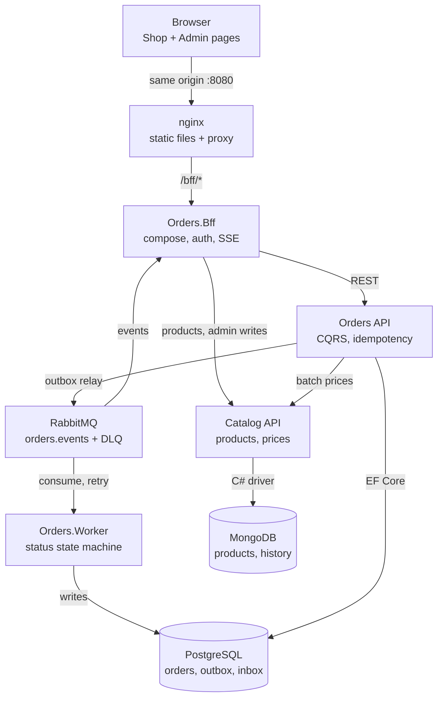
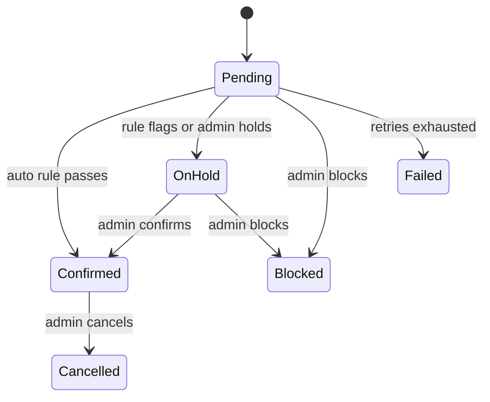

# Plataforma de Pedidos e Catálogo — Dimensionamento técnico

26 de out. de 2026 · Elyton Victor

## Resumo

Um squad de 6 pessoas (4,75 FTE) entrega a plataforma em 8 semanas, com um esforço estimado de 128 pessoas-dia, que já inclui uma contingência de 10%. A implementação é assistida por IA: o Sonnet 5.5 escreve cada commit a partir do guia de execução, e os engenheiros revisam, testam e fazem o merge. A pegada de execução é de 10 contêineres, que exigem cerca de 5 vCPU e 5,5 GB de RAM em uma máquina de desenvolvedor, e está dimensionada para 100 usuários simultâneos e 50 pedidos por minuto no pico.

| Indicador | Valor |
| --- | --- |
| Duração | 8 semanas (40 dias úteis) |
| Esforço | 116 pessoas-dia + 12 de contingência = 128 pessoas-dia |
| Equipe | 6 pessoas, média de 4,75 FTE |
| Contêineres | 10 localmente (mais 2 no perfil de observabilidade) |
| Meta de carga de pico | 100 usuários simultâneos, 50 pedidos/min, 20 consultas de preço/s |
| Metas de latência (p95) | Criar pedido < 300 ms, lote de preços < 50 ms, listar pedidos < 200 ms |

O escopo completo e as fases estão no plano de implementação; este documento faz o dimensionamento deles.

## Premissas

As estimativas só valem enquanto estas premissas se mantiverem; qualquer mudança em uma delas dispara uma reestimativa. Referência de escopo: [Plano de implementação](01-implementation-plan.md).

**Escopo**

- O escopo está fixado no plano de implementação: Orders API, Orders.Worker, Orders.Bff, Catalog API, página Shop, página Admin, Docker Compose, GitHub Actions.
- Tanto compradores quanto administradores criam pedidos. Administradores criam pedidos em nome de um cliente e podem confirmar ou bloquear pedidos pela página Admin.
- Multimoeda: cada pedido tem uma única moeda, e o Catalog mantém um preço por SKU por moeda. BRL é a moeda padrão.
- A confirmação de pedidos é automática, por regra, no Orders.Worker; administradores podem sobrepor a decisão (confirmar ou bloquear) pela UI.
- Retenção: chaves de idempotência por 24 h, linhas publicadas do outbox por 30 dias.
- Fora do escopo: gateway de pagamento, reserva de estoque, notificações por e-mail, infraestrutura de nuvem de produção (assume-se apenas um ambiente de staging pronto para contêineres).

**Carga e dados**

- 10.000 SKUs ativos, 2 moedas no lançamento.
- 50.000 pedidos por mês, média de 3 linhas por pedido; pico de 50 pedidos/min, 100 usuários simultâneos.
- O registro do pedido com seus itens ocupa cerca de 2 KB; com índices, cerca de 5 KB por pedido, o que resulta em cerca de 250 MB de crescimento do Postgres por mês.

**Entrega**

- 5 dias úteis por semana, 6 horas produtivas por dia; 25% da capacidade vai para cerimônias, revisões e suporte.
- A implementação é assistida por IA: o Sonnet 5.5 produz cada commit a partir do guia de execução; uma pessoa revisa cada PR. Sem assistência de IA, multiplique o esforço por cerca de 1,6.
- Um único repositório, desenvolvimento trunk-based, GitHub Actions como CI/CD, GitHub Environments para `staging` e `production` com revisores obrigatórios.
- A equipe tem máquinas capazes de rodar Docker, com 16 GB de RAM ou mais.
- Um Product Owner da área de negócio fica disponível 4 horas por semana para o aceite e para decisões sobre regras de desconto e regras de confirmação.

## Arquitetura

Nove componentes de runtime, dos quais apenas o nginx fica exposto no host. Chamadas síncronas transportam as requisições e as verificações de preço; o RabbitMQ transporta os efeitos colaterais para o Worker e para o feed ao vivo do Admin.

O BFF é a única porta de entrada do navegador; a Orders API chama o Catalog uma vez por pedido para obter todos os preços.

### Ciclo de vida do pedido

O Orders.Worker aplica a regra de confirmação automaticamente. Pedidos sinalizados pela regra (por exemplo, com total acima de um limite configurado) aguardam em OnHold até que um administrador os confirme ou bloqueie pela página Admin; um administrador também pode colocar em espera ou bloquear um pedido Pending. Toda transição grava uma linha no histórico de status, registrando quem a executou.

## Dimensionamento de runtime

Localmente, a stack precisa de cerca de 5 vCPU e 5,5 GB de RAM; um staging semelhante à produção duplica os serviços stateless e executa os data stores em sua configuração de alta disponibilidade. Os limites abaixo são os `deploy.resources.limits` do compose e o ponto de partida para o staging.

| Componente | Réplicas local / staging | Limite de CPU | Limite de memória | Armazenamento | Meta de throughput |
| --- | --- | --- | --- | --- | --- |
| nginx | 1 / 2 | 0,25 | 64 MB | - | 200 req/s |
| Orders.Bff | 1 / 2 | 0,5 | 256 MB | - | 100 req/s, 200 conexões SSE |
| Orders API | 1 / 2 | 0,5 | 384 MB | - | 50 pedidos/min, p95 < 300 ms |
| Orders.Worker | 1 / 2 | 0,25 | 256 MB | - | 10 msg/s, prefetch 20 |
| Catalog API | 1 / 2 | 0,5 | 256 MB | - | 20 consultas em lote/s, p95 < 50 ms |
| PostgreSQL 17 | 1 / 1 primária + 1 réplica | 1,0 | 1 GB | Volume de 10 GB, +250 MB/mês | Máximo de 200 conexões, pool de 20 por serviço |
| MongoDB 8 | 1 (rs0) / replica set de 3 nós | 1,0 | 1 GB | Volume de 5 GB | 10.000 SKUs no working set |
| RabbitMQ 4 | 1 / 3 nós (quorum) | 0,5 | 512 MB | Volume de 2 GB | 50 msg/s sustentados |
| Keycloak (identidade de dev) | 1 / 1 | 0,5 | 768 MB | Usa o Postgres | - |
| OTel Collector + Aspire Dashboard (perfil) | 1 / 1 | 0,5 | 512 MB | Em memória | - |

Observações de capacidade:

- Crescimento de dados: o Postgres cresce cerca de 250 MB por mês com 50.000 pedidos; as linhas de idempotência (24 h) ficam abaixo de 5 MB e as linhas publicadas do outbox (30 dias), abaixo de 100 MB, graças ao job de limpeza.
- Orçamento de conexões: 2 Orders API + 2 Worker + 1 migrator + Keycloak ficam abaixo de 100 conexões no Postgres com pools de 20.
- Caminho de escala: Orders API, BFF, Worker e Catalog são stateless e escalam horizontalmente; as conexões SSE ficam fixadas a uma instância do BFF, e cada instância tem sua própria fila de feed no RabbitMQ.
- Máquina de desenvolvedor: mínimo de 16 GB de RAM, Docker Desktop com WSL 2 configurado com pelo menos 6 GB.

## Esforço por fase

O núcleo do Orders e o front-end são as duas maiores fases, com 22 pessoas-dia cada; junto com a mensageria, concentram metade das 116 pessoas-dia. O esforço cobre implementação assistida por IA, revisão, testes e CI para cada commit do guia de execução.

| Fase | Commits | Esforço (pessoas-dia) | Papel líder | Senioridade necessária | Critério de saída |
| --- | --- | --- | --- | --- | --- |
| 0 Fundações | 8 | 8 | Tech Lead + DevOps | Sênior | Infra do compose saudável, CI verde, deploy gate implantado |
| 1 Serviço Catalog | 7 | 12 | Back-end (pleno) | Pleno, com revisão sênior | Edição de preço retorna o novo recurso; consulta em lote em uma única query |
| 2 Núcleo do Orders | 9 | 22 | Back-end (sênior) | Sênior | Duplicatas concorrentes criam um único pedido |
| 3 Motor de descontos | 6 | 12 | Back-end (sênior) | Sênior | Mudança de regra refletida na próxima cotação sem deploy |
| 4 Mensageria e confirmação | 8 | 18 | Back-end (sênior) + DevOps | Sênior | Reinício do Worker não perde nada; confirmação/bloqueio pelo admin funciona |
| 5 BFF e autenticação | 6 | 12 | Back-end (pleno) | Pleno, com revisão sênior | Rotas de Shop e Admin aplicam os papéis via nginx |
| 6 Front-end | 9 | 22 | Front-end | Pleno-sênior | Comprador faz um pedido, o admin o vê ao vivo, axe sem violações |
| 7 Hardening e release | 5 | 10 | Squad inteiro | - | Todos os critérios de aceite verificados; deploy em produção aprovado |
| **Total** | **58** | **116** |  |  |  |

A contingência de 10% (12 pessoas-dia) fica sob controle do Tech Lead e só é liberada para reestimativas disparadas por uma mudança de premissa.

## Composição da equipe e senioridade

Seis pessoas com 4,75 FTE somam 142 pessoas-dia produtivas ao longo de 8 semanas, contra 128 necessárias, uma utilização de cerca de 90%. O Tech Lead e o engenheiro back-end sênior cobrem as partes de maior risco (idempotência, mensageria, motor de descontos); os engenheiros plenos ficam responsáveis por Catalog, BFF e a UI, com revisão sênior.

| Papel | Senioridade | Alocação | Semanas | Pessoas-dia produtivas | Responsável por |
| --- | --- | --- | --- | --- | --- |
| Tech Lead / Arquiteto de software | Sênior / Staff, .NET + sistemas distribuídos | 100% | 1-8 | 30 | Decisões de arquitetura (ADRs), Fase 0, revisão de todo PR que altere Domain ou mensageria, prompts do agente de IA e manutenção do guia, contingência |
| Engenheiro back-end | Sênior, .NET, EF Core, RabbitMQ | 100% | 1-8 | 30 | Núcleo do Orders, motor de descontos, mensageria, Worker, fluxo de confirmação |
| Engenheiro back-end | Pleno, .NET, MongoDB | 100% | 1-8 | 30 | Serviço Catalog, BFF, integração de autenticação |
| Engenheiro front-end | Pleno-sênior, TypeScript, acessibilidade | 100% | 3-8 | 22,5 | Páginas Shop e Admin, testes de front-end, cliente SSE |
| QA / SDET | Pleno, xUnit, Testcontainers, Vitest | 50% | 1-8 | 15 | Estratégia de testes, suítes de integração e de smoke, verificação de aceite |
| Engenheiro DevOps / de plataforma | Sênior, GitHub Actions, Docker | 50% | 1-8 | 15 | Compose, workflows de CI/CD, deploy gate, ambientes, segurança de imagens |
| Product Owner (negócio) | - | 4 h/semana | 1-8 | Não contabilizado | Aceite, regras de desconto e de confirmação |

Squad mínimo viável, se o orçamento estiver apertado: Tech Lead, back-end sênior e front-end, com as atribuições de QA e DevOps compartilhadas; nesse caso, a duração aumenta para cerca de 11 semanas.

## Cronograma de entrega

O caminho crítico é Fundações → Núcleo do Orders → Motor de descontos → Mensageria → Hardening; Catalog, BFF e front-end correm em paralelo. O staging recebe deploys contínuos a partir da semana 2; a produção depende do gate ao final da semana 8.

| Fase | S1 | S2 | S3 | S4 | S5 | S6 | S7 | S8 |
| --- | --- | --- | --- | --- | --- | --- | --- | --- |
| 0 Fundações | ■ | | | | | | | |
| 1 Serviço Catalog | | ■ | ■ | | | | | |
| 2 Núcleo do Orders | | ■ | ■ | ■ | | | | |
| 3 Motor de descontos | | | | ■ | ■ | | | |
| 4 Mensageria + confirmação | | | | | ■ | ■ | | |
| 5 BFF e autenticação | | | | | ■ | ■ | | |
| 6 Front-end | | | ■ | ■ | ■ | ■ | ■ | |
| 7 Hardening e release | | | | | | | | ■ |

O gate de deploy em produção (aprovação obrigatória) fecha ao final da semana 8.

O front-end começa na semana 3 usando stubs dos contratos do BFF e, por isso, não espera pela Fase 5.

## Riscos da estimativa e contingência

A contingência de 12 pessoas-dia cobre um risco médio; se dois ou mais se materializarem, o gate é adiado em uma semana.

| Risco | Probabilidade | Impacto no esforço (pessoas-dia) | Mitigação |
| --- | --- | --- | --- |
| As regras de multimoeda crescem (conversão, arredondamento por moeda) | Média | +5 | Manter uma moeda por pedido, sem conversão; preço por SKU por moeda no Catalog |
| As regras de confirmação viram um motor de regras próprio | Média | +6 | Reutilizar o modelo de especificações do motor de descontos para as condições de confirmação |
| Commits gerados por IA exigem retrabalho pesado | Média | +8 | Commits pequenos, definição de pronto rigorosa, Tech Lead revisa os PRs de Domain e mensageria |
| Atrito na integração com o Keycloak ou com a autenticação | Baixa | +3 | Export de realm pré-configurado commitado na Fase 0 |
| Correções de acessibilidade no front-end chegam tarde | Baixa | +3 | Verificações com axe desde a primeira tela, não no final |
| Engenheiro pleno indisponível por 2+ semanas | Baixa | +10 | Back-end sênior assume Catalog/BFF; o início do front-end passa para a semana 4 |

Gatilhos de reestimativa: qualquer mudança de premissa, uma fase que exceda seu esforço em mais de 20% ou uma nova integração externa (pagamento, estoque, e-mail).
