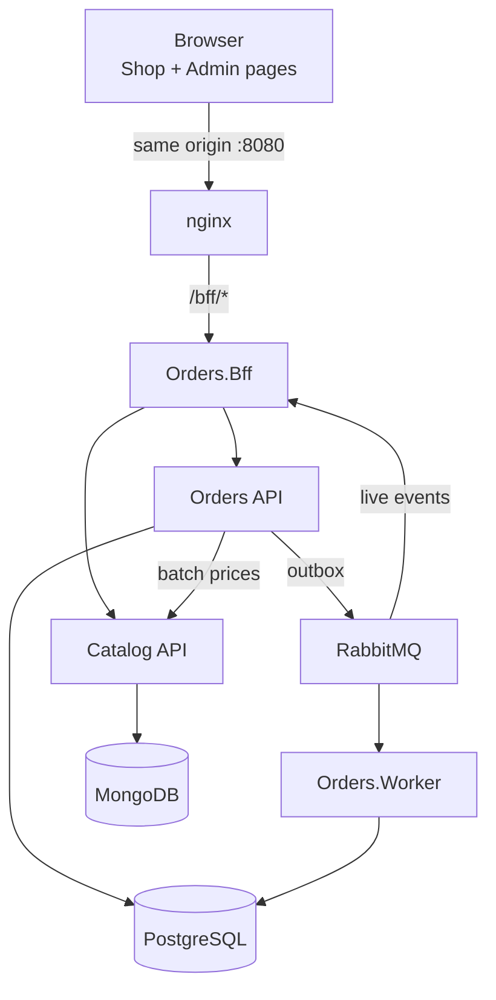

# Plataforma de Pedidos e Catálogo — Apresentação

Uma plataforma de pedidos em .NET 10 com um serviço de pedidos (PostgreSQL), um de catálogo (MongoDB), um BFF e duas páginas, Shop e Admin. Esta apresentação curta cobre a arquitetura, as decisões, os diferenciais e um roteiro de demonstração.

## Arquitetura

- O navegador fala só com o BFF, pelo nginx, na mesma origem; o Catalog nunca é exposto.
- O Orders guarda os pedidos no PostgreSQL e publica eventos por um outbox transacional; o Worker confirma ou retém cada pedido por regras; o BFF mostra os eventos ao vivo no Admin.
- O Catalog é a autoridade de preços; o Orders pergunta os preços em uma única chamada em lote.

## Decisões

| Decisão | Por quê | Registro |
| --- | --- | --- |
| Um BFF na frente de tudo | O navegador não vê o Catalog nem os tokens; um contrato por página | [ADR 0001](../adr/0001-bff.md) |
| Wolverine para CQRS, outbox e RabbitMQ | Evento publicado na mesma transação do pedido; consumo idempotente, retentativas e DLQ | [ADR 0002](../adr/0002-wolverine.md) |
| MongoDB como replica set | Mudar o preço e gravar o histórico numa transação só | [ADR 0003](../adr/0003-mongo-replica-set.md) |
| Várias moedas, uma por pedido | Um preço por SKU por moeda; sem conversão; dinheiro sempre `decimal` | [ADR 0004](../adr/0004-multiple-currencies.md) |
| Confirmação por regras configuráveis | A regra muda sem deploy; pedidos retidos esperam uma pessoa | [ADR 0005](../adr/0005-confirmation-rules.md) |

## Diferenciais

- **Idempotência de ponta a ponta:** a mesma `Idempotency-Key` devolve o mesmo pedido (dez requisições em paralelo criam um só), e o desconto de uso único não é gasto duas vezes.
- **Regras como dados:** descontos e confirmação são versionados, com prévia e histórico, sem deploy.
- **Operação:** retentativas, DLQ com replay confirmado na tela, métricas customizadas e [limites de alerta](../operations/alerts.md), [runbook](../operations/runbook.md), migrations só de adição para a reversão ser segura.
- **Qualidade:** testes de arquitetura, consultas parametrizadas (EF1002 é erro de build), planos `EXPLAIN` guardados em `docs/perf/`, front-end com axe-core e limite de cobertura; veja a [tabela de evidências](../quality.md).
- **Governança:** documentação em dois idiomas verificada pelo CI, uma etapa por commit, o registro do uso de IA em cada etapa em [Desenvolvimento assistido por IA](../05-ai-development.md).

## Roteiro de demonstração

1. `cp .env.example .env && docker compose up -d --build --wait`.
2. Abra `http://localhost:8080/shop.html`, entre como `shopper` (senha do `.env`), adicione produtos ao carrinho e veja a cotação.
3. Em outra aba, abra `http://localhost:8080/admin.html` como `admin` e deixe a tabela de eventos ao vivo à vista.
4. Faça o pedido no Shop: ele aparece no Admin e termina em `Confirmed`, ou em `OnHold` se casar com a regra de desenvolvimento (BRL acima de 5.000,00); no Admin, confirme-o.
5. Repita o pedido com a mesma chave (o smoke test faz isso): o número do pedido é o mesmo.
6. No Admin, mude uma regra de desconto com a prévia, grave e refaça a cotação no Shop.
7. Mostre "Mensagens mortas" e, com `--profile observability`, as métricas no Aspire Dashboard (`http://localhost:18888`).
8. `bash scripts/smoke.sh http://localhost:8080` repete os passos 2 a 5 por linha de comando.
